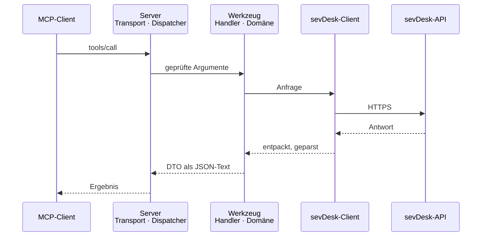

<!-- translated-from: docs/architecture.md sha256:9af192f0c73a -->

# Architektur

Dieses Dokument erklärt, wie `mcp-server-sevdesk` gebaut ist und warum. Es richtet sich an
Mitwirkende und an alle, die beurteilen wollen, ob sie den Server bedenkenlos auf ihre Buchhaltung
loslassen können. Die Begründungen der größeren Entscheidungen stehen in den
[Architekturentscheidungen (ADRs)](adr/README.de.md).

> [!NOTE]
> **Stand.** Diese Seite beschreibt Version 1.0, gebaut über die Meilensteine M1 Kern, M2
> Lesezugriff, M3 Lebenszyklus von Dokumenten, M4 Eingang von Belegen und E-Rechnungen,
> Schreibvorgänge für Belege, Zuordnung und Steuerauswertungen, M5 Fernzugriff über HTTP und M6
> Veröffentlichung (die Claude-Desktop-Erweiterung, Prompts, lokale Profile und der Schlüsselbund
> des Betriebssystems, die Dateiübertragung im Fernzugriff und der generische Lesezugriff). Was 1.0
> stabil hält, legt die Seite [Kompatibilität](compatibility.de.md) fest.

Die Einzelheiten haben eigene Seiten:

- [Sicherheitsmodell](architecture/safety.de.md): Durchsetzung der Stufen, der Schreibablauf,
  Bestätigung, Trennung nach Konto, Datensatzsperren, nicht vertrauenswürdiger Text und das Token.
- [Transporte](architecture/transports.de.md): stdio, der Weg einer HTTP-Anfrage und die Routen,
  Herunterfahren und wie Werkzeuge Dateien bekommen und herausgeben.
- [Builds und Tests](architecture/build-and-test.de.md): die drei ausgelieferten Formen und die
  Testebenen.

## Ziele

- **Standardmäßig sicher.** Der Server startet nur lesend. Jede Aktion, die schreibt, bucht,
  fertigstellt oder versendet, muss ausdrücklich freigeschaltet werden, und bindende oder nach
  außen wirkende Aktionen brauchen eine Bestätigung durch einen Menschen, die das Modell nicht
  fälschen kann.
- **Korrekt gegenüber der echten API.** Die OpenAPI-Spezifikation von sevDesk ist an vielen Stellen
  falsch. Der Code folgt dem beobachteten Verhalten, und jede bekannte Abweichung ist
  aufgeschrieben und getestet.
- **Nützlich statt vollständig.** Eine kleine Zahl aufgabenbezogener Werkzeuge deckt die Abläufe
  der Buchhaltung ab (einen Kontakt finden, eine Rechnung entwerfen und fertigstellen, einen Beleg
  ablegen, einen Kontoumsatz zuordnen, die Umsatzsteuer zusammenfassen), statt eines Werkzeugs je
  Endpunkt.
- **Ein Paket, zwei Modi.** Lokal über stdio für Desktop-Clients und ein selbst betreibbarer
  Streamable-HTTP-Server mit OAuth für entfernte Clients.
- **Leicht beizutragen.** Klare Schichten, ein Weg, ein Werkzeug zu definieren, und Tests, die ohne
  sevDesk-Konto laufen.

Keine Ziele: eine gehostete öffentliche Instanz (vorerst), ein 1:1-Abbild der REST-API und aus der
Spezifikation generierte Clients.

## Schichten

```
tools  →  domain  →  sevdesk client  →  sevDesk REST API
```

Jede Schicht ruft nur die rechts von ihr auf.

- **`src/tools/`** definiert die MCP-Werkzeuge. Ein Werkzeug gibt sein Schema, seine Stufe und
  seine Annotationen an und ruft Domänenfunktionen auf. Werkzeuge rufen nie `fetch` oder den
  HTTP-Client direkt auf: Ein Werkzeug übergibt den Client seines Kontexts an eine
  Domänenfunktion, auch für die bindenden Anfragen (fertigstellen, versenden, festschreiben,
  stornieren, zurücksetzen, eine Zahlung buchen), die es aus `execute` mit dem auf seine Stufe
  beschränkten Client sendet. Aus `src/sevdesk/` importiert ein Werkzeug nur die Fehler, die
  Datumshilfen und die Client-Typen, und es enthält keinen Dateisystem-Code.
- **`src/domain/`** enthält die Geschäftslogik: normalisierte DTOs, den Dezimaltyp für Geld,
  Referenzdaten, Regeln für den Lebenszyklus (welcher Status wohin wechseln darf), die Prüfung
  gegen sevDesks ReceiptGuidance, den E-Rechnungs-Parser, den Abgleich für die Zuordnung und die
  Steuerauswertungen. Sie baut außerdem jede Anfrage (Pfad und Body) und sendet sie über den
  Client, den sie bekommt; die bindenden stehen in `src/domain/lifecycle/actions.ts` und
  `src/domain/reconciliation/transaction-writes.ts`. Sie importiert nichts aus `src/tools/`.
- **`src/sevdesk/`** ist der HTTP-Client. Er kennt das Wire-Format von sevDesk: Authentifizierung,
  die Antwort-Hülle, Skalare als Zeichenketten, Datumsformate, Fehler-Bodys, Drosselung. Von MCP,
  den Werkzeugen und der Domänenschicht weiß er nichts. Er könnte später ein eigenes SDK-Paket
  werden.
- **`src/safety/`** wird von allen Schichten verwendet: Stufen, Schwärzung des API-Tokens,
  Einfassung nicht vertrauenswürdigen Texts, Bestätigungen, Probelauf, das Audit-Log, der
  Schlüsselbund des Betriebssystems und der Dateizugriff, über den Werkzeuge Dateien lesen und
  ausliefern (lokale Ordner, Uploads und Download-Links über HTTP und Downloads von erlaubten
  https-Links mit dem SSRF-Schutz, den sie mit dem OAuth-Modus teilen). Es importiert weder aus
  `src/tools/` noch aus `src/domain/`; die Typen, die diese mit ihm teilen (die Vorschau einer
  Bestätigung, der Verweis auf einen geänderten Datensatz), stehen in `src/safety/write-types.ts`.

ESLint setzt diese Regeln durch (`eslint.config.js`, die Blöcke `layering/…`): In `src/tools/`
lassen ein Aufruf einer Client-Methode, `fetch`, `node:fs` und jeder andere Import aus
`src/sevdesk/` den Lint scheitern (der Schreibablauf, der den Client je Aufruf einhüllt, darf
außerdem `scoped-client.ts` importieren), ebenso die oben genannten Importe für die anderen drei
Verzeichnisse, reine Typ-Importe eingeschlossen.

Neben den Werkzeugen gibt es zwei kleinere Teile: **`src/prompts/`** erzeugt die MCP-Prompts aus
den registrierten Werkzeugen ([Prompts](#prompts)), und **`src/resources/`** stellt
Dokumentdateien und Referenzdaten als MCP-Ressourcen bereit.

Im HTTP-Modus stehen zwei weitere Teile vor den Werkzeugen. **`src/http/`** macht aus einer
HTTP-Anfrage eine authentifizierte Anfrage (Härtung, Bearer oder OAuth), und **`src/accounts/`**
macht daraus einen Kontokontext: die `Config` und den sevDesk-Client, die die Werkzeuge dieser
Anfrage verwenden. Beide übergeben den Kontext an die Server-Factory und rufen nie Werkzeuge auf
([Transporte](architecture/transports.de.md)). Ihr einziger eigener Aufruf bei sevDesk ist die
Abfrage der Identität (`GET /SevClient`) bei der Zustimmung, der Erneuerung und der Anmeldung am
Postfach.

## Modulübersicht

| Pfad                                      | Aufgabe                                                                                                                                                                                                                                                                                                                                                                                                                                                                                                                                                   |
| ----------------------------------------- | --------------------------------------------------------------------------------------------------------------------------------------------------------------------------------------------------------------------------------------------------------------------------------------------------------------------------------------------------------------------------------------------------------------------------------------------------------------------------------------------------------------------------------------------------------- |
| `src/index.ts`                            | Einstieg (`mcp-server-sevdesk`): führt aus, was `cli.ts` erkannt hat: den stdio-Server, den HTTP-Server oder einen Befehl für Betreiber. stdout gehört dem Transport.                                                                                                                                                                                                                                                                                                                                                                                     |
| `src/cli.ts`                              | Kommandozeile: `--stdio`, `--http`, `grants list`/`revoke`, `generate-secret`, `account-id`, `healthcheck`, `token set`/`check`/`delete`, `profiles list`; alles Unbekannte ist ein Bedienungsfehler (Exit-Code 2).                                                                                                                                                                                                                                                                                                                                       |
| `src/server.ts`                           | Server-Factory: baut den MCP-Server für einen Kontokontext mit den Werkzeugen seiner Stufen, den dazu passenden Prompts, den Ressourcen und generierten `instructions` (unter 1.500 Zeichen); Werkzeuge, Prompts und Anweisungen werden je Stufenkombination zwischengespeichert. Seine Kennung trägt das Icon aus `assets/icon.svg` als `data:`-URI (`server-icon.ts`).                                                                                                                                                                                  |
| `src/config.ts`                           | Konfiguration aus der Umgebung: Einstellungen für alle Konten (Stufen, Werkzeuggruppen, Bestätigung, Ordner, Drosselung) und die `Config` je Konto (Token, Konto, Bereitstellung). Ein Konto je Prozess über stdio und im Bearer-Modus; eines je Zugang im OAuth-Modus.                                                                                                                                                                                                                                                                                   |
| `src/accounts/`                           | Kontokontexte: der Resolver (ein fester Kontext oder eine eingefrorene `Config` und ein Client je OAuth-Konto, zwischengespeichert) und die Abfrage der sevDesk-Identität (`GET /SevClient`). Über stdio außerdem die lokale Konfiguration: `profiles.ts` (die Profildatei, ihre Vertrauensprüfungen und die Überlagerung der Umgebung) und `local-config.ts` (Profil, Abfrage im Schlüsselbund, dann `loadConfig`).                                                                                                                                      |
| `src/token-cli.ts`, `src/profiles-cli.ts` | `token set`/`check`/`delete` (das Token im Schlüsselbund des Betriebssystems, vor dem Ablegen bei sevDesk geprüft) und `profiles list`.                                                                                                                                                                                                                                                                                                                                                                                                                   |
| `src/prompts/`                            | Die MCP-Prompts: `catalog.ts` (die Abläufe, vertrauenswürdiger Text; jeder Schritt nennt seine Werkzeuge), `index.ts` (Auswahl, Planung je Konfiguration, Darstellung, Registrierung) und `completions.ts` (Vorschläge für Argumente).                                                                                                                                                                                                                                                                                                                    |
| `src/sevdesk/client.ts`                   | HTTP-Client: `Authorization`-Header mit dem rohen Token, User-Agent, Drosselung, Zeitlimits, Abbruch, Schreibschranke, Wiederholungen nur für GET, Einordnung von Fehlern, Größengrenzen (16 MiB je JSON-Antwort, beim Streamen gelesen).                                                                                                                                                                                                                                                                                                                 |
| `src/sevdesk/envelope.ts`                 | Entpackt `{objects: …}`, auch bei Schreibvorgängen und PDFs, und Ergebnisse von GET-by-id als Array mit einem Element.                                                                                                                                                                                                                                                                                                                                                                                                                                    |
| `src/sevdesk/schema.ts`                   | Nachsichtige zod-Bausteine für Antworten (IDs, Beträge und Booleans als Zeichenketten oder Zahlen).                                                                                                                                                                                                                                                                                                                                                                                                                                                       |
| `src/sevdesk/dates.ts`                    | Datumsformate je Endpunkt (`dd.mm.yyyy`, Unix-Sekunden, ISO), bezogen auf Europe/Berlin.                                                                                                                                                                                                                                                                                                                                                                                                                                                                  |
| `src/sevdesk/errors.ts`                   | Fehler-Body → typisierter Fehler; erkennt Validierungsfehler, die als HTTP 500 ankommen; vertrauenswürdige, umsetzbare Meldungen.                                                                                                                                                                                                                                                                                                                                                                                                                         |
| `src/sevdesk/system-version.ts`           | Erkennt das Buchhaltungssystem 1.0 oder 2.0 je Konto und je Objekt.                                                                                                                                                                                                                                                                                                                                                                                                                                                                                       |
| `src/sevdesk/paths.ts`                    | Prüft jeden Anfragepfad und jede ID vor dem Senden; kennt die Mindeststufe jedes Endpunkts und weiß, welche GETs Nebenwirkungen haben; `genericGetRefusal` entscheidet, was `sevdesk_api_get` lesen darf.                                                                                                                                                                                                                                                                                                                                                 |
| `src/sevdesk/pacing.ts`                   | Drosselung per Token-Bucket (etwa 4 Anfragen pro Sekunde) und eine Grenze für gleichzeitige Anfragen.                                                                                                                                                                                                                                                                                                                                                                                                                                                     |
| `src/domain/`                             | DTOs und Logik je Bereich: Kontakte, Benutzer, Referenzdaten, Geld, Rechnungen, Gutschriften, Aufträge, Belege, Banking, Auswertungen, Lebenszyklus, Entwürfe. `preview-text.ts`: die beiden Sprachen einer Bestätigungsvorschau ([Schreibablauf](architecture/safety.de.md#schreibablauf)).                                                                                                                                                                                                                                                              |
| `src/domain/einvoice/`                    | Lokaler Parser für XRechnung (UBL, CII) und ZUGFeRD/Factur-X (Teilmenge von EN 16931, Prüfung der Geschäftsregeln), Vorschläge für Belege, Vorabprüfung ausgehender Rechnungen.                                                                                                                                                                                                                                                                                                                                                                           |
| `src/domain/vat/`                         | EU-Mitgliedstaaten mit den Formaten ihrer USt-IdNr. und datierten Regelsteuersätzen, die Wahl der Steuerregel für Verkäufe (`sales-tax-rule.ts`), die Steuerregel-Hilfe und die Prüfung der USt-IdNr. hinter ihren Werkzeugen, was eine Antwort von VIES bedeutet (`vies.ts`; die Anfrage selbst ist `src/sevdesk/vies-request.ts`, nur mit `SEVDESK_VIES_CHECK`).                                                                                                                                                                                        |
| `src/domain/reconciliation/`              | Leser für das Umsatzprotokoll, die reine Bewertung von Treffern (Betrag, Dokumentnummer, Gegenpartei, Aufteilungen), Planung der Zuordnung und Schutz gegen Überbuchung.                                                                                                                                                                                                                                                                                                                                                                                  |
| `src/domain/reports/`                     | Auf dem Server berechnete Summen: Übersichten, Altersstruktur offener Posten, Liquidität, Änderungen, die Umsatzsteuer-Zusammenfassung (UStVA-Kennzahlen mit Quellen, ZM, OSS) und die Gewinn- und Verlustrechnung im Stil der EÜR.                                                                                                                                                                                                                                                                                                                       |
| `src/domain/exports/`                     | DATEV-Exportauftrag (Start, Fortschritt, vorsignierter Download) und CSV-Exporte von sevDesk.                                                                                                                                                                                                                                                                                                                                                                                                                                                             |
| `src/domain/api-get.ts`                   | Der generische Lesezugriff hinter `sevdesk_api_get`: Ablehnungsregeln, ein Client ohne Schreibrechte, ein begrenzter Download, die Antwort-Hülle, Bereinigung von nicht vertrauenswürdigem und binärem Inhalt, die Grenze für die Ausgabe.                                                                                                                                                                                                                                                                                                                |
| `src/sevdesk/export-download.ts`          | Neben der VIES-Prüfung und dem Abruf der Client-Metadaten die einzige Anfrage außerhalb der Basis-URL der API: das DATEV-ZIP aus dem Export-Bucket von sevDesk (ein https-Host, keine Zugangsdaten, keine Weiterleitungen, begrenzt).                                                                                                                                                                                                                                                                                                                     |
| `src/sevdesk/vies-request.ts`             | Die VIES-Prüfung, nur wenn eingeschaltet (`SEVDESK_VIES_CHECK`): eine feste https-URL bei `ec.europa.eu`, im Body nur die USt-IdNr., keine Zugangsdaten, keine Weiterleitungen, ein Zeitlimit und eine begrenzte Antwort. Was die Antwort bedeutet, steht in `src/domain/vat/vies.ts`.                                                                                                                                                                                                                                                                    |
| `src/tools/define-tool.ts`                | `defineTool(...)`: Name, Titel, Werkzeuggruppe, Stufe, alle vier Annotationen, Ein- und Ausgabeschema, Handler.                                                                                                                                                                                                                                                                                                                                                                                                                                           |
| `src/tools/registry.ts`                   | Wählt die Werkzeuge für eine Konfiguration und hüllt jeden Aufruf ein (erneute Prüfung der Stufe, Validierung, Prüfung der Ausgabe, Zuordnung von Fehlern).                                                                                                                                                                                                                                                                                                                                                                                               |
| `src/tools/<toolset>/`                    | Die Werkzeuge einer Werkzeuggruppe, zum Beispiel `contacts/`, `meta/`; `advanced/` enthält `sevdesk_api_get`.                                                                                                                                                                                                                                                                                                                                                                                                                                             |
| `src/resources/`                          | MCP-Ressourcen: Dokumentdateien (`sevdesk://invoices/{id}/pdf`, …) und Referenzdaten (`sevdesk://reference/…`).                                                                                                                                                                                                                                                                                                                                                                                                                                           |
| `src/safety/`                             | Stufen, Schwärzung, Einfassung nicht vertrauenswürdigen Texts, Bestätigung (Elicitation; der Freigabespeicher, die lokale Freigabeseite und die Darstellung von Freigabe, Postfach und Anmeldung), Vorschauen für Probeläufe, das Audit-Log, eingegrenztes Lesen von Dateien, der Schlüsselbund des Betriebssystems (`keychain.ts`), Web-Hilfen (Header der Seiten und ihre CSP, Cookies, CSRF).                                                                                                                                                          |
| `src/safety/` (Dateien)                   | Wie Werkzeuge Dateien bekommen und herausgeben ([Dateien](architecture/transports.de.md#dateien)): `file-access.ts` (der Vertrag `FileAccess`, Verweise `upload:<id>`), `file-sources.ts` (lokale Ordner oder Uploads und Download-Links), `transfer-types.ts` und `transfer-store.ts` (Upload-Tickets und Download-Links je Konto, Grenzen, Laufzeiten), `blob-store.ts` (verschlüsselte Dateiinhalte im Speicher oder im Zustandsverzeichnis), `url-files.ts` (Downloads von erlaubten https-Links).                                                    |
| `src/pages/`                              | Was alle Seiten des Servers gemeinsam haben ([ADR 0010](adr/0010-server-pages-in-two-languages.de.md)): `html.ts` (das Template-Tag `markup`, das jeden eingesetzten Wert maskiert), `theme.ts` (Farb- und Schrift-Tokens, das eine Stylesheet), `frame.ts`, `components.ts`, `icons.ts`, `message.ts` (Ergebnis- und Fehlerseiten), `locale.ts` und `text/` (die Texte der Seiten auf Englisch und Deutsch, gewählt nach `Accept-Language`), `assets.ts` (die eingebetteten Schriften und das Icon, ausgeliefert unter `/assets/`). Nirgends ein Skript. |
| `src/http/`                               | Streamable HTTP: die Brücke zu `node:http`, Router und Härtung (Host, Origin, Ratenbegrenzungen, Body-Grenzen, Zeitlimits), Anfrage-Logs, Bearer-Authentifizierung, die MCP-Route, Server-Schlüssel und versiegelte Tokens, Browser-Sitzungen (`browser-session.ts`), das Freigabe-Postfach, die Upload- und Download-Seiten (`transfer-routes.ts`, `transfer-pages.ts`) und die Assets der Seiten (`asset-route.ts`).                                                                                                                                    |
| `src/http/oauth/`                         | Der OAuth-2.1-Autorisierungsserver: Metadaten, `/authorize` und die Zustimmungsseite, `/token`, `/revoke`, die Prüfung der Access-Tokens, das Abrufen von CIMD (SSRF-Schutz und gebundener Abruf liegen in `src/safety/`), der Abgleich der Redirect-URIs, der Zugangsspeicher.                                                                                                                                                                                                                                                                           |
| `src/grants-cli.ts`                       | `grants list` und `grants revoke` gegen den Zugangsspeicher in `SEVDESK_HTTP_STATE_DIR`.                                                                                                                                                                                                                                                                                                                                                                                                                                                                  |
| `spec/`                                   | Referenz-Snapshot der OpenAPI-Spezifikation von sevDesk und das [Abweichungsregister](../spec/deviations.md).                                                                                                                                                                                                                                                                                                                                                                                                                                             |
| `scripts/`                                | Prüfung auf Abweichungen der Spezifikation, Smoke-Tests für Paket und HTTP, Generator der Werkzeugdoku, Fixture-Recorder, API-Proben, Generator für E-Rechnungs-Fixtures, der `.mcpb`-Build, die Assets der Seiten (`pnpm pages:assets`) und die Vorschau der Seiten (`pnpm pages:preview`).                                                                                                                                                                                                                                                              |
| `Dockerfile`                              | Das Image: auf der Build-Plattform gebaut, läuft auf distroless Node.js als uid 65532 mit `--http`, Zustand in `/data`, eine Zustandsprüfung über `healthcheck`.                                                                                                                                                                                                                                                                                                                                                                                          |
| `mcpb/`, `tsdown.mcpb.config.ts`          | Die Claude-Desktop-Erweiterung: ihr Manifest (Einstellungen, abgebildet auf `SEVDESK_*`-Variablen), Icon und Bundle-Build ([Builds](architecture/build-and-test.de.md#builds)).                                                                                                                                                                                                                                                                                                                                                                           |
| `deploy/`                                 | Vorlagen für die Bereitstellung: Docker Compose mit Caddy, Fly.io, Render, Railway ([Bereitstellung](remote/deployment.de.md)).                                                                                                                                                                                                                                                                                                                                                                                                                           |
| `test/`                                   | Unit-, Vertrags-, Regressions-, Integrations- und (auf Wunsch) Live-Tests; Evals für die Werkzeugauswahl; Fixtures mit Herkunftsangabe.                                                                                                                                                                                                                                                                                                                                                                                                                   |
| `plugin/`, `.claude-plugin/`              | Claude-Code-Plugin (startet diesen Server, Buchhaltungs-Skill mit belegten Quellen) und der Plugin-Marketplace des Repositorys.                                                                                                                                                                                                                                                                                                                                                                                                                           |

## Lebenszyklus eines Werkzeugaufrufs



1. **Registrierung (beim Start; über HTTP bei jeder Anfrage).** Die Registry wählt Werkzeuge nach
   Werkzeuggruppe (`SEVDESK_TOOLSETS`) und Stufe (`SEVDESK_ALLOW`, `SEVDESK_READ_ONLY` und im
   OAuth-Modus die Stufen des Zugangs). Werkzeuge außerhalb der Auswahl werden **nicht
   registriert**, das Modell sieht sie also nie. `tools/list` liefert eine Seite in stabiler
   Reihenfolge, und die `instructions` des Servers werden aus den registrierten Werkzeugen erzeugt.
   Über HTTP wird der Server für jede Anfrage für deren Kontokontext gebaut; Auswahl und
   Anweisungen werden je Stufenkombination zwischengespeichert.
2. **Validierung.** Die Argumente werden mit dem zod-Eingabeschema des Werkzeugs geparst.
   Eingabeschemas haben ein Objekt als Wurzel, sind flach und lehnen unbekannte Parameter mit
   einer Meldung ab, die sie nennt (sevDesk selbst ignoriert unbekannte Felder stillschweigend,
   siehe [D-003](../spec/deviations.md#d-003-unknown-request-fields-are-silently-ignored)). Das
   JSON Schema, das Clients sehen, erzeugt zod selbst.
3. **Prüfungen im Dispatcher.** Der Wrapper prüft die Stufe des Werkzeugs erneut gegen die
   Konfiguration. Schreibwerkzeuge durchlaufen dann den Schreibablauf (`src/tools/write-flow.ts`):
   `prepare` liest mit einem Client ohne Schreibrechte und gibt eine Vorschau zurück; bei einem
   Probelauf ist die Vorschau das Ergebnis; bei Werkzeugen der Stufen `commit` und `external` gibt
   zuerst ein Mensch diese Vorschau frei (siehe [Sicherheitsmodell](architecture/safety.de.md));
   dann läuft `execute` mit einem Client, der auf die Stufe des Werkzeugs beschränkt ist.
4. **Domäne.** Der Handler (oder `prepare`/`execute`) ruft Domänenfunktionen auf. Schreibvorgänge
   lesen zuerst den aktuellen Datensatz und führen die Änderung damit zusammen, suchen vor dem
   Anlegen nach Dubletten, ergänzen Verweise wie `contactPerson` und lassen sevDesk die
   Dokumentnummern vergeben.
5. **sevDesk-Client.** Der Client prüft den Pfad, setzt die Schreibschranke durch, drosselt die
   Anfrage, sendet sie mit einem Zeitlimit und dem Abbruchsignal des Aufrufers und entpackt und
   parst die Antwort nachsichtig. GETs dürfen wiederholt werden, POST und PUT nie. Fehler-Bodys
   werden zu typisierten Fehlern mit geschwärztem Token.
6. **Ergebnis.** Die Domäne gibt ein kompaktes DTO zurück: Geld als exakte Dezimalzahlen mit
   Währung, ISO-Daten, Deep Links in die Web-App von sevDesk und bereinigter, nicht
   vertrauenswürdiger Text. Das Werkzeug gibt das DTO immer als minifiziertes JSON nach einer
   vertrauenswürdigen Zusammenfassung und einer Leerzeile in einem Textblock zurück. Das
   JSON-Escaping hält nicht vertrauenswürdige Zeichenketten des DTO in ihren Werten, ohne sich auf
   Einrückung zu verlassen; nicht vertrauenswürdiger Text neben Fließtext steht in
   Markdown-Fences. Statische JSON-Ressourcen mit Referenzdaten sind ebenfalls minifiziert. Das
   Werkzeug ergänzt `outputSchema` und `structuredContent` nur ab Protokollversion 2026-07-28 oder
   mit `SEVDESK_STRUCTURED_OUTPUT=on`, weil einige Clients mit strukturierter Ausgabe falsch
   umgehen. Gekürzte Listen sagen, wie viele Einträge ausgelassen wurden. Dateien (PDF, XML,
   Exporte) kommen als Ressourcen zurück, werden in `SEVDESK_OUTPUT_DIR` geschrieben oder über
   HTTP als Download-Links herausgegeben ([Dateien](architecture/transports.de.md#dateien)), nie
   als Base64-Text.
7. **Fehler** werden zu `isError`-Ergebnissen mit vertrauenswürdigem, umsetzbarem Text. Der
   Fehlerwortlaut von sevDesk erscheint nur eingefasst.

## Prompts

`src/prompts/` enthält die MCP-Prompts: `catalog.ts` (die Abläufe, vertrauenswürdiger Text; jeder
Schritt gibt die Werkzeuge an, die er nennt) und `index.ts` (Auswahl, Planung, Darstellung,
Registrierung). Für jede Konfiguration behält `planPrompts` die Prompts, deren benötigte Werkzeuge
registriert sind, zeigt die Schritte, deren Werkzeuge registriert sind, und macht aus den übrigen
Zeilen der Form „needs <setting>“, abgeleitet aus Stufe, Werkzeuggruppe und Verfügbarkeit der
fehlenden Werkzeuge und formuliert für die Bereitstellung (stdio, Bearer oder OAuth). Der Plan
gehört zum Bestand, der je Stufenkombination zwischengespeichert wird, wie die Werkzeuge und die
Anweisungen. Handler erzeugen nur Text und rufen sevDesk nie auf; Argumente prüft das SDK gegen ein
Muster (ungültige werden mit InvalidParams beantwortet), und sie erscheinen nur eingefasst. Ein
Lint (`test/integration/prompts-list.test.ts`) erzeugt jeden Prompt in vielen Konfigurationen und
für beide Protokollgenerationen und prüft, dass jedes Werkzeug, das ein Prompt nennt, in der
`tools/list` dieser Konfiguration steht.

Argumente lassen sich vervollständigen (`completion/complete`). Der Katalog nennt je Argument nur
eine Art (Monat, Zeitraum, Jahr, Kontakt, Zahlungskonto); `registerPrompts` hängt die
Vervollständiger einer Serverinstanz an eine Kopie des Argumentschemas, weil `completable` aus dem
SDK ein Schema dauerhaft markiert und die Schemas des Katalogs von allen Konten geteilt werden.
Monate, Quartale und Jahre ergeben sich aus der Uhr. Namen von Kontakten und Konten (`completions.ts`) kommen aus
einer Listenabfrage je Art, dazu einer Namenssuche (Limit 100) je getipptem Namen, wenn das Konto
mehr Kontakte hat, als eine Abfrage liefert, immer nur lesend und mit ausdrücklichem Limit. Ein
getippter Name, der mit einem beginnt, dessen Suche vollständig zurückkam, wird ohne Abfrage aus
dieser Suche beantwortet, denn die Namenssuche von sevDesk findet jeden Teil des Namens
(spec/deviations.md D-020).
Gelesen werden sie nur, wenn `sevdesk_contacts_search` oder `sevdesk_bank_accounts_list`
registriert ist, und eine Minute je `Config` eines Kontos zwischengespeichert (über HTTP ist jede
Anfrage eine neue Instanz). Ein fehlgeschlagener Lesevorgang schlägt einige Sekunden lang nichts
vor, statt bei jedem Tastendruck erneut gesendet zu werden, und eine Suche wird abgebrochen, wenn
die HTTP-Anfrage, die auf sie wartet, vorzeitig endet. Jeder Vorschlag
besteht die Prüfung seines Arguments, bevor er angeboten wird, und ein gewählter wird wie ein
getippter geprüft und eingefasst. Die Fähigkeit `completions` meldet das SDK nur, wenn ein
gelisteter Prompt ein Argument hat, das diese Instanz vervollständigt.

## Eigenheiten der sevDesk-API, die den Entwurf geprägt haben

Die vollständige Liste mit Quellen und Tests ist das
[Abweichungsregister](../spec/deviations.md). Die mit der größten Wirkung auf den Code:

- **Keine Testumgebung und keine Webhooks.** Jeder Schreibvorgang ist echt; deshalb sind
  Schreibvorgänge standardmäßig aus und werden gegen Fixtures getestet. Abfragen nach Änderungen
  seit einem Zeitpunkt (`sevdesk_changed_since`) ersetzen Webhooks.
- **Die Spezifikation ist unzuverlässig** ([ADR 0002](adr/0002-hand-written-zod-schemas.de.md)).
  Antworten sind in `{objects: …}` verpackt, auch wo die Spezifikation etwas anderes sagt, Skalare
  kommen als Zeichenketten, und unbekannte Felder einer Anfrage werden ohne Fehler verworfen.
- **Listen werden stillschweigend gekürzt.** Ohne `limit` enden Listen bei 100 Datensätzen; `limit`
  muss zwischen 1 und 1000 liegen. Der Client sendet immer ein Limit und blättert bis zu einer
  leeren Seite.
- **Nebenwirkungen verstecken sich in GETs.** `getPdf` markiert ein Dokument als versendet, wenn
  `preventSendBy` nicht gesetzt ist.
- **Zwei Generationen der Buchhaltung.** Update 2.0 hat `taxType` durch `taxRule` und
  Buchungskonten durch `accountDatev` ersetzt, und ein Konto kann Objekte beider Generationen
  enthalten. Der Client erkennt die Version je Konto und je Objekt.
- **Fehler sind uneinheitlich.** Manche Validierungsfehler kommen als HTTP 500 zurück, und eine
  Ratenbegrenzung ist nicht dokumentiert. Der Client ordnet Fehler selbst ein und drosselt seine
  Anfragen.
