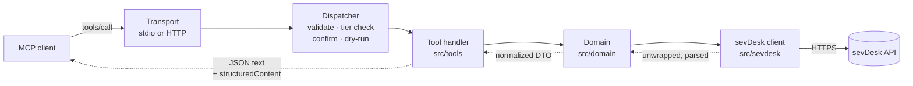
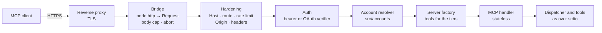

# Architecture

This document explains how `mcp-server-sevdesk` is built and why. It is for contributors and for
anyone who wants to judge whether the server is safe to point at their books. The reasoning behind
the bigger decisions is in the [architecture decision records](adr/README.md).

> **Status.** This page describes version 1.0, built through milestones M1 core, M2 read
> coverage, M3 document lifecycle, M4 receipt and e-invoice intake, voucher writes, reconciliation
> and tax reports, M5 remote HTTP, and M6 launch (the Claude Desktop extension, prompts, local
> profiles and the OS keychain, remote file transfer and the generic read). What 1.0 keeps stable
> is defined in [compatibility.md](compatibility.md).

## Goals

- **Safe by default.** The server starts read-only. Every action that writes, books, finalizes or
  sends needs an explicit opt-in, and binding or external actions need a human confirmation that
  the model cannot fake.
- **Correct against the real API.** sevDesk's OpenAPI spec is wrong in many places. The code follows
  observed behavior, and every known difference is written down and tested.
- **Useful, not exhaustive.** A small set of task-shaped tools covers the bookkeeping workflows
  (find a contact, draft and finalize an invoice, file a receipt, reconcile a bank transaction,
  summarize VAT) instead of one tool per endpoint.
- **One package, two modes.** Local stdio for desktop clients, and a self-hostable Streamable HTTP
  server with OAuth for remote clients.
- **Easy to contribute to.** Clear layers, one way to define a tool, and tests that run without a
  sevDesk account.

Non-goals: a hosted public instance (for now), a 1:1 mirror of the REST API, and generated clients
from the spec.

## Layers

```
tools  →  domain  →  sevdesk client  →  sevDesk REST API
```

Each layer only calls the one to its right.

- **`src/tools/`** defines the MCP tools. A tool declares its schema, tier and annotations and
  calls domain functions. Tools never call `fetch` or the HTTP client directly: a tool passes the
  client of its context to a domain function, also for the binding requests (finalize, send,
  enshrine, cancel, reset, book a payment), which it sends from `execute` with the client scoped
  to its tier. From `src/sevdesk/` a tool imports only the errors, the date helpers and the client
  types, and it has no file-system code.
- **`src/domain/`** holds the business logic: normalized DTOs, the decimal money type, reference
  data, lifecycle rules (which status may go where), validation against sevDesk's
  ReceiptGuidance, the e-invoice parser, the reconciliation matcher and the tax reports. It also
  builds every request (path and body) and sends it through the client it is given; the binding
  ones are in `src/domain/lifecycle/actions.ts` and
  `src/domain/reconciliation/transaction-writes.ts`. It does not import from `src/tools/`.
- **`src/sevdesk/`** is the HTTP client. It knows sevDesk's wire format: auth, the response
  envelope, string scalars, date formats, error bodies, pacing. It knows nothing about MCP, the
  tools or the domain layer. It could later become its own SDK package.
- **`src/safety/`** is used by all layers: tiers, redaction of the API token, fencing of untrusted
  text, confirmations, dry-run, the audit log, the OS keychain, and the file access tools read
  and deliver files through (local folders, or uploads and download links over HTTP). It imports
  from neither `src/tools/` nor `src/domain/`; the types those share with it (the confirmation
  preview, the reference to a changed record) are in `src/safety/write-types.ts`.

ESLint enforces these rules (`eslint.config.js`, the `layering/…` blocks): in `src/tools/` a call
of a client method, `fetch`, `node:fs` and any other import from `src/sevdesk/` fail the lint (the
write flow, which wraps the client per call, may also import `scoped-client.ts`), and so do the
imports named above for the other three directories, type-only imports included.

Two smaller parts sit beside the tools: **`src/prompts/`** renders the MCP prompts from the
registered tools ([Prompts](#prompts)), and **`src/resources/`** serves document files and
reference data as MCP resources.

In HTTP mode two more parts sit in front of the tools. **`src/http/`** turns an HTTP request into
an authenticated request (hardening, bearer or OAuth), and **`src/accounts/`** turns that into an
account context: the `Config` and sevDesk client the tools of this request use. Both hand the
context to the server factory and never call tools ([Transports](#transports)). Their only own
sevDesk call is the identity lookup (`GET /SevClient`) at consent, refresh and inbox sign-in.

## Module map

| Path                                      | Responsibility                                                                                                                                                                                                                                                                                                                                                                                                                                                                                              |
| ----------------------------------------- | ----------------------------------------------------------------------------------------------------------------------------------------------------------------------------------------------------------------------------------------------------------------------------------------------------------------------------------------------------------------------------------------------------------------------------------------------------------------------------------------------------------- |
| `src/index.ts`                            | Entry (`mcp-server-sevdesk`): runs what `cli.ts` parsed: the stdio server, the HTTP server, or an operator command. stdout belongs to the transport.                                                                                                                                                                                                                                                                                                                                                        |
| `src/cli.ts`                              | Command line: `--stdio`, `--http`, `grants list`/`revoke`, `generate-secret`, `account-id`, `healthcheck`, `token set`/`check`/`delete`, `profiles list`; anything unknown is a usage error (exit 2).                                                                                                                                                                                                                                                                                                       |
| `src/server.ts`                           | Server factory: builds the MCP server for an account context with the tools of its tiers, the prompts that fit them, the resources and generated `instructions` (under 1,500 characters); tools, prompts and instructions are cached per tier set.                                                                                                                                                                                                                                                          |
| `src/config.ts`                           | Configuration from the environment: settings shared by all accounts (tiers, toolsets, confirmation, folders, pacing) and the per-account `Config` (token, account, deployment). One account per process over stdio and in bearer mode; one per grant in OAuth mode.                                                                                                                                                                                                                                         |
| `src/accounts/`                           | Account contexts: the resolver (one fixed context, or a frozen `Config` and client per OAuth account, cached) and the sevDesk identity lookup (`GET /SevClient`). Over stdio also the local configuration: `profiles.ts` (the profiles file, its trust checks and the overlay onto the environment) and `local-config.ts` (profile, keychain lookup, then `loadConfig`).                                                                                                                                    |
| `src/token-cli.ts`, `src/profiles-cli.ts` | `token set`/`check`/`delete` (the token in the OS keychain, checked with sevDesk before it is stored) and `profiles list`.                                                                                                                                                                                                                                                                                                                                                                                  |
| `src/prompts/`                            | The MCP prompts: `catalog.ts` (the workflows, trusted text; each step names its tools) and `index.ts` (selection, planning per configuration, rendering, registration).                                                                                                                                                                                                                                                                                                                                     |
| `src/sevdesk/client.ts`                   | HTTP client: raw-token `Authorization` header, User-Agent, pacing, timeouts, cancellation, write gate, GET-only retries, error classification.                                                                                                                                                                                                                                                                                                                                                              |
| `src/sevdesk/envelope.ts`                 | Unwraps `{objects: …}`, including on writes and PDFs, and array-of-one GET-by-id results.                                                                                                                                                                                                                                                                                                                                                                                                                   |
| `src/sevdesk/schema.ts`                   | Lenient zod building blocks for responses (ids, amounts and booleans as strings or numbers).                                                                                                                                                                                                                                                                                                                                                                                                                |
| `src/sevdesk/dates.ts`                    | Per-endpoint date serializers (`dd.mm.yyyy`, Unix seconds, ISO), anchored to Europe/Berlin.                                                                                                                                                                                                                                                                                                                                                                                                                 |
| `src/sevdesk/errors.ts`                   | Error body → typed error; spots validation errors that arrive as HTTP 500; trusted, actionable messages.                                                                                                                                                                                                                                                                                                                                                                                                    |
| `src/sevdesk/system-version.ts`           | Detects bookkeeping system 1.0 vs 2.0 per account and per object.                                                                                                                                                                                                                                                                                                                                                                                                                                           |
| `src/sevdesk/paths.ts`                    | Validates every request path and id before it is sent; knows the minimum tier of every endpoint and which GETs have side effects; `genericGetRefusal` decides what `sevdesk_api_get` may read.                                                                                                                                                                                                                                                                                                              |
| `src/sevdesk/pacing.ts`                   | Token-bucket pacing (about 4 requests per second) and an in-flight cap.                                                                                                                                                                                                                                                                                                                                                                                                                                     |
| `src/domain/`                             | DTOs and logic per area: contacts, users, reference data, money, invoices, credit notes, orders, vouchers, banking, reports, lifecycle, drafts. `preview-text.ts`: the two languages of a confirmation preview ([Human confirmation](#safety-model)).                                                                                                                                                                                                                                                       |
| `src/domain/einvoice/`                    | Local XRechnung (UBL, CII) and ZUGFeRD/Factur-X parser (EN 16931 subset, business-rule checks), voucher suggestions, outgoing preflight.                                                                                                                                                                                                                                                                                                                                                                    |
| `src/domain/reconciliation/`              | Transaction log reader, the pure match scorer (amount, document number, counterparty, splits), allocation planning and over-booking guards.                                                                                                                                                                                                                                                                                                                                                                 |
| `src/domain/reports/`                     | Server-side aggregates: summaries, aging, cash position, changes, the VAT summary (UStVA boxes with sources, ZM, OSS) and the EÜR-style P&L.                                                                                                                                                                                                                                                                                                                                                                |
| `src/domain/exports/`                     | DATEV export job (start, progress, presigned download) and sevDesk CSV exports.                                                                                                                                                                                                                                                                                                                                                                                                                             |
| `src/domain/api-get.ts`                   | The generic read behind `sevdesk_api_get`: refusal rules, a read-only client, a capped download, the response envelope, cleaning of untrusted and binary content, the output cap.                                                                                                                                                                                                                                                                                                                           |
| `src/sevdesk/export-download.ts`          | The only request outside the API base URL: the DATEV ZIP from sevDesk's export bucket (one https host, no credentials, no redirects, capped).                                                                                                                                                                                                                                                                                                                                                               |
| `src/tools/define-tool.ts`                | `defineTool(...)`: name, title, toolset, tier, all four annotations, input and output schemas, handler.                                                                                                                                                                                                                                                                                                                                                                                                     |
| `src/tools/registry.ts`                   | Picks the tools for a configuration and wraps every call (tier re-check, validation, output check, error mapping).                                                                                                                                                                                                                                                                                                                                                                                          |
| `src/tools/<toolset>/`                    | The tools of one toolset, for example `contacts/`, `meta/`; `advanced/` holds `sevdesk_api_get`.                                                                                                                                                                                                                                                                                                                                                                                                            |
| `src/resources/`                          | MCP resources: document files (`sevdesk://invoices/{id}/pdf`, …) and reference data (`sevdesk://reference/…`).                                                                                                                                                                                                                                                                                                                                                                                              |
| `src/safety/`                             | Tiers, redaction, untrusted-text fencing, confirmation (elicitation; the approval store, the local approval page and the approval, inbox and sign-in renderers), dry-run previews, the audit log, confined file reading, the OS keychain (`keychain.ts`), web helpers (page headers and their CSP, cookies, CSRF).                                                                                                                                                                                          |
| `src/safety/` (files)                     | How tools get and hand out files ([Files](#files)): `file-access.ts` (the `FileAccess` contract, `upload:<id>` references), `file-sources.ts` (local folders, or uploads and download links), `transfer-types.ts` and `transfer-store.ts` (upload tickets and download links per account, limits, lifetimes), `blob-store.ts` (encrypted file bytes in memory or the state directory).                                                                                                                      |
| `src/pages/`                              | What every page of the server shares ([ADR 0010](adr/0010-server-pages-in-two-languages.md)): `html.ts` (the `markup` template tag, which escapes every interpolated value), `theme.ts` (colour and type tokens, the one stylesheet), `frame.ts`, `components.ts`, `icons.ts`, `message.ts` (result and error pages), `locale.ts` and `text/` (the page texts in English and German, chosen from `Accept-Language`), `assets.ts` (the embedded fonts and icon served under `/assets/`). No script anywhere. |
| `src/http/`                               | Streamable HTTP: the `node:http` bridge, router and hardening (Host, Origin, rate limits, body caps, timeouts), request logs, bearer auth, the MCP route, server keys and sealed tokens, browser sessions (`browser-session.ts`), the approval inbox, the upload and download pages (`transfer-routes.ts`, `transfer-pages.ts`), and the page assets (`asset-route.ts`).                                                                                                                                    |
| `src/http/oauth/`                         | The OAuth 2.1 authorization server: metadata, `/authorize` and the consent page, `/token`, `/revoke`, the access-token verifier, CIMD fetching with its SSRF guard, redirect matching, the grant store.                                                                                                                                                                                                                                                                                                     |
| `src/grants-cli.ts`                       | `grants list` and `grants revoke` against the grant store in `SEVDESK_HTTP_STATE_DIR`.                                                                                                                                                                                                                                                                                                                                                                                                                      |
| `spec/`                                   | Reference snapshot of the upstream OpenAPI spec and the [deviations register](../spec/deviations.md).                                                                                                                                                                                                                                                                                                                                                                                                       |
| `scripts/`                                | Spec-drift check, package and HTTP smoke tests, tool-doc generator, fixture recorder, API probes, e-invoice fixture generator, the `.mcpb` build, the page assets (`pnpm pages:assets`) and the page preview (`pnpm pages:preview`).                                                                                                                                                                                                                                                                        |
| `Dockerfile`                              | The image: built on the build platform, run on distroless Node.js as uid 65532 with `--http`, state in `/data`, a health check via `healthcheck`.                                                                                                                                                                                                                                                                                                                                                           |
| `mcpb/`, `tsdown.mcpb.config.ts`          | The Claude Desktop extension: its manifest (settings mapped to `SEVDESK_*` variables), icon and bundle build ([Builds](#builds)).                                                                                                                                                                                                                                                                                                                                                                           |
| `deploy/`                                 | Deploy templates: Docker Compose with Caddy, Fly.io, Render, Railway ([remote.md](remote.md#deployment)).                                                                                                                                                                                                                                                                                                                                                                                                   |
| `test/`                                   | Unit, contract, regression, integration and (opt-in) live tests; tool-selection evals; fixtures with provenance.                                                                                                                                                                                                                                                                                                                                                                                            |
| `plugin/`, `.claude-plugin/`              | Claude Code plugin (starts this server, bookkeeping skill with cited references) and the repository's plugin marketplace.                                                                                                                                                                                                                                                                                                                                                                                   |

## Lifecycle of a tool call



1. **Registration (at startup; over HTTP for each request).** The registry selects tools by
   toolset (`SEVDESK_TOOLSETS`) and tier (`SEVDESK_ALLOW`, `SEVDESK_READ_ONLY`, and in OAuth mode
   the grant's tiers). Tools outside the selection are **not registered**, so the model never sees
   them. `tools/list` returns one page in a stable order, and the server `instructions` are
   generated from the registered tools. Over HTTP the server is built per request for the
   request's account context; the selection and instructions are cached per tier set.
2. **Validation.** Arguments are parsed with the tool's zod input schema. Input schemas have an
   object root, are flat and reject unknown parameters with a message that names them (sevDesk
   itself silently ignores unknown fields, see
   [D-003](../spec/deviations.md#d-003-unknown-request-fields-are-silently-ignored)). The JSON
   Schema clients see is generated by zod itself.
3. **Dispatcher checks.** The wrapper re-checks the tool's tier against the configuration. Write
   tools then run through the write flow (`src/tools/write-flow.ts`): `prepare` reads with a
   read-only client and returns a preview; in a dry run the preview is the result; for `commit`
   and `external` tools the human approves that preview first (see [Safety model](#safety-model)); then
   `execute` runs with a client scoped to the tool's tier.
4. **Domain.** The handler (or `prepare`/`execute`) calls domain functions. Writes read the current
   record first and merge the change, check for duplicates before creating, fill in references
   such as `contactPerson`, and let sevDesk assign document numbers.
5. **sevDesk client.** The client validates the path, enforces the write gate, paces the request,
   sends it with a timeout and the caller's cancellation signal, and unwraps and leniently parses
   the response. GETs may be retried; POST and PUT never are. Error bodies become typed errors with
   the token redacted.
6. **Result.** The domain returns a compact DTO: money as exact decimals with currency, ISO dates,
   deep links into the sevDesk web app, and untrusted text fenced. The tool always returns the DTO
   as a JSON text block. It adds `outputSchema` and `structuredContent` only on protocol version
   2026-07-28 or later, or when `SEVDESK_STRUCTURED_OUTPUT=on`, because some clients mishandle
   structured output. Truncated lists say how many items were left out. Files (PDF, XML, exports)
   are returned as resources, written to `SEVDESK_OUTPUT_DIR` or, over HTTP, handed out as
   download links ([Files](#files)), never as base64 text.
7. **Errors** become `isError` results with trusted, actionable text. sevDesk's own error wording
   appears only fenced.

## Safety model

Every tool has exactly one tier. Reads and writes never share a tool.

| Tier       | What it covers                                                                                               | Default |
| ---------- | ------------------------------------------------------------------------------------------------------------ | ------- |
| `read`     | list, get, search, reports, PDF preview (with `preventSendBy`)                                               | on      |
| `write`    | contacts, parts, draft invoices, vouchers and offers, the DATEV export (reversible or harmless)              | off     |
| `commit`   | finalize, book payment, reconcile, cancel, enshrine, reset, delete a voucher draft (binding or irreversible) | off     |
| `external` | send by email (reaches third parties)                                                                        | off     |

**Switches.** `SEVDESK_ALLOW=read,write,commit,external` chooses the tiers. `SEVDESK_READ_ONLY=1`
overrides everything else. `SEVDESK_DRY_RUN=1`, or `dryRun` on a single call, runs the tool's
checks and returns its preview (status `dry_run`) without sending anything or asking anyone.

**Enforcement in three places.**

1. Registration: tools above the allowed tiers are not registered.
2. Dispatcher: every call re-checks the tier.
3. HTTP client: every request that changes data (any non-GET, and the GETs that change state)
   must declare its tier, and is refused before sending in read-only or dry-run mode, when it
   declares no tier, when `SEVDESK_ALLOW` does not enable that tier, or when the tier is below the
   endpoint's minimum (`minimumWriteTier` in `paths.ts`: `sendBy`, `bookAmount`, `enshrine`,
   `cancelInvoice`, `resetToDraft`, `resetToOpen`, `changeParameter`, a sending `getPdf`,
   DATEV `enshrine` exports, a `saveVoucher` whose voucher is not a draft (the voucher's
   finalize) and `PUT`/`DELETE /CheckAccountTransaction/{id}` (private marking, reset) need
   `commit`; `sendViaEmail` and `sendByWithRender` need `external`). Write tools never set the tier: their `execute` gets a client that stamps it
   (`tierScopedClient`, which applies the endpoint rule too), their `prepare` one that refuses
   every write (`readOnlyClient`). The client recognizes the
   state-changing GETs by endpoint, not only by the caller's `sideEffect` flag: a `getPdf` read
   always goes out with the literal `preventSendBy=true` (recorded: drafts stay drafts), while
   `getPdf` with `preventSendBy` off, `sendByWithRender`, DATEV exports with an `enshrine` flag
   (all `commit`/`external`, see [D-023](../spec/deviations.md#d-023-some-gets-change-state)) and
   the next-number endpoints unless `useNextNumber=false` (they reserve a document number;
   `write`; the documented `getNextCustomerNumber` stays a read) count as writes.

**Write flow** (`src/tools/write-flow.ts`). A write tool has `prepare` (reads, checks, builds a
preview: action, facts, warnings, irreversible) and `execute`. A `commit` or `external` tool
builds the preview twice from the same data, in English and in German (`previewDe`; the type of
`defineWriteTool` requires it): the model, dry runs, the audit log and the elicitation show the
English text, the approval pages show the German one to a reader whose browser asks for German.
The flow refuses a pair that differs in the number of facts or warnings or in `irreversible`,
and the preview hash covers both texts. Every call runs `prepare`, then a
dry run stops, `commit`/`external` calls are confirmed, the audit log records `executing` and
only then `execute` runs. Results are wrapped as `{status: "done" | "dry_run" |
"approval_pending" | "declined", result?, preview?, approval?}` (`result` only when done); the
same era rules for `outputSchema` and `structuredContent` apply as for reads.

**Human confirmation** for `commit` and `external` tools, set by `SEVDESK_CONFIRM`
([ADR 0003](adr/0003-tiers-and-human-confirmation.md), [SECURITY.md](../SECURITY.md)):

- `elicit` (default): the call answers with an MCP elicitation (the SDK's multi-round-trip
  `inputRequired` flow) whose message is the sanitized preview. The `requestState` is sealed with
  the SDK's HMAC codec (per-process key, 10 minutes), bound to the method, the client, the grant
  and the account, and binds the tool, a SHA-256 of the arguments, a SHA-256 of the preview and a
  single-use nonce. On the retry the server checks them, prepares again and asks again if the
  preview changed. 2025-era clients get real `elicitation/create` requests from the SDK's legacy
  shim on the same handler; clients without form elicitation (and 2025-era clients over stateless
  HTTP) get an error pointing to `browser`.
- `browser`: the call returns `approval_pending` with a non-secret reference code and the expiry,
  and the model calls again with the same arguments after the human decided. Approvals live in an
  approval store (`src/safety/approval-store.ts`), bind tool, arguments and preview, belong to the
  grant that asked, expire after 10 minutes and are used once. How the human reaches them depends
  on the transport:
  - over stdio, a local approval page (`src/safety/approval-local.ts`, `127.0.0.1`, ephemeral port,
    one per process), opened in the user's browser (`src/safety/open-url.ts`,
    `SEVDESK_CONFIRM_OPEN`) with its link logged to stderr; the link is a secret and never shown to
    the model;
  - over HTTP, the server's approval inbox (`/approvals`, `src/http/approval-routes.ts`), which a
    browser unlocks by proving the account: the session cookie from the OAuth consent, or a
    sign-in with the sevDesk token. The tool result names the inbox URL, which is not a secret
    ([ADR 0007](adr/0007-approval-inbox-over-http.md)).
- `off`: only together with `SEVDESK_I_UNDERSTAND_NO_CONFIRM=1`.

The key, the nonces, the approvals and the audit writer live in one `SafetyRuntime`
(`src/safety/runtime.ts`) per server factory, shared by every instance the factory builds.

**Pages.** Every page a human sees (approval, inbox, sign-in, consent, upload, results and
errors) is built on `src/pages/`: static HTML without script, every value escaped by the
`markup` template tag, one style block with a per-response nonce, German or English from
`Accept-Language`. The response headers come from `htmlResponse` (`src/safety/web.ts`):
`no-store`, no framing, and the policy `default-src 'none'; style-src 'nonce-…'; font-src
<origin>/assets/; img-src <origin>/assets/; form-action 'self'; frame-ancestors 'none';
base-uri 'none'`. Fonts and the icon are embedded in the build and served by the server itself
under `/assets/` (immutable, by content hash); nothing is fetched from anyone else
([ADR 0010](adr/0010-server-pages-in-two-languages.md)).

**Account scoping.** In OAuth mode one process serves several accounts and grants, so everything
that holds state is keyed by the request's principal (grant and account, from
`requestPrincipal`):

- the confirmation codec binds the principal, so a `requestState` issued to one account is refused
  for another;
- a retry takes only an approval its own grant created; the inbox lists and decides per account,
  and one account's approvals cannot push another account's out of the store;
- every account gets its own frozen `Config` and sevDesk client, and the domain caches (account
  settings, ReceiptGuidance, booking accounts, the bookkeeping system version) are keyed by that
  config object, so accounts never share cached data;
- the audit log records the account and the grant of every line.

A `confirm: true` argument is never a gate, because the model can set it itself. `enshrine` always
warns that it is irreversible (GoBD).

**Annotations.** Every tool declares all four MCP annotations (`readOnlyHint`, `destructiveHint`,
`idempotentHint`, `openWorldHint`) explicitly; a test enforces it.

**Write integrity.** Duplicate check before creating (number, amount, date, description). No
retries for writes. Read back after every write. Optional JSONL audit log via `SEVDESK_AUDIT_LOG`
(`src/safety/audit.ts`: one line per event, each starting with `ts` and the format version `v`,
mode 0600, token redacted; no `executing` line, no request). A multi-step write that fails half-way reports the records it already changed
(`SevdeskError.completedWrites`), in the error text and the audit log. Document drafts validate
tax rule × rate against the reference tax rules before any API call; booking accounts against
ReceiptGuidance (`src/domain/receipt-guidance.ts`): voucher drafts and finalizing check every
account × tax rule × rate against it, because sevDesk itself accepts any combination on a draft.
Bank bookings plan every allocation against the document's open amount and the transaction's
remaining amount (from the transaction log) before anything is sent.

**Record locks.** A check followed by a write is void when two calls run at once: both read the
state before either wrote. So a write tool declares `locks`: the records its checks depend on (the
document, the bank transaction, the contact, the part, the order or invoice a document is derived
from) or an account-wide key (all bookings; the credit note number range, whose counter sevDesk
does not advance on `createFromInvoice`; customer numbers; part numbers; new voucher drafts, for
their duplicate refusal). Calls of one account
that share a key run one after the other, from `prepare` to the end of `execute`
(`src/safety/record-locks.ts`). The locks live in one server process; several replicas would need
a shared lock. The metadata lint fails for a write tool without `locks` unless it is on a short
list with its reason: new invoice and order drafts (their duplicate check only warns) and the
DATEV export.

**Untrusted text.** Contact names, descriptions, bank transfer purposes (Verwendungszweck) and
e-invoice fields can be written by third parties and may carry prompt injection. They are stripped
of invisible and bidi characters, fenced in output, and never interpolated into error messages or
instructions.

**Files.** Tools never touch the file system or the transfer store directly; every byte they read
or hand out passes the `FileAccess` of their context ([Files](#files)). Every tool that reads or
writes files or opens an upload page declares `localEffects` and is on a reviewed list in the
metadata lint; a `read` tool that hands out files or opens an upload page (a ticket on this
server) sets `readOnlyHint: false`, because it changes state outside sevDesk. E-invoice XML
is parsed without entity expansion or DOCTYPEs, with size and depth limits.

**Generic read.** `sevdesk_api_get` (toolset `advanced`, off by default) lets the model choose a
GET path, so it has four independent guards: the configured token anywhere in the URL is refused;
`genericGetRefusal` (`paths.ts`) refuses state-changing, file, export, report and number endpoints
and dangerous query keys before anything is sent; the read-only client and the HTTP client refuse
every side-effect GET that `resolveGetSafety` recognizes. The answer is read with a 1 MiB cap,
must be a JSON envelope, and is cleaned as untrusted text (binary content and `sevClient` echoes
removed) and capped at about 100 KB (`src/domain/api-get.ts`).

**Token.** The sevDesk API token has full account access, no scopes and no expiry. Over stdio it is
read from the environment, a `*_FILE` or, optionally, the OS keychain, and checked at startup with
`GET /Tools/bookkeepingSystemVersion`. Over stdio, `SEVDESK_PROFILE` first overlays a named profile
from a local JSON file onto the same variables before they are validated
(`src/accounts/local-config.ts`, [ADR 0009](adr/0009-local-profiles-and-os-keychain.md)); the
keychain is read through the operating system's helpers (`/usr/bin/security` on macOS,
`secret-tool` on Linux) under the fixed service `mcp-server-sevdesk`, so configuration names only
a label. In bearer mode it comes from the environment or a `*_FILE`,
and the server looks up its account (`GET /SevClient`) at startup; a failed lookup is logged as a
warning and does not stop the server (approvals and audit lines then use the account scope
`bearer`). In OAuth mode each user pastes it on the consent page; it is checked with
`GET /SevClient`, sealed into that user's tokens and checked again on every refresh. It is redacted
everywhere, and a 401 is final. The threat model is in [SECURITY.md](../SECURITY.md).

## Files

Tools get file bytes and hand files out through a `FileAccess` (`src/safety/file-access.ts`) that
the registry builds for every call from the configuration and the request's principal. There are
two implementations (`src/safety/file-sources.ts`):

- **Local** (stdio, and HTTP with file transfer off): reads only inside `SEVDESK_FILE_DIRS`
  (`src/safety/local-files.ts`: real paths, no symlink escapes, `O_NOFOLLOW` plus an inode check,
  content sniffing, size caps); deliveries are new files in `SEVDESK_OUTPUT_DIR`
  (`src/safety/output-files.ts`: exclusive creation, mode 0600, never overwriting).
- **Remote** (HTTP with `SEVDESK_HTTP_FILES`, on by default): a file argument may be an
  `upload:<id>` reference from `sevdesk_upload_request`, for which the human uploads the file on
  a page of the server; deliveries become short-lived download links. Both pages need a browser
  session of the record's account (`src/http/browser-session.ts`, shared with the approval
  inbox), so a link the model passes on is not a capability. The records live in
  `src/safety/transfer-store.ts` (per grant and account, with limits per account and overall, and
  nothing ever evicted); the bytes live in `src/safety/blob-store.ts`, encrypted with a key drawn
  per process, in memory or in the state directory, and gone after a restart. The pages are
  `src/http/transfer-routes.ts` and `transfer-pages.ts`. Bearer mode can still use local folders,
  and `SEVDESK_OUTPUT_DIR`, when set, wins over download links.

The model never sees or sends file bytes, and it cannot put text on the upload page. Operator
details, limits and lifetimes are in [remote.md](remote.md#files-uploads-and-download-links); the
decisions are in [ADR 0008](adr/0008-file-transfer-over-http.md).

## Prompts

`src/prompts/` holds the MCP prompts: `catalog.ts` (the workflows, trusted text; every step
declares the tools it names) and `index.ts` (selection, planning, rendering, registration). For
each configuration, `planPrompts` keeps the prompts whose required tools are registered, shows the
steps whose tools are registered, and turns the others into "needs <setting>" lines derived from
the missing tools' tier, toolset and availability, worded for the deployment (stdio, bearer or
OAuth). The plan is part of the surface cached per tier set, like the tools and the instructions.
Handlers only render text and never call sevDesk; arguments are pattern-checked by the SDK
(invalid ones answer InvalidParams) and shown only fenced. A lint
(`test/integration/prompts-list.test.ts`) renders every prompt in many configurations and both
protocol eras and checks that every tool a prompt names is in that configuration's `tools/list`.

## sevDesk API realities that shaped the design

The full list, with sources and tests, is the
[deviations register](../spec/deviations.md). The ones with the biggest effect on the code:

- **No sandbox and no webhooks.** Every write is real, which is why writes are off by default and
  tested against fixtures. "Changed since" queries (`sevdesk_changed_since`) replace webhooks.
- **The spec is not reliable** ([ADR 0002](adr/0002-hand-written-zod-schemas.md)). Responses are
  wrapped in `{objects: …}` even where the spec says otherwise, scalars arrive as strings, and
  unknown request fields are dropped without an error.
- **Lists truncate silently.** Without a `limit`, lists stop at 100 records; `limit` must be
  1–1000. The client always sends a limit and pages until an empty page.
- **Side effects hide in GETs.** `getPdf` marks a document as sent unless `preventSendBy` is set.
- **Two bookkeeping generations.** Update 2.0 replaced `taxType` with `taxRule` and booking accounts
  with `accountDatev`, and one account can hold objects of both. The client detects the version
  per account and per object.
- **Errors are inconsistent.** Some validation errors come back as HTTP 500, and no rate limit is
  documented. The client classifies errors itself and paces requests.

## Transports

- **stdio** (default): for local clients such as Claude Desktop, Claude Code, Cursor or VS Code.
- **Streamable HTTP** (`--http`, `src/http/`): for remote clients such as claude.ai custom
  connectors. It is for self-hosting; there is no public hosted instance. The operator's guide is
  [remote.md](remote.md), the decisions are [ADR 0006](adr/0006-built-in-authorization-server-and-grant-store.md)
  and [ADR 0007](adr/0007-approval-inbox-over-http.md).

**Stateless MCP, one instance.** `POST /mcp` goes to the SDK's
`createMcpHandler(factory, {legacy: "stateless"})`: every request gets a fresh server instance from
the factory, there is no MCP session, and GET and DELETE on `/mcp` answer 405. The protocol would
let any instance serve any request, but the server supports exactly one: the grant store (with a
lock on its state directory), pending approvals, the confirmation nonces and codec key, and the
rate limits live in the process. Sharing them would need a database, which the design avoids.

**Authentication.** The HTTP mode **refuses to start without it**:

- `bearer`: one shared secret (or two while rotating), compared as HMACs in constant time; the
  server holds one sevDesk token, so there is one fixed account context.
- `oauth`: the server is its own OAuth 2.1 authorization server (`src/http/oauth/`): clients
  identified by Client ID Metadata Documents (CIMD) from an allowlist, PKCE with S256, an exact
  RFC 8707 audience check, `iss` in the authorization response (RFC 9207), sealed tokens
  (AES-256-GCM, keys derived from `SEVDESK_HTTP_SECRET` per purpose with HKDF), rotating refresh
  tokens with replay detection, and a grant store that holds no tokens. The user pastes their
  sevDesk token once on the consent page; it travels sealed inside their own tokens.

**Request path.** Every URL the server prints or redirects to is built from the configured public
origin (`SEVDESK_HTTP_PUBLIC_URL`), never from `Host` or `X-Forwarded-*` headers.



1. **Proxy.** TLS ends at a reverse proxy, a platform's edge or a tunnel.
   `SEVDESK_HTTP_TRUST_PROXY` says how many entries of `X-Forwarded-For` (from the right) were
   added by proxies; the client IP for rate limits and logs is the next one.
2. **Bridge** (`node-bridge.ts`, `serve.ts`): converts between `node:http` and Web
   `Request`/`Response`, refuses bodies over the route's cap with 413 before reading more (1 MiB
   on `/mcp`, 8 KiB on `/authorize`, 4 KiB on `/token` and `/revoke`), aborts the request's signal
   when the client disconnects, answers 408 when a body does not arrive in time, and streams
   responses without buffering, a large chunk in slices of 64 KiB (a client that takes no slice
   for a minute is dropped). Server timeouts: 15 s for headers, 65 s keep-alive, and for a whole
   request the longest body window of any route plus 30 s (45 s; 120 s with the upload page, whose
   body may take 90 s); at most 256 connections.
3. **Hardening** (`router.ts`, `hardening.ts`, `rate-limit.ts`): the `Host` allowlist (the SDK's
   validator; `/healthz` is exempt for platform health checks), the route match (404, or 405 with
   `Allow` for other methods), token-bucket rate limits per client address (IPv6 per /64; 429 with
   `Retry-After`), caps on requests in flight (64 in all, 8 per client address, 8 per sevDesk
   account on `/mcp`, and 8 of the 64 kept for the routes other than `/mcp`), a 120 s deadline, the route's `Origin` policy (`/mcp`: the SDK's validator, which compares host names
   against the allowed origins; there is no CORS, so web pages on other origins cannot call `/mcp`;
   HTML forms: same-origin POSTs only, never `Origin: null`), and security headers on every response
   (`nosniff`, `no-store, no-transform`, a referrer policy, HSTS on https). One JSON log line per request,
   redacted (`log.ts`).
4. **Auth.** Bearer: `bearer.ts`. OAuth: the SDK's `requireBearerAuth` with our verifier, which
   opens the access token, checks type, issuer, expiry and audience, looks the grant up in the
   store (so revocation is immediate), checks its account and client against the current
   allowlists and puts a `VerifiedGrant` into `AuthInfo`. Failures answer
   401 with `WWW-Authenticate` (in OAuth mode pointing to the protected resource metadata).
5. **Account resolver** (`src/accounts/resolver.ts`): bearer and stdio have one fixed context.
   OAuth gets a frozen `Config` per account with the tiers of the grant ∩ `SEVDESK_ALLOW`, no
   local folders and no browser opening, and a sevDesk client whose pacing is shared by all
   contexts of the account. Contexts are cached (64, 15 minutes idle).
6. **Server factory** (`src/server.ts`): registers the tools of the context's tiers with the
   context's `Config` and client. From here on a call runs exactly as over stdio
   ([Lifecycle of a tool call](#lifecycle-of-a-tool-call)).

**Routes.**

| Route                                                                                        | What                                                              | Access                                        |
| -------------------------------------------------------------------------------------------- | ----------------------------------------------------------------- | --------------------------------------------- |
| `POST /mcp`                                                                                  | MCP (Streamable HTTP, stateless)                                  | bearer secret or OAuth access token           |
| `GET /healthz`                                                                               | `{"status":"ok"}`, 503 while shutting down                        | open, no Host check                           |
| `GET /.well-known/oauth-protected-resource[/mcp]`, `/.well-known/oauth-authorization-server` | OAuth metadata (404 in bearer mode)                               | open, CORS `*`                                |
| `GET`/`POST /authorize`                                                                      | consent page                                                      | CSRF cookie and token, same-origin POSTs      |
| `POST /token`, `POST /revoke`                                                                | code and refresh exchange, revocation (RFC 7009)                  | PKCE, the tokens themselves                   |
| `GET /approvals`, `GET`/`POST /approvals/<id>`                                               | approval inbox (only with `SEVDESK_CONFIRM=browser`)              | session cookie, CSRF token, same-origin POSTs |
| `POST /approvals/login`, `POST /approvals/logout`                                            | browser sign-in (with the inbox or file transfer)                 | sevDesk token, CSRF token, same-origin POSTs  |
| `GET`/`POST /uploads/<id>`                                                                   | upload page of an upload request (file transfer)                  | session of the record's account, CSRF token   |
| `GET /files/<id>`                                                                            | download link (file transfer), attachment only                    | session of the record's account               |
| `GET /assets/<name>`                                                                         | fonts and the icon of the pages (whenever the server shows pages) | open, rate-limited, immutable                 |

**Shutdown.** On SIGTERM `/healthz` answers 503, running requests get 10 seconds, then the grant
store is written and its lock released.

## Builds

The same source ships in three forms; no code path is specific to one of them.

- **npm** (`tsdown.config.ts` → `dist/`): the package `mcp-server-sevdesk`, dependencies installed
  by npm. `npx -y mcp-server-sevdesk` runs it over stdio.
- **Container image** (`Dockerfile`): `dist/` with production dependencies on distroless Node.js,
  `--http` by default, `--stdio` on request.
- **Claude Desktop extension** (`pnpm mcpb`: `tsdown.mcpb.config.ts`, `scripts/build-mcpb.ts`):
  everything bundled into one file, `server/index.mjs`, that imports only Node.js built-ins, plus
  `mcpb/manifest.json`, the icon, the license and the notices of every bundled package and of
  the embedded fonts. The
  manifest maps Claude Desktop's settings to the same `SEVDESK_*` variables, its tool list is
  generated from the tool definitions, and every optional setting has a default, because Claude
  Desktop would pass an empty one as the literal `${user_config.…}`. The build validates and packs
  the bundle, then starts the unpacked server the way Claude Desktop does. CI builds it on every
  pull request; a release attaches it to the GitHub release with a provenance attestation.

All three carry the pages' fonts and icon inside the JavaScript (`src/pages/assets.generated.ts`,
written by `pnpm pages:assets` from `assets/`; a test fails when the two drift apart) and the
fonts' licence texts (`licenses/`).

## Testing

There is no shared paid test account, so most tests run against fixtures. Each fixture records its
provenance (`spec`, `community` or `recorded`, plus date and system version).

1. **Unit:** envelope and coercion, dates, money, tiers, redaction, fencing, the confirmation
   codec, ReceiptGuidance validator, e-invoice parser (official KoSIT samples plus an attack
   corpus) and reconciliation matcher.
2. **Contract:** domain functions against fixtures served by an in-memory fake client
   (`test/helpers/fake-client.ts`) or a scripted fake `fetch` (`test/helpers/fake-fetch.ts`). Each open entry in the
   deviations register has a test.
3. **Regressions:** one test per known trap (for example `preventSendBy`, top-level `filename` on
   vouchers, no write retries, the silent 100-record limit, the expense sign).
4. **MCP integration:** in-process calls through the real server: a `tools/list` snapshot per tier
   configuration, every tool against fixtures, and a metadata lint (explicit annotations, unique
   names, description length, object-root schemas, output matching its schema).
5. **HTTP mode** (`test/unit/http/`, `test/integration/http-*.test.ts`): every startup refusal;
   the bridge, router and hardening on a real socket (Host and Origin refusals, 413, 429, 503,
   aborts, streaming); bearer and OAuth end to end with the real SDK client (CIMD, PKCE, `iss`,
   refresh rotation and replay, revocation); threat tests for sealed tokens, redirect matching,
   CIMD SSRF, CSRF and cookies; two accounts through one server that never share caches,
   approvals or confirmation state; captured logs and responses that never contain a secret. CI
   also builds the image and runs the HTTP smoke test in a read-only container.
6. **Pages** (`test/unit/pages/`): every page in every state and both languages is rendered from
   one set of fixtures (`test/helpers/page-gallery.ts`) and checked against what its policy
   would block (no script, no inline style, nothing loaded from outside `/assets/`), for labelled
   fields and CSRF-protected forms, and for speaking one language; the colour tokens are checked
   for contrast (WCAG AA) in light and dark. `pnpm pages:preview` serves the same fixtures under
   the real headers for a look in a browser, with all texts in both languages side by side.
   `test/integration/write-previews-de.test.ts` holds the German preview of every confirmed tool
   against the English one and snapshots its wording.
7. **Package smoke:** `npm pack`, install the tarball, run the binary, complete the MCP handshake on
   Linux, macOS and Windows with Node 22 and 24.
8. **Live tests:** opt-in, run by hand with a real token (`pnpm test:live`), read-only unless a
   trial account runs the lifecycle scenario ([docs/recording-session.md](recording-session.md)).
9. **Tool-selection evals** (`test/evals/`, `pnpm evals`): about 70 German and English requests,
   scored on the tools the model picks in its first answer; model answers are recorded once and
   replayed, and
   `.github/workflows/evals.yml` runs them on PRs that touch tools (informative, not required).

Upstream changes are watched separately: a weekly job compares the spec and the API-news feed with
the stored snapshot and opens an issue on drift ([spec/README.md](../spec/README.md)).
