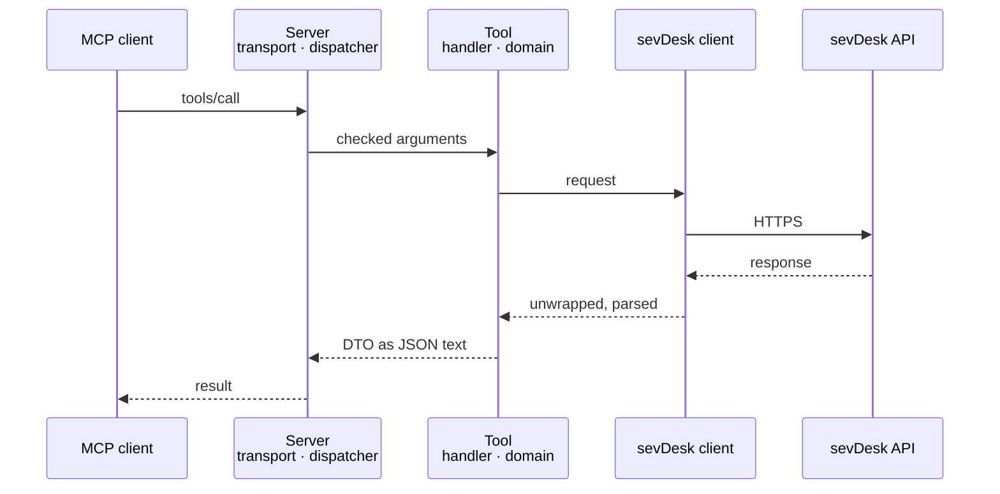

# Architecture

This document explains how `mcp-server-sevdesk` is built and why. It is for contributors and for
anyone who wants to judge whether the server is safe to point at their books. The reasoning behind
the bigger decisions is in the [architecture decision records](adr/README.md).

> [!NOTE]
> **Status.** This page describes version 1.0, built through milestones M1 core, M2 read
> coverage, M3 document lifecycle, M4 receipt and e-invoice intake, voucher writes, reconciliation
> and tax reports, M5 remote HTTP, and M6 launch (the Claude Desktop extension, prompts, local
> profiles and the OS keychain, remote file transfer and the generic read). What 1.0 keeps stable
> is defined in [Compatibility](compatibility.md).

The details have their own pages:

- [Safety model](architecture/safety.md): enforcement of the tiers, the write flow, confirmation,
  account scoping, record locks, untrusted text and the token.
- [Transports](architecture/transports.md): stdio, the HTTP request path and routes, shutdown, and
  how tools get and hand out files.
- [Builds and tests](architecture/build-and-test.md): the three shipped forms and the test layers.

## Goals

- **Safe by default.** The server starts read-only. Every action that writes, books, finalizes or
  sends needs an explicit opt-in, and binding or external actions need a human confirmation that
  the model cannot fake.
- **Correct against the real API.** sevDesk's OpenAPI spec is wrong in many places. The code follows
  observed behavior, and every known difference is written down and tested.
- **Useful, not exhaustive.** A small set of task-shaped tools covers the bookkeeping workflows
  (find a contact, draft and finalize an invoice, file a receipt, reconcile a bank transaction,
  summarize VAT) instead of one tool per endpoint.
- **One package, two modes.** Local stdio for desktop clients, and a self-hostable Streamable HTTP
  server with OAuth for remote clients.
- **Easy to contribute to.** Clear layers, one way to define a tool, and tests that run without a
  sevDesk account.

Non-goals: a hosted public instance (for now), a 1:1 mirror of the REST API, and generated clients
from the spec.

## Layers

```
tools  →  domain  →  sevdesk client  →  sevDesk REST API
```

Each layer only calls the one to its right.

- **`src/tools/`** defines the MCP tools. A tool declares its schema, tier and annotations and
  calls domain functions. Tools never call `fetch` or the HTTP client directly: a tool passes the
  client of its context to a domain function, also for the binding requests (finalize, send,
  enshrine, cancel, reset, book a payment), which it sends from `execute` with the client scoped
  to its tier. From `src/sevdesk/` a tool imports only the errors, the date helpers and the client
  types, and it has no file-system code.
- **`src/domain/`** holds the business logic: normalized DTOs, the decimal money type, reference
  data, lifecycle rules (which status may go where), validation against sevDesk's
  ReceiptGuidance, the e-invoice parser, the reconciliation matcher and the tax reports. It also
  builds every request (path and body) and sends it through the client it is given; the binding
  ones are in `src/domain/lifecycle/actions.ts` and
  `src/domain/reconciliation/transaction-writes.ts`. It does not import from `src/tools/`.
- **`src/sevdesk/`** is the HTTP client. It knows sevDesk's wire format: auth, the response
  envelope, string scalars, date formats, error bodies, pacing. It knows nothing about MCP, the
  tools or the domain layer. It could later become its own SDK package.
- **`src/safety/`** is used by all layers: tiers, redaction of the API token, fencing of untrusted
  text, confirmations, dry-run, the audit log, the OS keychain, and the file access tools read
  and deliver files through (local folders, uploads and download links over HTTP, and downloads
  from allowed https links with the SSRF guard they share with the OAuth mode). It imports
  from neither `src/tools/` nor `src/domain/`; the types those share with it (the confirmation
  preview, the reference to a changed record) are in `src/safety/write-types.ts`.

ESLint enforces these rules (`eslint.config.js`, the `layering/…` blocks): in `src/tools/` a call
of a client method, `fetch`, `node:fs` and any other import from `src/sevdesk/` fail the lint (the
write flow, which wraps the client per call, may also import `scoped-client.ts`), and so do the
imports named above for the other three directories, type-only imports included.

Two smaller parts sit beside the tools: **`src/prompts/`** renders the MCP prompts from the
registered tools ([Prompts](#prompts)), and **`src/resources/`** serves document files and
reference data as MCP resources.

In HTTP mode two more parts sit in front of the tools. **`src/http/`** turns an HTTP request into
an authenticated request (hardening, bearer or OAuth), and **`src/accounts/`** turns that into an
account context: the `Config` and sevDesk client the tools of this request use. Both hand the
context to the server factory and never call tools ([Transports](architecture/transports.md)).
Their only own sevDesk call is the identity lookup (`GET /SevClient`) at consent, refresh and inbox
sign-in.

## Module map

| Path                                      | Responsibility                                                                                                                                                                                                                                                                                                                                                                                                                                                                                              |
| ----------------------------------------- | ----------------------------------------------------------------------------------------------------------------------------------------------------------------------------------------------------------------------------------------------------------------------------------------------------------------------------------------------------------------------------------------------------------------------------------------------------------------------------------------------------------- |
| `src/index.ts`                            | Entry (`mcp-server-sevdesk`): runs what `cli.ts` parsed: the stdio server, the HTTP server, or an operator command. stdout belongs to the transport.                                                                                                                                                                                                                                                                                                                                                        |
| `src/cli.ts`                              | Command line: `--stdio`, `--http`, `grants list`/`revoke`, `generate-secret`, `account-id`, `healthcheck`, `token set`/`check`/`delete`, `profiles list`; anything unknown is a usage error (exit 2).                                                                                                                                                                                                                                                                                                       |
| `src/server.ts`                           | Server factory: builds the MCP server for an account context with the tools of its tiers, the prompts that fit them, the resources and generated `instructions` (under 1,500 characters); tools, prompts and instructions are cached per tier set. Its identity carries the icon from `assets/icon.svg` as a `data:` URI (`server-icon.ts`).                                                                                                                                                                |
| `src/config.ts`                           | Configuration from the environment: settings shared by all accounts (tiers, toolsets, confirmation, folders, pacing) and the per-account `Config` (token, account, deployment). One account per process over stdio and in bearer mode; one per grant in OAuth mode.                                                                                                                                                                                                                                         |
| `src/accounts/`                           | Account contexts: the resolver (one fixed context, or a frozen `Config` and client per OAuth account, cached) and the sevDesk identity lookup (`GET /SevClient`). Over stdio also the local configuration: `profiles.ts` (the profiles file, its trust checks and the overlay onto the environment) and `local-config.ts` (profile, keychain lookup, then `loadConfig`).                                                                                                                                    |
| `src/token-cli.ts`, `src/profiles-cli.ts` | `token set`/`check`/`delete` (the token in the OS keychain, checked with sevDesk before it is stored) and `profiles list`.                                                                                                                                                                                                                                                                                                                                                                                  |
| `src/prompts/`                            | The MCP prompts: `catalog.ts` (the workflows, trusted text; each step names its tools), `index.ts` (selection, planning per configuration, rendering, registration) and `completions.ts` (argument suggestions).                                                                                                                                                                                                                                                                                            |
| `src/sevdesk/client.ts`                   | HTTP client: raw-token `Authorization` header, User-Agent, pacing, timeouts, cancellation, write gate, GET-only retries, error classification, body caps (16 MiB per JSON answer, read while streaming).                                                                                                                                                                                                                                                                                                    |
| `src/sevdesk/envelope.ts`                 | Unwraps `{objects: …}`, including on writes and PDFs, and array-of-one GET-by-id results.                                                                                                                                                                                                                                                                                                                                                                                                                   |
| `src/sevdesk/schema.ts`                   | Lenient zod building blocks for responses (ids, amounts and booleans as strings or numbers).                                                                                                                                                                                                                                                                                                                                                                                                                |
| `src/sevdesk/dates.ts`                    | Per-endpoint date serializers (`dd.mm.yyyy`, Unix seconds, ISO), anchored to Europe/Berlin.                                                                                                                                                                                                                                                                                                                                                                                                                 |
| `src/sevdesk/errors.ts`                   | Error body → typed error; spots validation errors that arrive as HTTP 500; trusted, actionable messages.                                                                                                                                                                                                                                                                                                                                                                                                    |
| `src/sevdesk/system-version.ts`           | Detects bookkeeping system 1.0 vs 2.0 per account and per object.                                                                                                                                                                                                                                                                                                                                                                                                                                           |
| `src/sevdesk/paths.ts`                    | Validates every request path and id before it is sent; knows the minimum tier of every endpoint and which GETs have side effects; `genericGetRefusal` decides what `sevdesk_api_get` may read.                                                                                                                                                                                                                                                                                                              |
| `src/sevdesk/pacing.ts`                   | Token-bucket pacing (about 4 requests per second) and an in-flight cap.                                                                                                                                                                                                                                                                                                                                                                                                                                     |
| `src/domain/`                             | DTOs and logic per area: contacts, users, reference data, money, invoices, credit notes, orders, vouchers, banking, reports, lifecycle, drafts. `preview-text.ts`: the two languages of a confirmation preview ([Write flow](architecture/safety.md#write-flow)).                                                                                                                                                                                                                                           |
| `src/domain/einvoice/`                    | Local XRechnung (UBL, CII) and ZUGFeRD/Factur-X parser (EN 16931 subset, business-rule checks), voucher suggestions, outgoing preflight.                                                                                                                                                                                                                                                                                                                                                                    |
| `src/domain/vat/`                         | EU member states with their VAT-ID formats and dated standard rates, the tax-rule decision for sales (`sales-tax-rule.ts`), the tax-rule helper and VAT-ID check behind their tools, what a VIES answer means (`vies.ts`; the request is `src/sevdesk/vies-request.ts`, only with `SEVDESK_VIES_CHECK`).                                                                                                                                                                                                    |
| `src/domain/reconciliation/`              | Transaction log reader, the pure match scorer (amount, document number, counterparty, splits), allocation planning and over-booking guards.                                                                                                                                                                                                                                                                                                                                                                 |
| `src/domain/reports/`                     | Server-side aggregates: summaries, aging, cash position, changes, the VAT summary (UStVA boxes with sources, ZM, OSS) and the EÜR-style P&L.                                                                                                                                                                                                                                                                                                                                                                |
| `src/domain/exports/`                     | DATEV export job (start, progress, presigned download) and sevDesk CSV exports.                                                                                                                                                                                                                                                                                                                                                                                                                             |
| `src/domain/api-get.ts`                   | The generic read behind `sevdesk_api_get`: refusal rules, a read-only client, a capped download, the response envelope, cleaning of untrusted and binary content, the output cap.                                                                                                                                                                                                                                                                                                                           |
| `src/sevdesk/export-download.ts`          | Besides the VIES check and the client metadata fetch, the only request outside the API base URL: the DATEV ZIP from sevDesk's export bucket (one https host, no credentials, no redirects, capped).                                                                                                                                                                                                                                                                                                         |
| `src/sevdesk/vies-request.ts`             | The opt-in VIES check (`SEVDESK_VIES_CHECK`): one fixed https URL at `ec.europa.eu`, only the VAT ID in the body, no credentials, no redirects, a timeout and a capped answer. What the answer means is `src/domain/vat/vies.ts`.                                                                                                                                                                                                                                                                           |
| `src/tools/define-tool.ts`                | `defineTool(...)`: name, title, toolset, tier, all four annotations, input and output schemas, handler.                                                                                                                                                                                                                                                                                                                                                                                                     |
| `src/tools/registry.ts`                   | Picks the tools for a configuration and wraps every call (tier re-check, validation, output check, error mapping).                                                                                                                                                                                                                                                                                                                                                                                          |
| `src/tools/<toolset>/`                    | The tools of one toolset, for example `contacts/`, `meta/`; `advanced/` holds `sevdesk_api_get`.                                                                                                                                                                                                                                                                                                                                                                                                            |
| `src/resources/`                          | MCP resources: document files (`sevdesk://invoices/{id}/pdf`, …) and reference data (`sevdesk://reference/…`).                                                                                                                                                                                                                                                                                                                                                                                              |
| `src/safety/`                             | Tiers, redaction, untrusted-text fencing, confirmation (elicitation; the approval store, the local approval page and the approval, inbox and sign-in renderers), dry-run previews, the audit log, confined file reading, the OS keychain (`keychain.ts`), web helpers (page headers and their CSP, cookies, CSRF).                                                                                                                                                                                          |
| `src/safety/` (files)                     | How tools get and hand out files ([Files](architecture/transports.md#files)): `file-access.ts` (the `FileAccess` contract, `upload:<id>` references), `file-sources.ts` (local folders, or uploads and download links), `transfer-types.ts` and `transfer-store.ts` (upload tickets and download links per account, limits, lifetimes), `blob-store.ts` (encrypted file bytes in memory or the state directory), `url-files.ts` (downloads from allowed https links).                                       |
| `src/pages/`                              | What every page of the server shares ([ADR 0010](adr/0010-server-pages-in-two-languages.md)): `html.ts` (the `markup` template tag, which escapes every interpolated value), `theme.ts` (colour and type tokens, the one stylesheet), `frame.ts`, `components.ts`, `icons.ts`, `message.ts` (result and error pages), `locale.ts` and `text/` (the page texts in English and German, chosen from `Accept-Language`), `assets.ts` (the embedded fonts and icon served under `/assets/`). No script anywhere. |
| `src/http/`                               | Streamable HTTP: the `node:http` bridge, router and hardening (Host, Origin, rate limits, body caps, timeouts), request logs, bearer auth, the MCP route, server keys and sealed tokens, browser sessions (`browser-session.ts`), the approval inbox, the upload and download pages (`transfer-routes.ts`, `transfer-pages.ts`), and the page assets (`asset-route.ts`).                                                                                                                                    |
| `src/http/oauth/`                         | The OAuth 2.1 authorization server: metadata, `/authorize` and the consent page, `/token`, `/revoke`, the access-token verifier, CIMD fetching (its SSRF guard and pinned GET live in `src/safety/`), redirect matching, the grant store.                                                                                                                                                                                                                                                                   |
| `src/grants-cli.ts`                       | `grants list` and `grants revoke` against the grant store in `SEVDESK_HTTP_STATE_DIR`.                                                                                                                                                                                                                                                                                                                                                                                                                      |
| `spec/`                                   | Reference snapshot of the upstream OpenAPI spec and the [deviations register](../spec/deviations.md).                                                                                                                                                                                                                                                                                                                                                                                                       |
| `scripts/`                                | Spec-drift check, package and HTTP smoke tests, tool-doc generator, fixture recorder, API probes, e-invoice fixture generator, the `.mcpb` build, the page assets (`pnpm pages:assets`) and the page preview (`pnpm pages:preview`).                                                                                                                                                                                                                                                                        |
| `Dockerfile`                              | The image: built on the build platform, run on distroless Node.js as uid 65532 with `--http`, state in `/data`, a health check via `healthcheck`.                                                                                                                                                                                                                                                                                                                                                           |
| `mcpb/`, `tsdown.mcpb.config.ts`          | The Claude Desktop extension: its manifest (settings mapped to `SEVDESK_*` variables), icon and bundle build ([Builds](architecture/build-and-test.md#builds)).                                                                                                                                                                                                                                                                                                                                             |
| `deploy/`                                 | Deploy templates: Docker Compose with Caddy, Fly.io, Render, Railway ([Deployment](remote/deployment.md)).                                                                                                                                                                                                                                                                                                                                                                                                  |
| `test/`                                   | Unit, contract, regression, integration and (opt-in) live tests; tool-selection evals; fixtures with provenance.                                                                                                                                                                                                                                                                                                                                                                                            |
| `plugin/`, `.claude-plugin/`              | Claude Code plugin (starts this server, bookkeeping skill with cited references) and the repository's plugin marketplace.                                                                                                                                                                                                                                                                                                                                                                                   |

## Lifecycle of a tool call



1. **Registration (at startup; over HTTP for each request).** The registry selects tools by
   toolset (`SEVDESK_TOOLSETS`) and tier (`SEVDESK_ALLOW`, `SEVDESK_READ_ONLY`, and in OAuth mode
   the grant's tiers). Tools outside the selection are **not registered**, so the model never sees
   them. `tools/list` returns one page in a stable order, and the server `instructions` are
   generated from the registered tools. Over HTTP the server is built per request for the
   request's account context; the selection and instructions are cached per tier set.
2. **Validation.** Arguments are parsed with the tool's zod input schema. Input schemas have an
   object root, are flat and reject unknown parameters with a message that names them (sevDesk
   itself silently ignores unknown fields, see
   [D-003](../spec/deviations.md#d-003-unknown-request-fields-are-silently-ignored)). The JSON
   Schema clients see is generated by zod itself.
3. **Dispatcher checks.** The wrapper re-checks the tool's tier against the configuration. Write
   tools then run through the write flow (`src/tools/write-flow.ts`): `prepare` reads with a
   read-only client and returns a preview; in a dry run the preview is the result; for `commit`
   and `external` tools the human approves that preview first (see
   [Safety model](architecture/safety.md)); then `execute` runs with a client scoped to the tool's
   tier.
4. **Domain.** The handler (or `prepare`/`execute`) calls domain functions. Writes read the current
   record first and merge the change, check for duplicates before creating, fill in references
   such as `contactPerson`, and let sevDesk assign document numbers.
5. **sevDesk client.** The client validates the path, enforces the write gate, paces the request,
   sends it with a timeout and the caller's cancellation signal, and unwraps and leniently parses
   the response. GETs may be retried; POST and PUT never are. Error bodies become typed errors with
   the token redacted.
6. **Result.** The domain returns a compact DTO: money as exact decimals with currency, ISO dates,
   deep links into the sevDesk web app, and untrusted text sanitized. The tool always returns the DTO
   as minified JSON after a trusted summary and a blank line in one text block. JSON escaping
   keeps untrusted DTO strings inside their values without relying on indentation; untrusted
   text beside prose uses Markdown fences. Static JSON reference resources are also minified.
   The tool adds `outputSchema` and `structuredContent` only on protocol version
   2026-07-28 or later, or when `SEVDESK_STRUCTURED_OUTPUT=on`, because some clients mishandle
   structured output. Truncated lists say how many items were left out. Files (PDF, XML, exports)
   are returned as resources, written to `SEVDESK_OUTPUT_DIR` or, over HTTP, handed out as
   download links ([Files](architecture/transports.md#files)), never as base64 text.
7. **Errors** become `isError` results with trusted, actionable text. sevDesk's own error wording
   appears only fenced.

## Prompts

`src/prompts/` holds the MCP prompts: `catalog.ts` (the workflows, trusted text; every step
declares the tools it names) and `index.ts` (selection, planning, rendering, registration). For
each configuration, `planPrompts` keeps the prompts whose required tools are registered, shows the
steps whose tools are registered, and turns the others into "needs <setting>" lines derived from
the missing tools' tier, toolset and availability, worded for the deployment (stdio, bearer or
OAuth). The plan is part of the surface cached per tier set, like the tools and the instructions.
Handlers only render text and never call sevDesk; arguments are pattern-checked by the SDK
(invalid ones answer InvalidParams) and shown only fenced. A lint
(`test/integration/prompts-list.test.ts`) renders every prompt in many configurations and both
protocol eras and checks that every tool a prompt names is in that configuration's `tools/list`.

Arguments can be completed (`completion/complete`). The catalog only names a kind per argument
(month, period, year, contact, payment account); `registerPrompts` attaches the completers of one
server instance to a copy of the argument's schema, because the SDK's `completable` marks a schema
for good and the catalog's schemas are shared by every account. Months, quarters and years come
from the clock. Contact and account names (`completions.ts`) come from one list request per kind, plus a
name search (limit 100) per typed name when the account has more contacts than one read returns,
always read-only and with an explicit limit. They are read only when `sevdesk_contacts_search` or
`sevdesk_bank_accounts_list` is registered, and cached for a minute per account `Config` (over
HTTP every request is a new instance). A failed read suggests nothing for a few seconds instead of
being sent again on every keystroke, and a search is stopped when the HTTP request waiting for it
ends early. Every suggestion passes the argument's own check before it is offered, and a chosen one
is validated and fenced like a typed one. The SDK declares the `completions` capability only when a
listed prompt has an argument this instance completes.

## sevDesk API realities that shaped the design

The full list, with sources and tests, is the
[deviations register](../spec/deviations.md). The ones with the biggest effect on the code:

- **No sandbox and no webhooks.** Every write is real, which is why writes are off by default and
  tested against fixtures. "Changed since" queries (`sevdesk_changed_since`) replace webhooks.
- **The spec is not reliable** ([ADR 0002](adr/0002-hand-written-zod-schemas.md)). Responses are
  wrapped in `{objects: …}` even where the spec says otherwise, scalars arrive as strings, and
  unknown request fields are dropped without an error.
- **Lists truncate silently.** Without a `limit`, lists stop at 100 records; `limit` must be
  1–1000. The client always sends a limit and pages until an empty page.
- **Side effects hide in GETs.** `getPdf` marks a document as sent unless `preventSendBy` is set.
- **Two bookkeeping generations.** Update 2.0 replaced `taxType` with `taxRule` and booking accounts
  with `accountDatev`, and one account can hold objects of both. The client detects the version
  per account and per object.
- **Errors are inconsistent.** Some validation errors come back as HTTP 500, and no rate limit is
  documented. The client classifies errors itself and paces requests.
