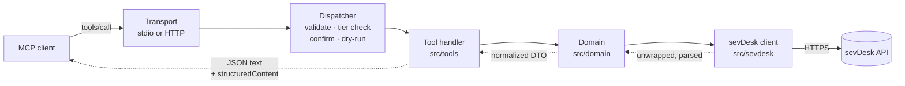

# Architecture

This document explains how `mcp-server-sevdesk` is built and why. It is for contributors and for
anyone who wants to judge whether the server is safe to point at their books. The reasoning behind
the bigger decisions is in the [architecture decision records](adr/README.md).

> **Status.** The project is in early development. This page describes the v1 design. Parts that
> exist (milestones M1 to M4) are not marked. Later parts are marked with the milestone that
> delivers them, for example _(planned, M5)_. Milestones: M1 core (0.1.0), M2 read coverage
> (0.2.0), M3 document lifecycle (0.3.0), M4 receipt and e-invoice intake, voucher writes,
> reconciliation and tax reports (0.4.0), M5 remote HTTP (0.5.0), M6 launch (1.0.0).

## Goals

- **Safe by default.** The server starts read-only. Every action that writes, books, finalizes or
  sends needs an explicit opt-in, and binding or external actions need a human confirmation that
  the model cannot fake.
- **Correct against the real API.** sevDesk's OpenAPI spec is wrong in many places. The code follows
  observed behavior, and every known difference is written down and tested.
- **Useful, not exhaustive.** A small set of task-shaped tools covers the bookkeeping workflows
  (find a contact, draft and finalize an invoice, file a receipt, reconcile a bank transaction,
  summarize VAT) instead of one tool per endpoint.
- **One package, two modes.** Local stdio for desktop clients, and a self-hostable Streamable HTTP
  server with OAuth for remote clients.
- **Easy to contribute to.** Clear layers, one way to define a tool, and tests that run without a
  sevDesk account.

Non-goals: a hosted public instance (for now), a 1:1 mirror of the REST API, and generated clients
from the spec.

## Layers

```
tools  →  domain  →  sevdesk client  →  sevDesk REST API
```

Each layer only calls the one to its right.

- **`src/tools/`** defines the MCP tools. A tool declares its schema, tier and annotations and
  calls domain functions. Tools never call `fetch` or the HTTP client directly.
- **`src/domain/`** holds the business logic: normalized DTOs, the decimal money type, reference
  data, lifecycle rules (which status may go where), validation against sevDesk's
  ReceiptGuidance, the e-invoice parser, the reconciliation matcher and the tax reports.
- **`src/sevdesk/`** is the HTTP client. It knows sevDesk's wire format: auth, the response
  envelope, string scalars, date formats, error bodies, pacing. It knows nothing about MCP. It could
  later become its own SDK package.
- **`src/safety/`** is used by all layers: tiers, redaction of the API token, fencing of untrusted
  text, confirmations, dry-run, the audit log and confined reading of local files.

## Module map

| Path                             | Responsibility                                                                                                                                  |
| -------------------------------- | ----------------------------------------------------------------------------------------------------------------------------------------------- |
| `src/index.ts`                   | CLI entry (`mcp-server-sevdesk`): flags and environment → config → server → stdio (or HTTP _(planned, M5)_). stdout belongs to the transport.   |
| `src/server.ts`                  | Builds the MCP server for a config: registers the selected tools and resources, and generated `instructions` (under 1,500 characters).          |
| `src/config.ts`                  | Configuration from the environment: token sources, tiers, toolsets, confirmation, output and file folders. One account per process.             |
| `src/sevdesk/client.ts`          | HTTP client: raw-token `Authorization` header, User-Agent, pacing, timeouts, cancellation, write gate, GET-only retries, error classification.  |
| `src/sevdesk/envelope.ts`        | Unwraps `{objects: …}`, including on writes and PDFs, and array-of-one GET-by-id results.                                                       |
| `src/sevdesk/schema.ts`          | Lenient zod building blocks for responses (ids, amounts and booleans as strings or numbers).                                                    |
| `src/sevdesk/dates.ts`           | Per-endpoint date serializers (`dd.mm.yyyy`, Unix seconds, ISO), anchored to Europe/Berlin.                                                     |
| `src/sevdesk/errors.ts`          | Error body → typed error; spots validation errors that arrive as HTTP 500; trusted, actionable messages.                                        |
| `src/sevdesk/system-version.ts`  | Detects bookkeeping system 1.0 vs 2.0 per account and per object.                                                                               |
| `src/sevdesk/paths.ts`           | Validates every request path and id before it is sent.                                                                                          |
| `src/sevdesk/pacing.ts`          | Token-bucket pacing (about 4 requests per second) and an in-flight cap.                                                                         |
| `src/domain/`                    | DTOs and logic per area: contacts, users, reference data, money, invoices, credit notes, orders, vouchers, banking, reports, lifecycle, drafts. |
| `src/domain/einvoice/`           | Local XRechnung (UBL, CII) and ZUGFeRD/Factur-X parser (EN 16931 subset, business-rule checks), voucher suggestions, outgoing preflight.        |
| `src/domain/reconciliation/`     | Transaction log reader, the pure match scorer (amount, document number, counterparty, splits), allocation planning and over-booking guards.     |
| `src/domain/reports/`            | Server-side aggregates: summaries, aging, cash position, changes, the VAT summary (UStVA boxes with sources, ZM, OSS) and the EÜR-style P&L.    |
| `src/domain/exports/`            | DATEV export job (start, progress, presigned download) and sevDesk CSV exports.                                                                 |
| `src/sevdesk/export-download.ts` | The only request outside the API base URL: the DATEV ZIP from sevDesk's export bucket (one https host, no credentials, no redirects, capped).   |
| `src/tools/define-tool.ts`       | `defineTool(...)`: name, title, toolset, tier, all four annotations, input and output schemas, handler.                                         |
| `src/tools/registry.ts`          | Picks the tools for a configuration and wraps every call (tier re-check, validation, output check, error mapping).                              |
| `src/tools/<toolset>/`           | The tools of one toolset, for example `contacts/`, `meta/`.                                                                                     |
| `src/safety/`                    | Tiers, redaction, untrusted-text fencing, confirmation (elicitation, approval page), dry-run previews, the audit log, confined file reading.    |
| `src/http/`                      | Streamable HTTP adapter, bearer and OAuth 2.1, consent page _(planned, M5)_.                                                                    |
| `spec/`                          | Reference snapshot of the upstream OpenAPI spec and the [deviations register](../spec/deviations.md).                                           |
| `scripts/`                       | Spec-drift check, package smoke test, tool-doc generator, fixture recorder, API probes, e-invoice fixture generator.                            |
| `test/`                          | Unit, contract, regression, integration and (opt-in) live tests; tool-selection evals; fixtures with provenance.                                |
| `plugin/`, `.claude-plugin/`     | Claude Code plugin (starts this server, bookkeeping skill with cited references) and the repository's plugin marketplace.                       |

## Lifecycle of a tool call



1. **Registration (at startup).** The registry selects tools by toolset (`SEVDESK_TOOLSETS`) and
   tier (`SEVDESK_ALLOW`, `SEVDESK_READ_ONLY`). Tools outside the selection are **not registered**,
   so the model never sees them. `tools/list` returns one page in a stable order, and the server
   `instructions` are generated from the registered tools.
2. **Validation.** Arguments are parsed with the tool's zod input schema. Input schemas have an
   object root, are flat and reject unknown parameters with a message that names them (sevDesk
   itself silently ignores unknown fields, see
   [D-003](../spec/deviations.md#d-003-unknown-request-fields-are-silently-ignored)). The JSON
   Schema clients see is generated by zod itself.
3. **Dispatcher checks.** The wrapper re-checks the tool's tier against the configuration. Write
   tools then run through the write flow (`src/tools/write-flow.ts`): `prepare` reads with a
   read-only client and returns a preview; in a dry run the preview is the result; for `commit`
   and `external` tools the human approves that preview first (see [Safety model](#safety-model)); then
   `execute` runs with a client scoped to the tool's tier.
4. **Domain.** The handler (or `prepare`/`execute`) calls domain functions. Writes read the current
   record first and merge the change, check for duplicates before creating, fill in references
   such as `contactPerson`, and let sevDesk assign document numbers.
5. **sevDesk client.** The client validates the path, enforces the write gate, paces the request,
   sends it with a timeout and the caller's cancellation signal, and unwraps and leniently parses
   the response. GETs may be retried; POST and PUT never are. Error bodies become typed errors with
   the token redacted.
6. **Result.** The domain returns a compact DTO: money as exact decimals with currency, ISO dates,
   deep links into the sevDesk web app, and untrusted text fenced. The tool always returns the DTO
   as a JSON text block. It adds `outputSchema` and `structuredContent` only on protocol version
   2026-07-28 or later, or when `SEVDESK_STRUCTURED_OUTPUT=1`, because some clients mishandle
   structured output. Truncated lists say how many items were left out. Files (PDF, XML, exports)
   are returned as resources or written to `SEVDESK_OUTPUT_DIR`, never as base64 text.
7. **Errors** become `isError` results with trusted, actionable text. sevDesk's own error wording
   appears only fenced.

## Safety model

Every tool has exactly one tier. Reads and writes never share a tool.

| Tier       | What it covers                                                                                               | Default |
| ---------- | ------------------------------------------------------------------------------------------------------------ | ------- |
| `read`     | list, get, search, reports, PDF preview (with `preventSendBy`)                                               | on      |
| `write`    | contacts, parts, draft invoices, vouchers and offers, the DATEV export (reversible or harmless)              | off     |
| `commit`   | finalize, book payment, reconcile, cancel, enshrine, reset, delete a voucher draft (binding or irreversible) | off     |
| `external` | send by email or letter (reaches third parties)                                                              | off     |

**Switches.** `SEVDESK_ALLOW=read,write,commit,external` chooses the tiers. `SEVDESK_READ_ONLY=1`
overrides everything else. `SEVDESK_DRY_RUN=1`, or `dryRun` on a single call, runs the tool's
checks and returns its preview (status `dry_run`) without sending anything or asking anyone.

**Enforcement in three places.**

1. Registration: tools above the allowed tiers are not registered.
2. Dispatcher: every call re-checks the tier.
3. HTTP client: every request that changes data (any non-GET, and the GETs that change state)
   must declare its tier, and is refused before sending in read-only or dry-run mode, when it
   declares no tier, when `SEVDESK_ALLOW` does not enable that tier, or when the tier is below the
   endpoint's minimum (`minimumWriteTier` in `paths.ts`: `sendBy`, `bookAmount`, `enshrine`,
   `cancelInvoice`, `resetToDraft`, `resetToOpen`, `changeParameter`, a sending `getPdf`,
   DATEV `enshrine` exports, a `saveVoucher` whose voucher is not a draft (the voucher's
   finalize) and `PUT`/`DELETE /CheckAccountTransaction/{id}` (private marking, reset) need
   `commit`; `sendViaEmail` and `sendByWithRender` need `external`). Write tools never set the tier: their `execute` gets a client that stamps it
   (`tierScopedClient`, which applies the endpoint rule too), their `prepare` one that refuses
   every write (`readOnlyClient`). The client recognizes the
   state-changing GETs by endpoint, not only by the caller's `sideEffect` flag: a `getPdf` read
   always goes out with the literal `preventSendBy=true` (recorded: drafts stay drafts), while
   `getPdf` with `preventSendBy` off, `sendByWithRender`, DATEV exports with an `enshrine` flag
   (all `commit`/`external`, see [D-023](../spec/deviations.md#d-023-some-gets-change-state)) and
   the next-number endpoints unless `useNextNumber=false` (they reserve a document number;
   `write`; the documented `getNextCustomerNumber` stays a read) count as writes.

**Write flow** (`src/tools/write-flow.ts`). A write tool has `prepare` (reads, checks, builds a
preview: action, facts, warnings, irreversible) and `execute`. Every call runs `prepare`, then a
dry run stops, `commit`/`external` calls are confirmed, the audit log records `executing` and
only then `execute` runs. Results are wrapped as `{status: "done" | "dry_run" |
"approval_pending" | "declined", result?, preview?, approval?}` (`result` only when done); the
same era rules for `outputSchema` and `structuredContent` apply as for reads.

**Human confirmation** for `commit` and `external` tools, set by `SEVDESK_CONFIRM`
([ADR 0003](adr/0003-tiers-and-human-confirmation.md), [SECURITY.md](../SECURITY.md)):

- `elicit` (default): the call answers with an MCP elicitation (the SDK's multi-round-trip
  `inputRequired` flow) whose message is the sanitized preview. The `requestState` is sealed with
  the SDK's HMAC codec (per-process key, 10 minutes) and binds the tool, a SHA-256 of the
  arguments, a SHA-256 of the preview and a single-use nonce. On the retry the server checks them,
  prepares again and asks again if the preview changed. 2025-era clients get real
  `elicitation/create` requests from the SDK's legacy shim on the same handler; clients without
  form elicitation (and 2025-era clients over stateless HTTP) get an error pointing to `browser`.
- `browser`: the server opens a local approval page (`src/safety/approval-server.ts`,
  `127.0.0.1`, ephemeral port, one per process) in the user's browser (`src/safety/open-url.ts`,
  `SEVDESK_CONFIRM_OPEN`) and logs its link to stderr; the call returns `approval_pending` with a
  non-secret reference code, never the link. The model calls again with the same arguments after
  the human decided; approvals bind tool, arguments and preview, expire after 10 minutes and are
  used once.
- `off`: only together with `SEVDESK_I_UNDERSTAND_NO_CONFIRM=1`.

The key, the nonces, the approvals and the audit writer live in one `SafetyRuntime`
(`src/safety/runtime.ts`) per server factory, shared by every instance the factory builds.

A `confirm: true` argument is never a gate, because the model can set it itself. `enshrine` always
warns that it is irreversible (GoBD).

**Annotations.** Every tool declares all four MCP annotations (`readOnlyHint`, `destructiveHint`,
`idempotentHint`, `openWorldHint`) explicitly; a test enforces it.

**Write integrity.** Duplicate check before creating (number, amount, date, description). No
retries for writes. Read back after every write. Optional JSONL audit log via `SEVDESK_AUDIT_LOG`
(`src/safety/audit.ts`: one line per event, mode 0600, token redacted; no `executing` line, no
request). A multi-step write that fails half-way reports the records it already changed
(`SevdeskError.completedWrites`), in the error text and the audit log. Document drafts validate
tax rule × rate against the reference tax rules before any API call; booking accounts against
ReceiptGuidance (`src/domain/receipt-guidance.ts`): voucher drafts and finalizing check every
account × tax rule × rate against it, because sevDesk itself accepts any combination on a draft.
Bank bookings plan every allocation against the document's open amount and the transaction's
remaining amount (from the transaction log) before anything is sent.

**Untrusted text.** Contact names, descriptions, bank transfer purposes (Verwendungszweck) and
e-invoice fields can be written by third parties and may carry prompt injection. They are stripped
of invisible and bidi characters, fenced in output, and never interpolated into error messages or
instructions.

**Local files.** Tools read local files only from `SEVDESK_FILE_DIRS`
(`src/safety/local-files.ts`: real paths, no symlink escapes, `O_NOFOLLOW` plus an inode check,
content sniffing, size caps) and write only into `SEVDESK_OUTPUT_DIR` (exclusive creation, mode
0600, never overwriting). Every such tool declares `localEffects` and is on a reviewed list in the
metadata lint. E-invoice XML is parsed without entity expansion or DOCTYPEs, with size and depth
limits.

**Token.** The sevDesk API token has full account access, no scopes and no expiry. It is read from
the environment, a `*_FILE` or, optionally, the OS keychain. It is checked at startup with
`GET /Tools/bookkeepingSystemVersion`, redacted everywhere, and a 401 is final. The
threat model is in [SECURITY.md](../SECURITY.md).

## sevDesk API realities that shaped the design

The full list, with sources and tests, is the
[deviations register](../spec/deviations.md). The ones with the biggest effect on the code:

- **No sandbox and no webhooks.** Every write is real, which is why writes are off by default and
  tested against fixtures. "Changed since" queries (`sevdesk_changed_since`) replace webhooks.
- **The spec is not reliable** ([ADR 0002](adr/0002-hand-written-zod-schemas.md)). Responses are
  wrapped in `{objects: …}` even where the spec says otherwise, scalars arrive as strings, and
  unknown request fields are dropped without an error.
- **Lists truncate silently.** Without a `limit`, lists stop at 100 records; `limit` must be
  1–1000. The client always sends a limit and pages until an empty page.
- **Side effects hide in GETs.** `getPdf` marks a document as sent unless `preventSendBy` is set.
- **Two bookkeeping generations.** Update 2.0 replaced `taxType` with `taxRule` and booking accounts
  with `accountDatev`, and one account can hold objects of both. The client detects the version
  per account and per object.
- **Errors are inconsistent.** Some validation errors come back as HTTP 500, and no rate limit is
  documented. The client classifies errors itself and paces requests.

## Transports

- **stdio** (default): for local clients such as Claude Desktop, Claude Code, Cursor or VS Code.
- **Streamable HTTP** (`--http`) _(planned, M5)_: stateless, built on the SDK's
  `createMcpHandler(...).fetch`, so any instance can serve any request. It **refuses to start
  without authentication**:
  - `bearer`: a static shared secret, compared in constant time.
  - `oauth`: OAuth 2.1 with PKCE, client registration through Client ID Metadata Documents (CIMD),
    and an RFC 8707 audience check. The user pastes their sevDesk token once on the consent page.
    It is encrypted with AES-GCM into the grant itself, so the server stores no tokens; revoking
    the grant revokes access.
  - Origin and Host validation, binding to 127.0.0.1 by default, and rate limits.

The HTTP mode is for self-hosting. There is no public hosted instance; see
[ADR 0004](adr/0004-stateless-remote-oauth.md).

## Testing

There is no shared paid test account, so most tests run against fixtures. Each fixture records its
provenance (`spec`, `community` or `recorded`, plus date and system version).

1. **Unit:** envelope and coercion, dates, money, tiers, redaction, fencing, the confirmation
   codec, ReceiptGuidance validator, e-invoice parser (official KoSIT samples plus an attack
   corpus) and reconciliation matcher.
2. **Contract:** domain functions against fixtures served by an in-memory fake client
   (`test/helpers/fake-client.ts`) or a scripted fake `fetch` (`test/helpers/fake-fetch.ts`). Each open entry in the
   deviations register has a test.
3. **Regressions:** one test per known trap (for example `preventSendBy`, top-level `filename` on
   vouchers, no write retries, the silent 100-record limit, the expense sign).
4. **MCP integration:** in-process calls through the real server: a `tools/list` snapshot per tier
   configuration, every tool against fixtures, and a metadata lint (explicit annotations, unique
   names, description length, object-root schemas, output matching its schema).
5. **HTTP mode** _(planned, M5)_: refusal without auth, bearer and OAuth flows, Origin checks,
   statelessness.
6. **Package smoke:** `npm pack`, install the tarball, run the binary, complete the MCP handshake on
   Linux, macOS and Windows with Node 22 and 24.
7. **Live tests:** opt-in, run by hand with a real token (`pnpm test:live`), read-only unless a
   trial account runs the lifecycle scenario ([docs/recording-session.md](recording-session.md)).
8. **Tool-selection evals** (`test/evals/`, `pnpm evals`): about 70 German and English requests,
   scored on the tools the model picks in its first answer; model answers are recorded once and
   replayed, and
   `.github/workflows/evals.yml` runs them on PRs that touch tools (informative, not required).

Upstream changes are watched separately: a weekly job compares the spec and the API-news feed with
the stored snapshot and opens an issue on drift ([spec/README.md](../spec/README.md)).
