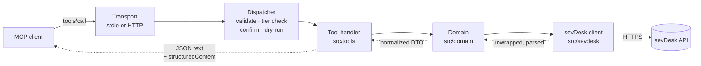

# Architecture

This document explains how `mcp-server-sevdesk` is built and why. It is for contributors and for
anyone who wants to judge whether the server is safe to point at their books. The reasoning behind
the bigger decisions is in the [architecture decision records](adr/README.md).

> **Status.** The project is in early development. This page describes the v1 design. Parts that
> belong to milestone M1 (core, in progress) are not marked. Later parts are marked with the
> milestone that delivers them, for example _(planned, M3)_. Milestones: M1 core (0.1.0), M2 read
> coverage (0.2.0), M3 invoice and voucher lifecycle (0.3.0), M4 intake, reconciliation and tax
> reports (0.4.0), M5 remote HTTP (0.5.0), M6 launch (1.0.0).

## Goals

- **Safe by default.** The server starts read-only. Every action that writes, books, finalizes or
  sends needs an explicit opt-in, and binding or external actions need a human confirmation that
  the model cannot fake.
- **Correct against the real API.** sevDesk's OpenAPI spec is wrong in many places. The code follows
  observed behavior, and every known difference is written down and tested.
- **Useful, not exhaustive.** A small set of task-shaped tools covers the bookkeeping workflows
  (find a contact, draft and finalize an invoice, file a receipt, reconcile a bank transaction,
  summarize VAT) instead of one tool per endpoint.
- **One package, two modes.** Local stdio for desktop clients, and a self-hostable Streamable HTTP
  server with OAuth for remote clients.
- **Easy to contribute to.** Clear layers, one way to define a tool, and tests that run without a
  sevDesk account.

Non-goals: a hosted public instance (for now), a 1:1 mirror of the REST API, and generated clients
from the spec.

## Layers

```
tools  →  domain  →  sevdesk client  →  sevDesk REST API
```

Each layer only calls the one to its right.

- **`src/tools/`** defines the MCP tools. A tool declares its schema, tier and annotations and
  calls domain functions. Tools never call `fetch` or the HTTP client directly.
- **`src/domain/`** holds the business logic: normalized DTOs, the decimal money type, reference
  data, lifecycle rules (which status may go where), and later validation against sevDesk's
  ReceiptGuidance, the e-invoice parser and the reconciliation matcher.
- **`src/sevdesk/`** is the HTTP client. It knows sevDesk's wire format: auth, the response
  envelope, string scalars, date formats, error bodies, pacing. It knows nothing about MCP. It could
  later become its own SDK package.
- **`src/safety/`** is used by all layers: tiers, redaction of the API token, and fencing of
  untrusted text; later confirmations, dry-run and the audit log.

## Module map

| Path                            | Responsibility                                                                                                                                  |
| ------------------------------- | ----------------------------------------------------------------------------------------------------------------------------------------------- |
| `src/index.ts`                  | CLI entry (`mcp-server-sevdesk`): flags and environment → config → server → stdio (or HTTP _(planned, M5)_). stdout belongs to the transport.   |
| `src/server.ts`                 | Builds the MCP server for a config: registers the selected tools, resources and prompts, and generated `instructions` (under 1,500 characters). |
| `src/config.ts`                 | Configuration parsed with zod: token sources, tiers, toolsets, output options, account profiles.                                                |
| `src/sevdesk/client.ts`         | HTTP client: raw-token `Authorization` header, User-Agent, pacing, timeouts, cancellation, write gate, GET-only retries, error classification.  |
| `src/sevdesk/envelope.ts`       | Unwraps `{objects: …}`, including on writes and PDFs, and array-of-one GET-by-id results.                                                       |
| `src/sevdesk/schema.ts`         | Lenient zod building blocks for responses (ids, amounts and booleans as strings or numbers).                                                    |
| `src/sevdesk/dates.ts`          | Per-endpoint date serializers (`dd.mm.yyyy`, Unix seconds, ISO), anchored to Europe/Berlin.                                                     |
| `src/sevdesk/errors.ts`         | Error body → typed error; spots validation errors that arrive as HTTP 500; trusted, actionable messages.                                        |
| `src/sevdesk/system-version.ts` | Detects bookkeeping system 1.0 vs 2.0 per account and per object.                                                                               |
| `src/sevdesk/paths.ts`          | Validates every request path and id before it is sent.                                                                                          |
| `src/sevdesk/pacing.ts`         | Token-bucket pacing (about 4 requests per second) and an in-flight cap.                                                                         |
| `src/domain/`                   | DTOs and logic per area (contacts, users, reference data, money; invoices, vouchers, banking, reports as they land).                            |
| `src/tools/define-tool.ts`      | `defineTool(...)`: name, title, toolset, tier, all four annotations, input and output schemas, handler.                                         |
| `src/tools/registry.ts`         | Picks the tools for a configuration and wraps every call (tier re-check, validation, output check, error mapping).                              |
| `src/tools/<toolset>/`          | The tools of one toolset, for example `contacts/`, `meta/`.                                                                                     |
| `src/safety/`                   | Tiers, redaction, untrusted-text fencing; confirmations, dry-run and audit log _(planned, M3)_.                                                 |
| `src/http/`                     | Streamable HTTP adapter, bearer and OAuth 2.1, consent page _(planned, M5)_.                                                                    |
| `spec/`                         | Reference snapshot of the upstream OpenAPI spec and the [deviations register](../spec/deviations.md).                                           |
| `scripts/`                      | Spec-drift check, package smoke test; tool-doc generator and fixture recorder _(planned)_.                                                      |
| `test/`                         | Unit, contract, regression, integration and (opt-in) live tests; fixtures with provenance.                                                      |

## Lifecycle of a tool call



1. **Registration (at startup).** The registry selects tools by toolset (`SEVDESK_TOOLSETS`) and
   tier (`SEVDESK_ALLOW`, `SEVDESK_READ_ONLY`). Tools outside the selection are **not registered**,
   so the model never sees them. `tools/list` returns one page in a stable order, and the server
   `instructions` are generated from the registered tools.
2. **Validation.** Arguments are parsed with the tool's zod input schema. Input schemas have an
   object root, are flat and reject unknown parameters with a message that names them (sevDesk
   itself silently ignores unknown fields, see
   [D-003](../spec/deviations.md#d-003-unknown-request-fields-are-silently-ignored)). The JSON
   Schema clients see is generated by zod itself.
3. **Dispatcher checks.** The wrapper re-checks the tool's tier against the configuration. For
   `commit` and `external` tools it asks the human to confirm, and in dry-run mode it returns the
   request that would be sent and stops _(both planned, M3)_.
4. **Domain.** The handler calls domain functions. Writes read the current record first and merge
   the change, check for duplicates before creating, fill in references such as `contactPerson`,
   and let sevDesk assign document numbers.
5. **sevDesk client.** The client validates the path, enforces the write gate, paces the request,
   sends it with a timeout and the caller's cancellation signal, and unwraps and leniently parses
   the response. GETs may be retried; POST and PUT never are. Error bodies become typed errors with
   the token redacted.
6. **Result.** The domain returns a compact DTO: money as exact decimals with currency, ISO dates,
   deep links into the sevDesk web app, and untrusted text fenced. The tool always returns the DTO
   as a JSON text block. It adds `outputSchema` and `structuredContent` only on protocol version
   2026-07-28 or later, or when `SEVDESK_STRUCTURED_OUTPUT=1`, because some clients mishandle
   structured output. Truncated lists say how many items were left out. Files (PDF, XML, exports)
   are returned as resources or written to `SEVDESK_OUTPUT_DIR`, never as base64 text.
7. **Errors** become `isError` results with trusted, actionable text. sevDesk's own error wording
   appears only fenced.

## Safety model

Every tool has exactly one tier. Reads and writes never share a tool.

| Tier       | What it covers                                                                                    | Default |
| ---------- | ------------------------------------------------------------------------------------------------- | ------- |
| `read`     | list, get, search, reports, PDF preview (with `preventSendBy`)                                    | on      |
| `write`    | contacts, parts, draft invoices, vouchers and offers, deleting drafts (reversible)                | off     |
| `commit`   | finalize, book payment, reconcile, cancel, credit note, enshrine, reset (binding or irreversible) | off     |
| `external` | send by email or letter (reaches third parties)                                                   | off     |

**Switches.** `SEVDESK_ALLOW=read,write,commit,external` chooses the tiers. `SEVDESK_READ_ONLY=1`
overrides everything else. `SEVDESK_DRY_RUN=1`, or `dryRun` on a single call, returns the planned
request without sending it _(planned, M3)_.

**Enforcement in three places.**

1. Registration: tools above the allowed tiers are not registered.
2. Dispatcher: every call re-checks the tier.
3. HTTP client: every request that changes data (any non-GET, and the GETs that change state)
   must declare its tier, and is refused before sending in read-only or dry-run mode, when it
   declares no tier, or when `SEVDESK_ALLOW` does not enable that tier. The client recognizes the
   state-changing GETs by endpoint, not only by the caller's `sideEffect` flag: a `getPdf` read
   always gets `preventSendBy=1`, while `getPdf` with `preventSendBy` off, `sendByWithRender`, and
   DATEV exports with an `enshrine` flag count as writes (see
   [D-023](../spec/deviations.md#d-023-some-gets-change-state)).

**Human confirmation** for `commit` and `external` tools _(planned, M3)_, set by `SEVDESK_CONFIRM`:

- `elicit` (default): the server answers with an MCP elicitation request (the SDK's multi-round-trip
  `inputRequired` flow) that shows what will happen. The pending request state is signed and bound
  to a SHA-256 of the tool name and arguments, a nonce and an expiry, and is checked again when the
  client retries. Older clients get a compatibility shim.
- `browser`: for clients without elicitation, the tool returns a pending handle and the server
  serves a local approval page with the exact preview.
- `off`: only together with `SEVDESK_I_UNDERSTAND_NO_CONFIRM=1`.

A `confirm: true` argument is never a gate, because the model can set it itself. `enshrine` always
warns that it is irreversible (GoBD).

**Annotations.** Every tool declares all four MCP annotations (`readOnlyHint`, `destructiveHint`,
`idempotentHint`, `openWorldHint`) explicitly; a test enforces it.

**Write integrity.** Duplicate check before creating (number, amount, date, description). No
retries for writes. Read back after every write. Optional JSONL audit log via `SEVDESK_AUDIT_LOG`
_(planned, M3)_. Pre-validation of tax rule, booking account and rate against ReceiptGuidance
before any API call _(planned, M3)_.

**Untrusted text.** Contact names, descriptions, bank transfer purposes (Verwendungszweck) and
e-invoice fields can be written by third parties and may carry prompt injection. They are stripped
of invisible and bidi characters, fenced in output, and never interpolated into error messages or
instructions.

**Token.** The sevDesk API token has full account access, no scopes and no expiry. It is read from
the environment, a `*_FILE` or, optionally, the OS keychain. It is checked at startup with
`GET /Tools/bookkeepingSystemVersion`, redacted everywhere, and a 401 is final. The
threat model is in [SECURITY.md](../SECURITY.md).

## sevDesk API realities that shaped the design

The full list, with sources and tests, is the
[deviations register](../spec/deviations.md). The ones with the biggest effect on the code:

- **No sandbox and no webhooks.** Every write is real, which is why writes are off by default and
  tested against fixtures. "Changed since" queries replace webhooks _(planned, M2)_.
- **The spec is not reliable** ([ADR 0002](adr/0002-hand-written-zod-schemas.md)). Responses are
  wrapped in `{objects: …}` even where the spec says otherwise, scalars arrive as strings, and
  unknown request fields are dropped without an error.
- **Lists truncate silently.** Without a `limit`, lists stop at 100 records; `limit` must be
  1–1000. The client always sends a limit and pages until an empty page.
- **Side effects hide in GETs.** `getPdf` marks a document as sent unless `preventSendBy` is set.
- **Two bookkeeping generations.** Update 2.0 replaced `taxType` with `taxRule` and booking accounts
  with `accountDatev`, and one account can hold objects of both. The client detects the version
  per account and per object.
- **Errors are inconsistent.** Some validation errors come back as HTTP 500, and no rate limit is
  documented. The client classifies errors itself and paces requests.

## Transports

- **stdio** (default): for local clients such as Claude Desktop, Claude Code, Cursor or VS Code.
- **Streamable HTTP** (`--http`) _(planned, M5)_: stateless, built on the SDK's
  `createMcpHandler(...).fetch`, so any instance can serve any request. It **refuses to start
  without authentication**:
  - `bearer`: a static shared secret, compared in constant time.
  - `oauth`: OAuth 2.1 with PKCE, client registration through Client ID Metadata Documents (CIMD),
    and an RFC 8707 audience check. The user pastes their sevDesk token once on the consent page.
    It is encrypted with AES-GCM into the grant itself, so the server stores no tokens; revoking
    the grant revokes access.
  - Origin and Host validation, binding to 127.0.0.1 by default, and rate limits.

The HTTP mode is for self-hosting. There is no public hosted instance; see
[ADR 0004](adr/0004-stateless-remote-oauth.md).

## Testing

There is no shared paid test account, so most tests run against fixtures. Each fixture records its
provenance (`spec`, `community` or `recorded`, plus date and system version).

1. **Unit:** envelope and coercion, dates, money, tiers, redaction, fencing; later the confirmation
   codec, ReceiptGuidance validator, e-invoice parser and reconciliation matcher.
2. **Contract:** domain functions against fixtures served by an in-memory fake client
   (`test/helpers/fake-client.ts`) or a scripted fake `fetch` (`test/helpers/fake-fetch.ts`). Each open entry in the
   deviations register has a test.
3. **Regressions:** one test per known trap (for example `preventSendBy`, top-level `filename` on
   vouchers, no write retries, the silent 100-record limit, the expense sign).
4. **MCP integration:** in-process calls through the real server: a `tools/list` snapshot per tier
   configuration, every tool against fixtures, and a metadata lint (explicit annotations, unique
   names, description length, object-root schemas, output matching its schema).
5. **HTTP mode** _(planned, M5)_: refusal without auth, bearer and OAuth flows, Origin checks,
   statelessness.
6. **Package smoke:** `npm pack`, install the tarball, run the binary, complete the MCP handshake on
   Linux, macOS and Windows with Node 22 and 24.
7. **Live tests** _(planned, M3)_: opt-in, run by hand with a real token (`pnpm test:live`), read-only
   unless a trial account runs the lifecycle scenario.
8. **Tool-selection evals** _(planned, M4)_: recorded model runs with German and English prompts,
   on PRs that touch tools.

Upstream changes are watched separately: a weekly job compares the spec and the API-news feed with
the stored snapshot and opens an issue on drift ([spec/README.md](../spec/README.md)).
