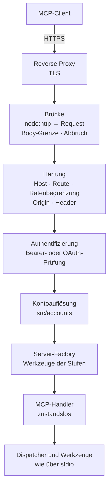

<!-- translated-from: docs/architecture/transports.md sha256:0904dc5f1af0 -->

# Transporte

Wie eine Anfrage über stdio und über Streamable HTTP zu den Werkzeugen gelangt, welche Routen der
HTTP-Server beantwortet und wie Werkzeuge in jedem Modus Dateien lesen und herausgeben. Die Seite
richtet sich an Mitwirkende und Reviewer; Betreiber beginnen mit [Fernzugriff](../remote.de.md).

## stdio und HTTP

- **stdio** (Standard): für lokale Clients wie Claude Desktop, Claude Code, Cursor oder VS Code.
- **Streamable HTTP** (`--http`, `src/http/`): für entfernte Clients wie benutzerdefinierte
  Connectoren in claude.ai. Der Server ist zum Selbstbetreiben gedacht; eine öffentliche gehostete
  Instanz gibt es nicht. Die Anleitung für Betreiber ist [Fernzugriff (HTTP)](../remote.de.md), die
  Entscheidungen sind [ADR 0006](../adr/0006-built-in-authorization-server-and-grant-store.de.md)
  und [ADR 0007](../adr/0007-approval-inbox-over-http.de.md).

## Zustandsloses MCP, eine Instanz

`POST /mcp` geht an `createMcpHandler(factory, {legacy: "stateless"})` des SDK: Jede Anfrage
bekommt eine frische Server-Instanz aus der Factory, es gibt keine MCP-Sitzung, und GET und DELETE
auf `/mcp` werden mit 405 beantwortet. Das Protokoll würde jede Instanz jede Anfrage bedienen
lassen, aber der Server unterstützt genau eine: Der Zugangsspeicher (mit einer Sperre auf seinem
Zustandsverzeichnis), ausstehende Freigaben, die Nonces und der Codec-Schlüssel der Bestätigungen
und die Ratenbegrenzungen leben im Prozess. Sie zu teilen bräuchte eine Datenbank, die der Entwurf
vermeidet.

## Authentifizierung

Der HTTP-Modus **startet nicht ohne sie**:

- `bearer`: ein gemeinsames Geheimnis (oder zwei während eines Wechsels), als HMACs in konstanter
  Zeit verglichen; der Server hält ein sevDesk-Token, es gibt also einen festen Kontokontext.
- `oauth`: Der Server ist sein eigener OAuth-2.1-Autorisierungsserver (`src/http/oauth/`): Clients,
  die sich über Client ID Metadata Documents (CIMD) aus einer Erlaubnisliste ausweisen, PKCE mit
  S256, eine genaue Prüfung der Zielgruppe nach RFC 8707, `iss` in der Autorisierungsantwort
  (RFC 9207), versiegelte Tokens (AES-256-GCM, Schlüssel je Zweck mit HKDF aus
  `SEVDESK_HTTP_SECRET` abgeleitet), rotierende Refresh-Tokens mit Erkennung erneuter Vorlage und
  ein Zugangsspeicher, der keine Tokens hält. Der Benutzer fügt sein sevDesk-Token einmal auf der
  Zustimmungsseite ein; es reist versiegelt in seinen eigenen Tokens.

## Weg einer Anfrage

Jede URL, die der Server ausgibt oder auf die er weiterleitet, wird aus der konfigurierten
öffentlichen Adresse (`SEVDESK_HTTP_PUBLIC_URL`) gebaut, nie aus `Host`- oder
`X-Forwarded-*`-Headern.

1. **Proxy.** TLS endet an einem Reverse Proxy, am Rand einer Plattform oder an einem Tunnel.
   `SEVDESK_HTTP_TRUST_PROXY` sagt, wie viele Einträge von `X-Forwarded-For` (von rechts) Proxys
   hinzugefügt haben; die Client-IP für Ratenbegrenzungen und Logs ist der nächste.
2. **Brücke** (`node-bridge.ts`, `serve.ts`): wandelt zwischen `node:http` und Web-`Request`/
   `Response` um, lehnt Bodys über der Grenze der Route mit 413 ab, bevor sie mehr liest (1 MiB an
   `/mcp`, 8 KiB an `/authorize`, 4 KiB an `/token` und `/revoke`), bricht das Signal der Anfrage
   ab, wenn der Client die Verbindung trennt, antwortet mit 408, wenn ein Body nicht rechtzeitig
   ankommt, und streamt Antworten ohne Pufferung, einen großen Block in Stücken von 64 KiB (ein
   Client, der eine Minute lang kein Stück abnimmt, wird getrennt). Zeitlimits des Servers: 15 s
   für die Header, 65 s Keep-alive und für eine ganze Anfrage das längste Body-Fenster aller Routen
   plus 30 s (45 s; 120 s mit der Upload-Seite, deren Body 90 s dauern darf); höchstens 256
   Verbindungen.
3. **Härtung** (`router.ts`, `hardening.ts`, `rate-limit.ts`): die Erlaubnisliste für `Host` (der
   Validator des SDK; `/healthz` ist für die Zustandsprüfungen von Plattformen ausgenommen), der
   Abgleich der Route (404, oder 405 mit `Allow` für andere Methoden), Ratenbegrenzungen per
   Token-Bucket je Client-Adresse (IPv6 je /64; 429 mit `Retry-After`), Grenzen für gleichzeitige
   Anfragen (64 insgesamt, 8 je Client-Adresse, 8 je sevDesk-Konto an `/mcp`, und 8 der 64 bleiben
   den Routen außer `/mcp` vorbehalten), eine Frist von 120 s, die `Origin`-Regel der Route
   (`/mcp`: der Validator des SDK, der Hostnamen mit den erlaubten Origins vergleicht; es gibt kein
   CORS, Webseiten auf anderen Origins können `/mcp` also nicht aufrufen; HTML-Formulare: nur POSTs
   vom selben Origin, nie `Origin: null`) und Sicherheits-Header an jeder Antwort (`nosniff`,
   `no-store, no-transform`, eine Referrer-Policy, HSTS über https). Eine JSON-Logzeile je
   Anfrage, geschwärzt (`log.ts`).
4. **Authentifizierung.** Bearer: `bearer.ts`. OAuth: `requireBearerAuth` des SDK mit unserer
   Prüfung, die das Access-Token öffnet, Typ, Issuer, Ablauf und Zielgruppe prüft, den Zugang im
   Speicher nachschlägt (sodass ein Widerruf sofort wirkt), sein Konto und seinen Client gegen die
   aktuellen Erlaubnislisten prüft und einen `VerifiedGrant` in `AuthInfo` legt. Fehlschläge
   werden mit 401 und `WWW-Authenticate` beantwortet (im OAuth-Modus mit Verweis auf die Metadaten
   der geschützten Ressource).
5. **Kontoauflösung** (`src/accounts/resolver.ts`): Bearer und stdio haben einen festen Kontext.
   OAuth bekommt je Konto eine eingefrorene `Config` mit den Stufen des Zugangs ∩ `SEVDESK_ALLOW`,
   ohne lokale Ordner und ohne Öffnen des Browsers, und einen sevDesk-Client, dessen Drosselung
   alle Kontexte des Kontos teilen. Kontexte werden zwischengespeichert (64, 15 Minuten ohne
   Nutzung).
6. **Server-Factory** (`src/server.ts`): registriert die Werkzeuge der Stufen des Kontexts mit
   dessen `Config` und Client. Von hier an läuft ein Aufruf genau wie über stdio
   ([Lebenszyklus eines Werkzeugaufrufs](../architecture.de.md#lebenszyklus-eines-werkzeugaufrufs)).

## Routen

| Route                                                                                        | Was                                                                   | Zugriff                                                |
| -------------------------------------------------------------------------------------------- | --------------------------------------------------------------------- | ------------------------------------------------------ |
| `POST /mcp`                                                                                  | MCP (Streamable HTTP, zustandslos)                                    | Bearer-Geheimnis oder OAuth-Access-Token               |
| `GET /healthz`                                                                               | `{"status":"ok"}`, 503 beim Herunterfahren                            | offen, keine Host-Prüfung                              |
| `GET /.well-known/oauth-protected-resource[/mcp]`, `/.well-known/oauth-authorization-server` | OAuth-Metadaten (404 im Bearer-Modus)                                 | offen, CORS `*`                                        |
| `GET`/`POST /authorize`                                                                      | Zustimmungsseite                                                      | CSRF-Cookie und -Token, POSTs vom selben Origin        |
| `POST /token`, `POST /revoke`                                                                | Austausch von Code und Refresh-Token, Widerruf (RFC 7009)             | PKCE, die Tokens selbst                                |
| `GET /approvals`, `GET`/`POST /approvals/<id>`                                               | Freigabe-Postfach (nur mit `SEVDESK_CONFIRM=browser`)                 | Sitzungs-Cookie, CSRF-Token, POSTs vom selben Origin   |
| `POST /approvals/login`, `POST /approvals/logout`                                            | Anmeldung im Browser (mit dem Postfach oder der Dateiübertragung)     | sevDesk-Token, CSRF-Token, POSTs vom selben Origin     |
| `GET`/`POST /uploads/<id>`                                                                   | Upload-Seite einer Upload-Anfrage (Dateiübertragung)                  | Sitzung des Kontos, dem der Eintrag gehört, CSRF-Token |
| `GET /files/<id>`                                                                            | Download-Link (Dateiübertragung), nur als Anhang                      | Sitzung des Kontos, dem der Eintrag gehört             |
| `GET /assets/<name>`                                                                         | Schriften und Icon der Seiten (immer, wenn der Server Seiten anzeigt) | offen, mit Ratenbegrenzung, unveränderlich             |

## Herunterfahren

Bei SIGTERM antwortet `/healthz` mit 503, laufende Anfragen bekommen 10 Sekunden, dann wird der
Zugangsspeicher geschrieben und seine Sperre freigegeben.

## Dateien

Werkzeuge bekommen Dateiinhalte und geben Dateien heraus über einen `FileAccess`
(`src/safety/file-access.ts`), den die Registry für jeden Aufruf aus der Konfiguration und dem
Prinzipal der Anfrage baut. Es gibt zwei Umsetzungen (`src/safety/file-sources.ts`):

- **Lokal** (stdio und HTTP mit ausgeschalteter Dateiübertragung): liest nur innerhalb von
  `SEVDESK_FILE_DIRS` (`src/safety/local-files.ts`: echte Pfade, kein Ausbruch über symbolische
  Links, `O_NOFOLLOW` plus eine Prüfung der Inode, Erkennung des Typs am Inhalt, Größengrenzen);
  Auslieferungen sind neue Dateien in `SEVDESK_OUTPUT_DIR` (`src/safety/output-files.ts`:
  exklusives Anlegen, Modus 0600, nie überschreibend).
- **Entfernt** (HTTP mit `SEVDESK_HTTP_FILES`, standardmäßig an): Ein Dateiargument darf ein
  Verweis `upload:<id>` aus `sevdesk_upload_request` sein, für den der Mensch die Datei auf einer
  Seite des Servers hochlädt; Auslieferungen werden zu kurzlebigen Download-Links. Beide Seiten
  brauchen eine Browser-Sitzung des Kontos, dem der Eintrag gehört (`src/http/browser-session.ts`,
  geteilt mit dem Freigabe-Postfach), sodass ein Link, den das Modell weitergibt, keine
  Berechtigung ist. Die Einträge leben in `src/safety/transfer-store.ts` (je Zugang und Konto, mit
  Grenzen je Konto und insgesamt, und nie wird etwas verdrängt); die Inhalte leben in
  `src/safety/blob-store.ts`, verschlüsselt mit einem Schlüssel, der je Prozess erzeugt wird, im
  Speicher oder im Zustandsverzeichnis, und nach einem Neustart weg. Die Seiten sind
  `src/http/transfer-routes.ts` und `transfer-pages.ts`. Der Bearer-Modus kann weiterhin lokale
  Ordner verwenden, und `SEVDESK_OUTPUT_DIR` hat, wenn gesetzt, Vorrang vor Download-Links.

In beiden ist ein Dateiargument, das wie eine URL beginnt, ein Link: `src/safety/url-files.ts` lädt
ihn während des Aufrufs von den Hosts in `SEVDESK_FILE_URL_HOSTS` herunter (standardmäßig keine),
löst den Host einmal und nur zu öffentlichen Adressen auf (`src/safety/public-address.ts`, geteilt
mit dem Abruf der Client-Metadaten im OAuth-Modus) und verbindet sich mit der geprüften Adresse
(`src/safety/pinned-https.ts`), folgt höchstens drei Weiterleitungen, die dieselben Prüfungen
bestehen, ohne Zugangsdaten und mit Größengrenze; nichts wird behalten
([Dateien von einem Link](../security/local.de.md#dateien-von-einem-link)).

Das Modell sieht und sendet nie Dateiinhalte, und es kann keinen Text auf die Upload-Seite setzen.
Einzelheiten für Betreiber, Grenzen und Laufzeiten stehen unter
[Dateien über HTTP](../remote/files.de.md); die Entscheidungen in
[ADR 0008](../adr/0008-file-transfer-over-http.de.md). Wie Werkzeuge auf diesem Weg gehalten
werden, steht im [Sicherheitsmodell](safety.de.md#dateien).
