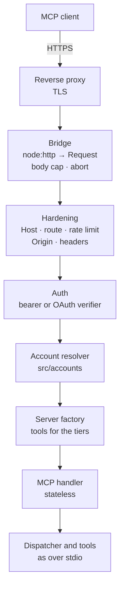

# Transports

How a request reaches the tools over stdio and over Streamable HTTP, which routes the HTTP server
answers, and how tools read and hand out files in each mode. It is for contributors and reviewers;
operators start with [Remote mode](../remote.md).

## stdio and HTTP

- **stdio** (default): for local clients such as Claude Desktop, Claude Code, Cursor or VS Code.
- **Streamable HTTP** (`--http`, `src/http/`): for remote clients such as claude.ai custom
  connectors. It is for self-hosting; there is no public hosted instance. The operator's guide is
  [remote.md](../remote.md), the decisions are
  [ADR 0006](../adr/0006-built-in-authorization-server-and-grant-store.md) and
  [ADR 0007](../adr/0007-approval-inbox-over-http.md).

## Stateless MCP, one instance

`POST /mcp` goes to the SDK's `createMcpHandler(factory, {legacy: "stateless"})`: every request
gets a fresh server instance from the factory, there is no MCP session, and GET and DELETE on
`/mcp` answer 405. The protocol would let any instance serve any request, but the server supports
exactly one: the grant store (with a lock on its state directory), pending approvals, the
confirmation nonces and codec key, and the rate limits live in the process. Sharing them would
need a database, which the design avoids.

## Authentication

The HTTP mode **refuses to start without it**:

- `bearer`: one shared secret (or two while rotating), compared as HMACs in constant time; the
  server holds one sevDesk token, so there is one fixed account context.
- `oauth`: the server is its own OAuth 2.1 authorization server (`src/http/oauth/`): clients
  identified by Client ID Metadata Documents (CIMD) from an allowlist, PKCE with S256, an exact
  RFC 8707 audience check, `iss` in the authorization response (RFC 9207), sealed tokens
  (AES-256-GCM, keys derived from `SEVDESK_HTTP_SECRET` per purpose with HKDF), rotating refresh
  tokens with replay detection, and a grant store that holds no tokens. The user pastes their
  sevDesk token once on the consent page; it travels sealed inside their own tokens.

## Request path

Every URL the server prints or redirects to is built from the configured public origin
(`SEVDESK_HTTP_PUBLIC_URL`), never from `Host` or `X-Forwarded-*` headers.

1. **Proxy.** TLS ends at a reverse proxy, a platform's edge or a tunnel.
   `SEVDESK_HTTP_TRUST_PROXY` says how many entries of `X-Forwarded-For` (from the right) were
   added by proxies; the client IP for rate limits and logs is the next one.
2. **Bridge** (`node-bridge.ts`, `serve.ts`): converts between `node:http` and Web
   `Request`/`Response`, refuses bodies over the route's cap with 413 before reading more (1 MiB
   on `/mcp`, 8 KiB on `/authorize`, 4 KiB on `/token` and `/revoke`), aborts the request's signal
   when the client disconnects, answers 408 when a body does not arrive in time, and streams
   responses without buffering, a large chunk in slices of 64 KiB (a client that takes no slice
   for a minute is dropped). Server timeouts: 15 s for headers, 65 s keep-alive, and for a whole
   request the longest body window of any route plus 30 s (45 s; 120 s with the upload page, whose
   body may take 90 s); at most 256 connections.
3. **Hardening** (`router.ts`, `hardening.ts`, `rate-limit.ts`): the `Host` allowlist (the SDK's
   validator; `/healthz` is exempt for platform health checks), the route match (404, or 405 with
   `Allow` for other methods), token-bucket rate limits per client address (IPv6 per /64; 429 with
   `Retry-After`), caps on requests in flight (64 in all, 8 per client address, 8 per sevDesk
   account on `/mcp`, and 8 of the 64 kept for the routes other than `/mcp`), a 120 s deadline,
   the route's `Origin` policy (`/mcp`: the SDK's validator, which compares host names against the
   allowed origins; there is no CORS, so web pages on other origins cannot call `/mcp`; HTML forms:
   same-origin POSTs only, never `Origin: null`), and security headers on every response
   (`nosniff`, `no-store, no-transform`, a referrer policy, HSTS on https). One JSON log line per
   request, redacted (`log.ts`).
4. **Auth.** Bearer: `bearer.ts`. OAuth: the SDK's `requireBearerAuth` with our verifier, which
   opens the access token, checks type, issuer, expiry and audience, looks the grant up in the
   store (so revocation is immediate), checks its account and client against the current
   allowlists and puts a `VerifiedGrant` into `AuthInfo`. Failures answer 401 with
   `WWW-Authenticate` (in OAuth mode pointing to the protected resource metadata).
5. **Account resolver** (`src/accounts/resolver.ts`): bearer and stdio have one fixed context.
   OAuth gets a frozen `Config` per account with the tiers of the grant ∩ `SEVDESK_ALLOW`, no
   local folders and no browser opening, and a sevDesk client whose pacing is shared by all
   contexts of the account. Contexts are cached (64, 15 minutes idle).
6. **Server factory** (`src/server.ts`): registers the tools of the context's tiers with the
   context's `Config` and client. From here on a call runs exactly as over stdio
   ([Lifecycle of a tool call](../architecture.md#lifecycle-of-a-tool-call)).

## Routes

| Route                                                                                        | What                                                              | Access                                        |
| -------------------------------------------------------------------------------------------- | ----------------------------------------------------------------- | --------------------------------------------- |
| `POST /mcp`                                                                                  | MCP (Streamable HTTP, stateless)                                  | bearer secret or OAuth access token           |
| `GET /healthz`                                                                               | `{"status":"ok"}`, 503 while shutting down                        | open, no Host check                           |
| `GET /.well-known/oauth-protected-resource[/mcp]`, `/.well-known/oauth-authorization-server` | OAuth metadata (404 in bearer mode)                               | open, CORS `*`                                |
| `GET`/`POST /authorize`                                                                      | consent page                                                      | CSRF cookie and token, same-origin POSTs      |
| `POST /token`, `POST /revoke`                                                                | code and refresh exchange, revocation (RFC 7009)                  | PKCE, the tokens themselves                   |
| `GET /approvals`, `GET`/`POST /approvals/<id>`                                               | approval inbox (only with `SEVDESK_CONFIRM=browser`)              | session cookie, CSRF token, same-origin POSTs |
| `POST /approvals/login`, `POST /approvals/logout`                                            | browser sign-in (with the inbox or file transfer)                 | sevDesk token, CSRF token, same-origin POSTs  |
| `GET`/`POST /uploads/<id>`                                                                   | upload page of an upload request (file transfer)                  | session of the record's account, CSRF token   |
| `GET /files/<id>`                                                                            | download link (file transfer), attachment only                    | session of the record's account               |
| `GET /assets/<name>`                                                                         | fonts and the icon of the pages (whenever the server shows pages) | open, rate-limited, immutable                 |

## Shutdown

On SIGTERM `/healthz` answers 503, running requests get 10 seconds, then the grant store is written
and its lock released.

## Files

Tools get file bytes and hand files out through a `FileAccess` (`src/safety/file-access.ts`) that
the registry builds for every call from the configuration and the request's principal. There are
two implementations (`src/safety/file-sources.ts`):

- **Local** (stdio, and HTTP with file transfer off): reads only inside `SEVDESK_FILE_DIRS`
  (`src/safety/local-files.ts`: real paths, no symlink escapes, `O_NOFOLLOW` plus an inode check,
  content sniffing, size caps); deliveries are new files in `SEVDESK_OUTPUT_DIR`
  (`src/safety/output-files.ts`: exclusive creation, mode 0600, never overwriting).
- **Remote** (HTTP with `SEVDESK_HTTP_FILES`, on by default): a file argument may be an
  `upload:<id>` reference from `sevdesk_upload_request`, for which the human uploads the file on
  a page of the server; deliveries become short-lived download links. Both pages need a browser
  session of the record's account (`src/http/browser-session.ts`, shared with the approval
  inbox), so a link the model passes on is not a capability. The records live in
  `src/safety/transfer-store.ts` (per grant and account, with limits per account and overall, and
  nothing ever evicted); the bytes live in `src/safety/blob-store.ts`, encrypted with a key drawn
  per process, in memory or in the state directory, and gone after a restart. The pages are
  `src/http/transfer-routes.ts` and `transfer-pages.ts`. Bearer mode can still use local folders,
  and `SEVDESK_OUTPUT_DIR`, when set, wins over download links.

The model never sees or sends file bytes, and it cannot put text on the upload page. Operator
details, limits and lifetimes are in [Files over HTTP](../remote/files.md); the decisions are in
[ADR 0008](../adr/0008-file-transfer-over-http.md). How tools are kept to this path is in
[Safety model](safety.md#files).
