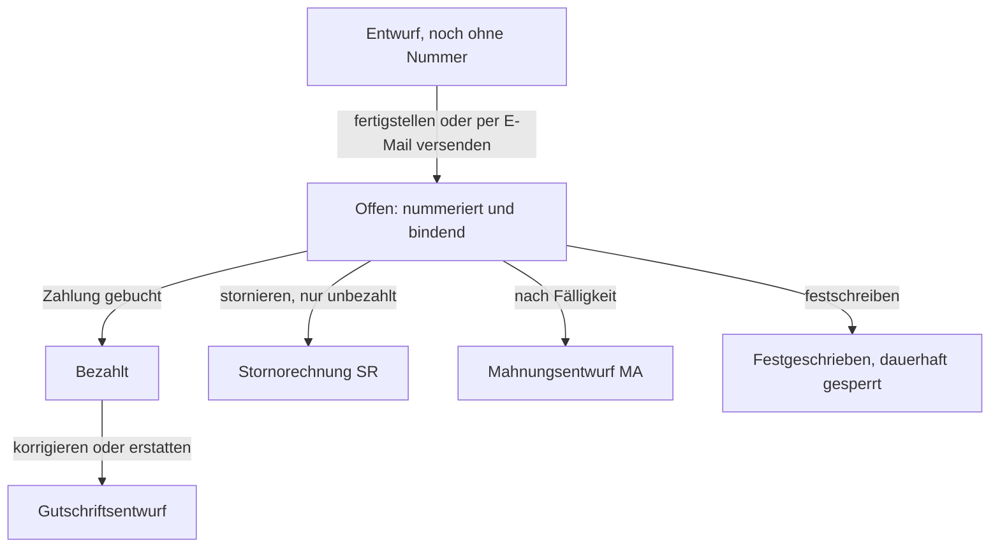

<!-- translated-from: docs/guides/invoices.md sha256:5116eed024ed -->

# Rechnungen: vom Entwurf bis zur Zahlung

Diese Anleitung begleitet eine Ausgangsrechnung mit dem Assistenten durch sevDesk: Entwurf,
Prüfung, Fertigstellen, Versand, Zahlung buchen, Mahnung und Korrektur. Sie ist für alle, die ihren
Kunden Rechnungen stellen. Zu jedem Schritt steht, was du fragst, welches Werkzeug läuft, welche
[Stufe](../permissions.de.md#stufen) es braucht und ob du es bestätigst.

## Überblick

| Schritt                                     | Werkzeug                                                                                                                                                         | Stufe             | Bestätigung    |
| ------------------------------------------- | ---------------------------------------------------------------------------------------------------------------------------------------------------------------- | ----------------- | -------------- |
| [Kunden finden](#bevor-du-beginnst)         | [`sevdesk_contacts_search`](../tools.md#sevdesk_contacts_search)                                                                                                 | `read`            | nein           |
| [Entwurf anlegen](#einen-entwurf-anlegen)   | [`sevdesk_invoice_create_draft`](../tools.md#sevdesk_invoice_create_draft), [`sevdesk_invoice_create_from_order`](../tools.md#sevdesk_invoice_create_from_order) | `write`           | nein           |
| [Prüfen](#den-entwurf-prüfen)               | [`sevdesk_invoice_get`](../tools.md#sevdesk_invoice_get), [`sevdesk_invoice_pdf`](../tools.md#sevdesk_invoice_pdf)                                               | `read`            | nein           |
| [Ändern](#den-entwurf-prüfen)               | [`sevdesk_invoice_update_draft`](../tools.md#sevdesk_invoice_update_draft)                                                                                       | `write`           | nein           |
| [Fertigstellen](#fertigstellen)             | [`sevdesk_invoice_finalize`](../tools.md#sevdesk_invoice_finalize)                                                                                               | `commit`          | **ja**         |
| [Per E-Mail versenden](#versenden)          | [`sevdesk_invoice_send_email`](../tools.md#sevdesk_invoice_send_email)                                                                                           | `external`        | **ja**         |
| [Zahlung buchen](#die-zahlung-buchen)       | [`sevdesk_invoice_book_payment`](../tools.md#sevdesk_invoice_book_payment)                                                                                       | `commit`          | **ja**         |
| [Mahnen](#säumige-kunden-mahnen)            | [`sevdesk_invoice_create_reminder`](../tools.md#sevdesk_invoice_create_reminder)                                                                                 | `write`           | nein           |
| [Korrigieren](#stornieren-oder-korrigieren) | [`sevdesk_invoice_cancel`](../tools.md#sevdesk_invoice_cancel), [`sevdesk_credit_note_create_from_invoice`](../tools.md#sevdesk_credit_note_create_from_invoice) | `commit`, `write` | Storno: **ja** |
| [Festschreiben](#festschreiben)             | [`sevdesk_invoice_enshrine`](../tools.md#sevdesk_invoice_enshrine)                                                                                               | `commit`          | **ja**         |

## Bevor du beginnst

- **Stufen.** Entwürfe brauchen `write`; Fertigstellen, Zahlungen, Stornieren und Festschreiben
  brauchen `commit`; E-Mail braucht `external`. Du setzt sie mit `SEVDESK_ALLOW`
  ([Berechtigungen](../permissions.de.md#stufen)).
- **Bestätigungen.** Bei Aufrufen der Stufen `commit` und `external` siehst du zuerst eine
  Vorschau. Prüf, ob dein Client sie anzeigen kann
  ([Clients](../clients.de.md#bestätigung-je-client)).
- **Probeläufe.** Jeder Schritt, der etwas ändert, kann zuerst als
  [Probelauf](../permissions.de.md#probelauf) laufen. Frag danach, wann immer du das Ergebnis sehen
  willst, bevor es gespeichert wird.
- **Der Kunde.** Der Assistent sucht den Kontakt über den Namen oder die Kundennummer. Gibt es
  keinen, kann er mit [`sevdesk_contact_create`](../tools.md#sevdesk_contact_create) (`write`)
  einen anlegen; das Werkzeug prüft vorher auf Dubletten.

> Such den Kunden Musterfirma GmbH und zeig mir seine Rechnungsadresse.

## Einen Entwurf anlegen

### Ohne Vorlage

> Erstell einen Rechnungsentwurf für die Musterfirma GmbH: 8 Stunden Beratung zu 95 € netto pro Stunde, zahlbar innerhalb von 14 Tagen.

[`sevdesk_invoice_create_draft`](../tools.md#sevdesk_invoice_create_draft) (`write`, ohne
Bestätigung) speichert einen Entwurf mit seinen Positionen. Nichts wird versendet, und noch gibt es
keine Rechnungsnummer; die vergibt sevDesk beim Fertigstellen. Wenn du nichts anderes sagst,
verwendet der Entwurf das heutige Datum als Rechnungs- und Lieferdatum, Nettopreise, EUR, die
Rechnungsadresse des Kontakts und die Steuerregel, die zu deinem Konto passt: 1 für die reguläre
Umsatzsteuer (Steuersätze 0, 7 und 19 %), 11 für Kleinunternehmer (0 %). Eine Steuerregel oder ein
Steuersatz, der nicht zum Konto passt, wird abgelehnt, bevor etwas gespeichert wird, und die
Vorschau warnt vor einer möglichen Dublette. Hat das Konto mehrere sevDesk-Benutzer, muss der
Assistent einen als Ansprechpartner angeben.

> Welche Steuerregel nimmt eine Rechnung über Beratung an die Wiener Muster GmbH in Wien?

Für Kunden im Ausland oder einen Verkauf, der kein einfacher Inlandsumsatz ist, schlägt
[`sevdesk_tax_rule_suggest`](../tools.md#sevdesk_tax_rule_suggest) (`read`) die Steuerregel vor:
aus dem Land des Kunden, ob er als Unternehmer kauft, seiner USt-IdNr. und ob du Waren lieferst
oder Leistungen erbringst. Es nennt die Regel, den Steuersatz (bei One-Stop-Shop-Umsätzen den
Regelsteuersatz des Kundenlandes), den Hinweis, den die Rechnung tragen muss (etwa
„Steuerschuldnerschaft des Leistungsempfängers“), und die Rechtsgrundlage. Entscheidet eine
Schwelle oder eine besondere Art von Leistung, nennt es jede Möglichkeit mit ihrer Bedingung,
statt zu raten. Nordirland folgt bei Waren den Regeln der EU (gib das Land `XI` oder die
XI-USt-IdNr. des Kunden an), Monaco gilt als Frankreich, und Gebiete von Mitgliedstaaten außerhalb
des Mehrwertsteuergebiets der EU, etwa die Kanarischen Inseln, kommen als Ausnahmen (Helgoland und
Büsingen, bei einem Kunden in Deutschland, als Hinweis). Es ist keine Steuerberatung.
[`sevdesk_vat_id_check`](../tools.md#sevdesk_vat_id_check) (`read`) prüft das Format einer
USt-IdNr.; beim VIES-Dienst der Europäischen Kommission fragt es nur nach, wenn der Betreiber des
Servers das eingeschaltet hat (`SEVDESK_VIES_CHECK`, siehe [Datenschutz](../../PRIVACY.de.md)).
Auch die Vorschau des Entwurfs warnt, wenn die Steuerregel nicht die übliche für den Kunden ist;
deshalb abgelehnt wird der Entwurf nie.

Eine Position kann einen Artikel aus [`sevdesk_parts_list`](../tools.md#sevdesk_parts_list)
verknüpfen, Bezeichnung und Preis kommen aber trotzdem aus der Position.

### Ein Rabatt auf die ganze Rechnung

> Gib der Musterfirma 3 % Rabatt auf die ganze Rechnung.

Neben dem Rabatt je Position kann ein Entwurf einen Rabatt auf den Gesamtbetrag tragen: einen
Prozentsatz vom Nettobetrag oder einen festen Nettobetrag in EUR, mit dem Text, der daneben
gedruckt wird („Rabatt“, wenn du keinen anderen nennst). Die Vorschau zeigt ihn und die Summe, die
sich daraus ergibt; das Ergebnis zeigt, was sevDesk abgezogen hat. Angebote, Auftragsbestätigungen
und Gutschriften nehmen denselben Rabatt. Vorerst setzt der Server ihn nur bei Nettopreisen mit
einem einzigen Steuersatz und nicht auf einer E-Rechnung: Wie sevDesk die anderen Fälle behandelt,
ist noch nicht geprüft, und die Werkzeuge sagen das, statt zu raten. Ändert der Assistent den
Entwurf später, bleibt der Rabatt, solange du ihn nicht ersetzt oder entfernst. Ein Dokument mit
mehreren Rabatten (sevDesk rechnet dann nur einen davon in die Summen ein) bleibt der Web-App von
sevDesk überlassen; die Abfragewerkzeuge und die Freigabe weisen darauf hin.

### Eine englische Rechnung auf anderem Briefpapier

> Stell die Rechnung an die Musterfirma auf Englisch und auf unser zweites Briefpapier um.

[`sevdesk_document_set_layout`](../tools.md#sevdesk_document_set_layout) (`commit`, **du
bestätigst**) setzt Sprache, Vorlage oder Briefpapier eines Entwurfs: Rechnung, Angebot,
Auftragsbestätigung, Lieferschein oder Gutschrift. Sprachen: Deutsch (Deutschland, Österreich,
Schweiz), Englisch, Spanisch, Französisch, Italienisch und Griechisch, als `de_DE`, `de_AT`,
`de_CH`, `en_US`, `es_ES`, `fr_FR`, `it_IT`, `el_GR`. Vorlagen und Briefpapiere nennst du mit ID
oder Namen; [`sevdesk_reference_lookup`](../tools.md#sevdesk_reference_lookup) listet sie (`kind`
`templates` mit `documentType`, `letterpapers`). Die Vorschau zeigt die bisherige und die neue
Auswahl; eine Sprache, Vorlage oder ein Briefpapier, das sevDesk für das Dokument nicht anbietet,
lehnt der Server ab, bevor etwas gesendet wird. Jede Auswahl geht einzeln an sevDesk, und das
Ergebnis nennt, was sevDesk gespeichert hat. Die übrigen Druckoptionen (etwa ein QR-Code zur
Zahlung oder Falzmarken) bleiben, wie sie sind.

Es fragt dich, obwohl es nur Entwürfe ändert, weil der Endpunkt von sevDesk dafür auch ein schon
versendetes Dokument ändern würde; der Server hält ihn deshalb auf der Stufe `commit`. Die
Freigaben zum Fertigstellen und Versenden zeigen das Layout noch einmal.

Kopf- und Fußtexte können aus deinen Textvorlagen kommen: Nenn eine als `headTextTemplate` oder
`footTextTemplate` der Entwurfswerkzeuge. Rechnungen nehmen die Vorlagen für Rechnungen;
Angebote, Auftragsbestätigungen und Lieferscheine die für Angebote (andere hält sevDesk für
Aufträge nicht vor); für Gutschriften gibt es das noch nicht.

> Nimm für die Rechnung unsere englische Fußtext-Vorlage.

### Angebote: annehmen, bestätigen, liefern

Bevor ein Angebot abgerechnet wird, kann der Assistent die Antwort des Kunden festhalten und die
Dokumente anlegen, die darauf folgen:

> Die Musterfirma hat das Angebot AN-1042 telefonisch angenommen. Markier es als angenommen.

> Das Angebot AN-1043 haben sie abgelehnt.

[`sevdesk_order_set_offer_status`](../tools.md#sevdesk_order_set_offer_status) (`commit`, **du
bestätigst**) markiert ein versendetes Angebot als angenommen oder abgelehnt oder setzt ein
angenommenes oder abgelehntes Angebot wieder auf versendet (`reopen`). Es ändert nur den Status und
sendet dem Kunden nichts. Angebotsentwürfe verweigert das Werkzeug (versende sie zuerst: sevDesk
würde einen Entwurf neu nummerieren), ebenso Auftragsbestätigungen und Lieferscheine.

> Erstell die Auftragsbestätigung zu AN-1042.

[`sevdesk_order_create_confirmation`](../tools.md#sevdesk_order_create_confirmation) (`commit`,
**du bestätigst**) legt einen Entwurf einer Auftragsbestätigung (AB) mit Kontakt, Texten und
Positionen des Angebots an; die Vorschau führt sie auf. sevDesk markiert das Angebot dabei als
angenommen, deshalb bestätigst du diesen Schritt. Es arbeitet nur mit versendeten und angenommenen
Angeboten: Einen Entwurf verweigert es (er würde ein Angebot annehmen, das der Kunde nie bekommen
hat), und ein abgelehntes Angebot muss zuerst wieder geöffnet werden. So ist aus einer Ablehnung
eine Annahme zu machen immer ein eigener Schritt.

> Erstell einen Lieferschein zu AB-1007.

[`sevdesk_order_create_delivery_note`](../tools.md#sevdesk_order_create_delivery_note) (`write`,
ohne Bestätigung) legt einen Lieferschein-Entwurf (LI) aus einer Auftragsbestätigung (Entwurf,
versendet oder angenommen) oder aus einem versendeten oder angenommenen Angebot an und lässt die
Vorlage unverändert. Angebotsentwürfe und abgelehnte Angebote verweigert es.

Das Werkzeug für Auftragsbestätigungen verweigert eine zweite aus demselben Angebot, außer du willst
ausdrücklich eine. Das Werkzeug für Lieferscheine verweigert nur, solange ein früherer Lieferschein
aus demselben Auftrag noch ein Entwurf ist, denn ein weiterer Lieferschein kann eine Teillieferung
sein; fertiggestellte nennt seine Vorschau. Fertiggestellt wird der neue Entwurf mit
[`sevdesk_order_finalize`](../tools.md#sevdesk_order_finalize). Beide Vorschauen führen auch Rabatte
und Aufschläge auf das ganze Dokument der Vorlage auf; ob sevDesk sie übernimmt, ist nicht geprüft,
also vergleiche die Summen des neuen Entwurfs, bevor du ihn fertigstellst. sevDesk gibt dem neuen
Dokument die nächste Nummer seines Nummernkreises, ohne den Zähler weiterzuschalten; es kann also
eine Nummer tragen, die eine andere Auftragsbestätigung oder ein anderer Lieferschein schon hat. Das
Ergebnis nennt solche, die es findet. Offene Angebote findest du mit einer Frage nach versendeten
Angeboten in einem Zeitraum ([`sevdesk_orders_list`](../tools.md#sevdesk_orders_list)). Der Prompt
[`offer_follow_up`](../tools.md#offer_follow_up) macht das für Angebote, die älter als eine Zahl von
Tagen sind (standardmäßig 14), und geht jedes mit dir durch: angenommen oder abgelehnt, die
Auftragsbestätigung, der Lieferschein, die Rechnung oder eine Nachfrage, die du selbst schickst.

### Aus einem Angebot oder einer Auftragsbestätigung

> Mach aus dem Angebot AN-1042 eine Rechnung.

> Erstell eine Abschlagsrechnung über 30 % zur Auftragsbestätigung AB-1007.

[`sevdesk_invoice_create_from_order`](../tools.md#sevdesk_invoice_create_from_order) (`write`, ohne
Bestätigung) übernimmt die Positionen eines Angebots oder einer Auftragsbestätigung: den ganzen
Auftrag, eine Teilrechnung oder eine Abschlagsrechnung über einen Prozentsatz oder einen Betrag,
netto oder brutto. Der Auftrag muss versendet, angenommen oder teilweise abgerechnet sein; Teil- und
Abschlagsrechnungen brauchen Steuerregel 1 oder 11. sevDesk übernimmt auch den Rabatt auf den
Gesamtbetrag des Auftrags; die Vorschau zeigt ihn, das Ergebnis den der Rechnung. Gibt es schon
einen Entwurf aus demselben Auftrag, lehnt das Werkzeug ab, außer du willst ausdrücklich einen
zweiten. Angebote selbst
entstehen mit [`sevdesk_order_create_draft`](../tools.md#sevdesk_order_create_draft).

## Den Entwurf prüfen

> Zeig mir den Rechnungsentwurf für die Musterfirma mit allen Positionen und der Summe.

> Öffne das PDF zu diesem Entwurf.

[`sevdesk_invoice_get`](../tools.md#sevdesk_invoice_get) liefert Positionen, einen Rabatt auf den
Gesamtbetrag, Summen, Steuerregel, Adresse und Zahlungsbedingungen;
[`sevdesk_invoice_pdf`](../tools.md#sevdesk_invoice_pdf) liefert
das PDF als Vorschau, die die Rechnung nie als versendet markiert. Beide sind `read`. Um eine Kopie
auf der Festplatte zu behalten, schreibt
[`sevdesk_document_save`](../tools.md#sevdesk_document_save) sie nach `SEVDESK_OUTPUT_DIR`
([Konfiguration](../configuration.de.md)).

> Setz das Zahlungsziel auf 30 Tage und ergänze eine Position Reisekosten über 120 € netto.

[`sevdesk_invoice_update_draft`](../tools.md#sevdesk_invoice_update_draft) (`write`, ohne
Bestätigung) ändert nur die Felder, die du nennst. Neue Positionen ersetzen alle gespeicherten,
deshalb übergibt der Assistent die vollständige Liste. Ein neuer Rabatt ersetzt den gespeicherten,
und „entferne den Rabatt“ löscht ihn. Nur Entwürfe lassen sich ändern.

### Bereit für die E-Rechnung

> Kann diese Rechnung als XRechnung rausgehen? Prüf, was noch fehlt.

[`sevdesk_invoice_einvoice_preflight`](../tools.md#sevdesk_invoice_einvoice_preflight) (`read`)
prüft deine Firmendaten, den Kunden (Adresse, E-Mail, Leitweg-ID bei öffentlichen Auftraggebern,
USt-IdNr., wo die Steuerregel sie verlangt), das Lieferdatum, die Zahlungsbedingungen, die
Einheiten und die Steuerregel und nennt zu jedem Problem das Werkzeug, das es behebt. Bei einer
fertiggestellten Rechnung prüft es auch das XML, das sevDesk erzeugt hat.

> [!NOTE]
> Der Server kann eine Rechnung nicht in eine E-Rechnung umwandeln. sevDesk erzeugt XRechnung und
> ZUGFeRD nur für Rechnungen, die in der sevDesk-Web-App als E-Rechnung angelegt wurden; die
> Prüfung sagt es, wenn das fehlt.

## Fertigstellen

> Stell die Rechnung an die Musterfirma fertig; das PDF verschicke ich selbst.

[`sevdesk_invoice_finalize`](../tools.md#sevdesk_invoice_finalize) (`commit`, **du bestätigst**)
macht aus dem Entwurf eine offene Rechnung: sevDesk vergibt die endgültige Nummer, bucht sie und
markiert sie als versendet. Beim Kunden kommt nichts an; das Werkzeug hält nur fest, wie du sie
versendest (standardmäßig PDF-Download, sonst Post, Druck oder E-Mail außerhalb von sevDesk). Bevor
du freigibst, zeigt die Vorschau, was in der Rechnung steht, so wie sevDesk sie speichert: Adresse,
Kopf- und Fußtext, jede Position, einen Rabatt auf den Gesamtbetrag, Bedingungen und Daten sowie
Sprache, Vorlage und Briefpapier. Ändert sich davon etwas, während du entscheidest, wirst du
erneut gefragt.

> [!WARNING]
> Mit dem Fertigstellen wird die Rechnung unter ihrer Nummer rechtlich bindend. Danach lässt sie
> sich nur noch auf Entwurf zurücksetzen, solange sie keine Zahlungen hat und nicht festgeschrieben
> ist, und eine Rechnung, die der Kunde schon erhalten hat, stornierst du besser oder korrigierst
> sie mit einer Gutschrift.

## Versenden

> Schick die Rechnung per E-Mail an buchhaltung@musterfirma.de, mit einem kurzen Dankeschön.

[`sevdesk_invoice_send_email`](../tools.md#sevdesk_invoice_send_email) (`external`, **du
bestätigst**) lässt sevDesk das PDF an einen Empfänger senden, mit bis zu 10 Empfängern in CC und 10
in BCC, und markiert die Rechnung als versendet. Die Vorschau zeigt jeden Empfänger, den Betreff und
den vollständigen Text. Ein Entwurf wird durch das Versenden fertiggestellt; dafür braucht es
zusätzlich die Stufe `commit`. Bei einer E-Rechnung kann der Assistent statt des PDFs das XML
anhängen.

> [!WARNING]
> Eine E-Mail lässt sich nicht zurückholen. Prüf Empfänger und Text in der Vorschau, bevor du
> freigibst.

Willst du sie auf deinem eigenen Weg versenden, nimm das PDF
([`sevdesk_invoice_pdf`](../tools.md#sevdesk_invoice_pdf)) oder bei einer E-Rechnung das XML
([`sevdesk_invoice_xml`](../tools.md#sevdesk_invoice_xml)) und stell die Rechnung mit der passenden
Versandart fertig. Briefe per Post versendet der Server nicht.

## Die Zahlung buchen

> Die Musterfirma hat RE-1001 gestern bezahlt; buch das auf dem Geschäftskonto.

> RE-1003 wurde mit 2 % Skonto bezahlt. Buch die Zahlung und schreib den Rest ab.

[`sevdesk_invoice_book_payment`](../tools.md#sevdesk_invoice_book_payment) (`commit`, **du
bestätigst**) bucht einen Bruttobetrag auf ein Zahlungskonto. Bei einem Konto, dessen Umsätze per
Bankimport kommen, verknüpft der Assistent den importierten Umsatz, damit die Zahlung nicht doppelt
zählt. Mehr als den offenen Betrag lehnt das Werkzeug ab, außer der Mehrbetrag ist eine Mahngebühr
oder eine andere gewollte Differenz; Skonto und Bankgebühren gleichen die Rechnung mit weniger aus.
Eine falsche Buchung machst du mit [`sevdesk_invoice_reset`](../tools.md#sevdesk_invoice_reset) auf
`open` rückgängig (`commit`, du bestätigst).

Viele Zahlungen gehen von der Bankseite aus leichter: Der Prompt
[`bank_reconciliation`](../tools.md#bank_reconciliation) ordnet nicht gebuchte Kontoumsätze mit
[`sevdesk_reconcile_suggest`](../tools.md#sevdesk_reconcile_suggest) offenen Rechnungen zu und bucht
jede Zuordnung, der du zustimmst, mit [`sevdesk_transaction_book`](../tools.md#sevdesk_transaction_book)
(`commit`).

## Säumige Kunden mahnen

> Welche Rechnungen sind überfällig, und seit wie vielen Tagen?

> Bereite Mahnungen für alle Rechnungen vor, die mehr als 14 Tage überfällig sind.

[`sevdesk_invoices_list`](../tools.md#sevdesk_invoices_list) mit `overdueOnly` und
[`sevdesk_receivables_aging`](../tools.md#sevdesk_receivables_aging) finden sie (`read`).
[`sevdesk_invoice_create_reminder`](../tools.md#sevdesk_invoice_create_reminder) (`write`, ohne
Bestätigung) legt einen Mahnungsentwurf an (Mahnung, Typ MA), für eine offene oder teilweise bezahlte
Rechnung nach ihrer Fälligkeit, und lehnt eine zweite noch nicht versendete Mahnung ab. Unter Update
2.0 setzt es keine Mahngebühr an. Die Mahnung wird dann wie eine Rechnung fertiggestellt (`commit`)
oder per E-Mail versendet (`external`), jeweils mit deiner Bestätigung. Der Prompt
[`dunning_run`](../tools.md#dunning_run) führt durch den ganzen Mahnlauf und schließt vorher
Zahlungen aus, die noch nicht gebucht sind.

## Stornieren oder korrigieren

> Storniere die Rechnung RE-1004, sie ging an den falschen Kunden.

[`sevdesk_invoice_cancel`](../tools.md#sevdesk_invoice_cancel) (`commit`, **du bestätigst**) lässt
sevDesk eine Stornorechnung (Typ SR) mit negativen Beträgen erstellen, die das Original ausgleicht;
beide bleiben in den Büchern. Stornieren lassen sich nur offene, unbezahlte Rechnungen. Die
Stornorechnung schickst du dem Kunden mit `sevdesk_invoice_send_email`.

> [!WARNING]
> Ein Storno lässt sich nicht rückgängig machen.

> Die Musterfirma hat RE-1002 schon bezahlt, aber eine Position war falsch. Erstell dafür eine Gutschrift.

Für eine bezahlte oder teilweise bezahlte Rechnung legt
[`sevdesk_credit_note_create_from_invoice`](../tools.md#sevdesk_credit_note_create_from_invoice)
(`write`, ohne Bestätigung) einen Gutschriftsentwurf mit allen ihren Positionen an.

> Lass in dieser Gutschrift nur die falsche Position stehen und schreib dafür 40 EUR netto gut.

[`sevdesk_credit_note_update_draft`](../tools.md#sevdesk_credit_note_update_draft) (`write`, ohne
Bestätigung) passt den Entwurf so an, wie du eine Rechnung änderst: Er ändert nur die Felder, die du
nennst, und neue Positionen ersetzen alle gespeicherten. Die Gutschrift behält ihre Nummer und die
Rechnung, die sie mindert; ihre Positionen dürfen nur die Steuersätze dieser Rechnung haben, und
Kontakt und Währung bleiben die der Rechnung. Ändern lassen sich nur Entwürfe. Fertiggestellt wird
die Gutschrift mit
[`sevdesk_credit_note_finalize`](../tools.md#sevdesk_credit_note_finalize) oder per E-Mail versendet
mit [`sevdesk_credit_note_send_email`](../tools.md#sevdesk_credit_note_send_email), und eine
Erstattung buchst du mit
[`sevdesk_credit_note_book_payment`](../tools.md#sevdesk_credit_note_book_payment), jeweils mit
deiner Bestätigung.

## Festschreiben

> Schreib alle Rechnungen aus Oktober fest; die Umsatzsteuer-Voranmeldung ist abgegeben.

[`sevdesk_invoice_enshrine`](../tools.md#sevdesk_invoice_enshrine) (`commit`, **du bestätigst**)
schreibt eine fertiggestellte Rechnung dauerhaft fest (GoBD); mehrere Rechnungen bedeuten also eine
Bestätigung je Rechnung. Zahlungen lassen sich danach noch buchen, aber die Rechnung lässt sich nie
wieder ändern, zurücksetzen oder löschen; Korrekturen brauchen dann ein Storno oder eine Gutschrift.
Wann du festschreibst, klärst du mit deiner Steuerberatung.

> [!WARNING]
> Die Festschreibung ist endgültig. Die Vorschau warnt ausdrücklich davor; gib sie nur für
> Rechnungen frei, bei denen du dir sicher bist.

## Siehe auch

- [Belege und Eingangsrechnungen](receipts.de.md): die andere Richtung, Lieferantenrechnungen und
  Quittungen.
- [Auswertungen und Exporte](evaluations.de.md): offene Forderungen, die Umsatzsteuer-Auswertung,
  der DATEV-Export.
- [Glossar](../glossary.de.md): Begriffe wie Rechnung, Storno und Mahnung mit ihren englischen
  Entsprechungen in den Werkzeugen.
