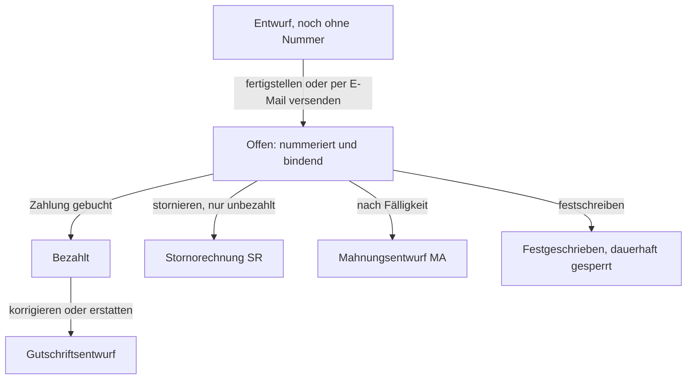

<!-- translated-from: docs/guides/invoices.md sha256:a89cc9bc2e8d -->

# Rechnungen: vom Entwurf bis zur Zahlung

Diese Anleitung begleitet eine Ausgangsrechnung mit dem Assistenten durch sevDesk: Entwurf,
Prüfung, Fertigstellen, Versand, Zahlung buchen, Mahnung und Korrektur. Sie ist für alle, die ihren
Kunden Rechnungen stellen. Zu jedem Schritt steht, was du fragst, welches Werkzeug läuft, welche
[Stufe](../permissions.de.md#stufen) es braucht und ob du es bestätigst.

## Überblick

| Schritt                                     | Werkzeug                                                                                                                                                                 | Stufe             | Bestätigung    |
| ------------------------------------------- | ------------------------------------------------------------------------------------------------------------------------------------------------------------------------ | ----------------- | -------------- |
| [Kunden finden](#bevor-du-beginnst)         | [`sevdesk_contacts_search`](../tools.md#sevdesk_contacts_search)                                                                                                         | `read`            | nein           |
| [Entwurf anlegen](#einen-entwurf-anlegen)   | [`sevdesk_invoice_create_draft`](../tools.md#sevdesk_invoice_create_draft), [`sevdesk_invoice_create_from_order`](../tools.md#sevdesk_invoice_create_from_order)         | `write`           | nein           |
| [Prüfen](#den-entwurf-prüfen)               | [`sevdesk_invoice_get`](../tools.md#sevdesk_invoice_get), [`sevdesk_invoice_pdf`](../tools.md#sevdesk_invoice_pdf)                                                       | `read`            | nein           |
| [Ändern](#den-entwurf-prüfen)               | [`sevdesk_invoice_update_draft`](../tools.md#sevdesk_invoice_update_draft)                                                                                               | `write`           | nein           |
| [Löschen](#einen-entwurf-löschen)           | [`sevdesk_document_delete_draft`](../tools.md#sevdesk_document_delete_draft)                                                                                             | `commit`          | **ja**         |
| [Fertigstellen](#fertigstellen)             | [`sevdesk_invoice_finalize`](../tools.md#sevdesk_invoice_finalize)                                                                                                       | `commit`          | **ja**         |
| [Per E-Mail versenden](#versenden)          | [`sevdesk_invoice_send_email`](../tools.md#sevdesk_invoice_send_email)                                                                                                   | `external`        | **ja**         |
| [Zahlung buchen](#die-zahlung-buchen)       | [`sevdesk_invoice_book_payment`](../tools.md#sevdesk_invoice_book_payment)                                                                                               | `commit`          | **ja**         |
| [Mahnen](#säumige-kunden-mahnen)            | [`sevdesk_invoice_create_reminder`](../tools.md#sevdesk_invoice_create_reminder)                                                                                         | `write`           | nein           |
| [Korrigieren](#stornieren-oder-korrigieren) | [`sevdesk_invoice_cancel`](../tools.md#sevdesk_invoice_cancel), [`sevdesk_credit_note_create_from_invoice`](../tools.md#sevdesk_credit_note_create_from_invoice)         | `commit`, `write` | Storno: **ja** |
| [Festschreiben](#festschreiben)             | [`sevdesk_invoice_enshrine`](../tools.md#sevdesk_invoice_enshrine)                                                                                                       | `commit`          | **ja**         |
| [Regelmäßig abrechnen](#abo-rechnungen)     | [`sevdesk_invoice_create_recurring`](../tools.md#sevdesk_invoice_create_recurring)                                                                                       | `commit`          | **ja**         |
| [Vorlage ändern](#abo-rechnungen)           | [`sevdesk_invoice_update_recurring`](../tools.md#sevdesk_invoice_update_recurring)                                                                                       | `commit`          | **ja**         |
| [Beenden oder neu starten](#abo-rechnungen) | [`sevdesk_invoice_end_recurring`](../tools.md#sevdesk_invoice_end_recurring), [`sevdesk_invoice_reactivate_recurring`](../tools.md#sevdesk_invoice_reactivate_recurring) | `commit`          | **ja**         |

## Bevor du beginnst

- **Stufen.** Entwürfe brauchen `write`; Fertigstellen, Zahlungen, Stornieren, Festschreiben und
  Abo-Rechnungen brauchen `commit`; E-Mail braucht `external`. Du setzt sie mit `SEVDESK_ALLOW`
  ([Berechtigungen](../permissions.de.md#stufen)).
- **Bestätigungen.** Bei Aufrufen der Stufen `commit` und `external` siehst du zuerst eine
  Vorschau. Prüf, ob dein Client sie anzeigen kann
  ([Clients](../clients.de.md#bestätigung-je-client)).
- **Probeläufe.** Jeder Schritt, der etwas ändert, kann zuerst als
  [Probelauf](../permissions.de.md#probelauf) laufen. Frag danach, wann immer du das Ergebnis sehen
  willst, bevor es gespeichert wird.
- **Der Kunde.** Der Assistent sucht den Kontakt über den Namen oder die Kundennummer. Gibt es
  keinen, kann er mit [`sevdesk_contact_create`](../tools.md#sevdesk_contact_create) (`write`)
  einen anlegen; das Werkzeug prüft vorher auf Dubletten.

> Such den Kunden Musterfirma GmbH und zeig mir seine Rechnungsadresse.

## Einen Entwurf anlegen

### Ohne Vorlage

> Erstell einen Rechnungsentwurf für die Musterfirma GmbH: 8 Stunden Beratung zu 95 € netto pro Stunde, zahlbar innerhalb von 14 Tagen.

[`sevdesk_invoice_create_draft`](../tools.md#sevdesk_invoice_create_draft) (`write`, ohne
Bestätigung) speichert einen Entwurf mit seinen Positionen. Nichts wird versendet, und noch gibt es
keine Rechnungsnummer; die vergibt sevDesk beim Fertigstellen. Wenn du nichts anderes sagst,
verwendet der Entwurf das heutige Datum als Rechnungs- und Lieferdatum, Nettopreise, EUR, die
Rechnungsadresse des Kontakts und die Steuerregel, die zu deinem Konto passt: 1 für die reguläre
Umsatzsteuer (Steuersätze 0, 7 und 19 %), 11 für Kleinunternehmer (0 %). Eine Steuerregel oder ein
Steuersatz, der nicht zum Konto passt, wird abgelehnt, bevor etwas gespeichert wird, und die
Vorschau warnt vor einer möglichen Dublette. Hat das Konto mehrere sevDesk-Benutzer, muss der
Assistent einen als Ansprechpartner angeben.

Eine Position kann einen Artikel aus [`sevdesk_parts_list`](../tools.md#sevdesk_parts_list)
verknüpfen, Bezeichnung und Preis kommen aber trotzdem aus der Position.

### Aus einem Angebot oder einer Auftragsbestätigung

> Mach aus dem Angebot AN-1042 eine Rechnung.

> Erstell eine Abschlagsrechnung über 30 % zur Auftragsbestätigung AB-1007.

[`sevdesk_invoice_create_from_order`](../tools.md#sevdesk_invoice_create_from_order) (`write`, ohne
Bestätigung) übernimmt die Positionen eines Angebots oder einer Auftragsbestätigung: den ganzen
Auftrag, eine Teilrechnung oder eine Abschlagsrechnung über einen Prozentsatz oder einen Betrag,
netto oder brutto. Der Auftrag muss versendet, angenommen oder teilweise abgerechnet sein; Teil- und
Abschlagsrechnungen brauchen Steuerregel 1 oder 11. Gibt es schon einen Entwurf aus demselben
Auftrag, lehnt das Werkzeug ab, außer du willst ausdrücklich einen zweiten. Angebote selbst
entstehen mit [`sevdesk_order_create_draft`](../tools.md#sevdesk_order_create_draft).

## Den Entwurf prüfen

> Zeig mir den Rechnungsentwurf für die Musterfirma mit allen Positionen und der Summe.

> Öffne das PDF zu diesem Entwurf.

[`sevdesk_invoice_get`](../tools.md#sevdesk_invoice_get) liefert Positionen, Summen, Steuerregel,
Adresse und Zahlungsbedingungen; [`sevdesk_invoice_pdf`](../tools.md#sevdesk_invoice_pdf) liefert
das PDF als Vorschau, die die Rechnung nie als versendet markiert. Beide sind `read`. Um eine Kopie
auf der Festplatte zu behalten, schreibt
[`sevdesk_document_save`](../tools.md#sevdesk_document_save) sie nach `SEVDESK_OUTPUT_DIR`
([Konfiguration](../configuration.de.md)).

> Setz das Zahlungsziel auf 30 Tage und ergänze eine Position Reisekosten über 120 € netto.

[`sevdesk_invoice_update_draft`](../tools.md#sevdesk_invoice_update_draft) (`write`, ohne
Bestätigung) ändert nur die Felder, die du nennst. Neue Positionen ersetzen alle gespeicherten,
deshalb übergibt der Assistent die vollständige Liste. Nur Entwürfe lassen sich ändern.

### Einen Entwurf löschen

> Lösch den Rechnungsentwurf für die Musterfirma, der ging an den falschen Kunden.

[`sevdesk_document_delete_draft`](../tools.md#sevdesk_document_delete_draft) (`commit`, **du
bestätigst**) löscht einen Entwurf mit seinen Positionen; dasselbe Werkzeug löscht auch Entwürfe
von Aufträgen und Gutschriften. Die Vorschau nennt das Dokument (Nummer, Kunde, Datum, Summe);
ändert sich der Entwurf, bevor du zustimmst, wirst du erneut gefragt. Gelöscht werden nur Entwürfe
(Status 100): Eine fertiggestellte Rechnung bleibt in der Buchhaltung und wird stattdessen storniert
oder mit einer Gutschrift korrigiert, und Abo-Rechnungen (Vorlagen) werden hier nicht gelöscht,
sondern [beendet](#abo-rechnungen).
Aufträge und Gutschriften bekommen ihre Nummer schon beim Speichern des Entwurfs; nach dem Löschen
vergibt sevDesk diese Nummer an das nächste Dokument, der Nummernkreis bleibt also lückenlos.

> [!WARNING]
> Das Löschen lässt sich nicht rückgängig machen.

### Bereit für die E-Rechnung

> Kann diese Rechnung als XRechnung rausgehen? Prüf, was noch fehlt.

[`sevdesk_invoice_einvoice_preflight`](../tools.md#sevdesk_invoice_einvoice_preflight) (`read`)
prüft deine Firmendaten, den Kunden (Adresse, E-Mail, Leitweg-ID bei öffentlichen Auftraggebern,
USt-IdNr., wo die Steuerregel sie verlangt), das Lieferdatum, die Zahlungsbedingungen, die
Einheiten und die Steuerregel und nennt zu jedem Problem das Werkzeug, das es behebt. Bei einer
fertiggestellten Rechnung prüft es auch das XML, das sevDesk erzeugt hat.

> [!NOTE]
> Der Server kann eine Rechnung nicht in eine E-Rechnung umwandeln. sevDesk erzeugt XRechnung und
> ZUGFeRD nur für Rechnungen, die in der sevDesk-Web-App als E-Rechnung angelegt wurden; die
> Prüfung sagt es, wenn das fehlt.

## Fertigstellen

> Stell die Rechnung an die Musterfirma fertig; das PDF verschicke ich selbst.

[`sevdesk_invoice_finalize`](../tools.md#sevdesk_invoice_finalize) (`commit`, **du bestätigst**)
macht aus dem Entwurf eine offene Rechnung: sevDesk vergibt die endgültige Nummer, bucht sie und
markiert sie als versendet. Beim Kunden kommt nichts an; das Werkzeug hält nur fest, wie du sie
versendest (standardmäßig PDF-Download, sonst Post, Druck oder E-Mail außerhalb von sevDesk). Bevor
du freigibst, zeigt die Vorschau, was in der Rechnung steht, so wie sevDesk sie speichert: Adresse,
Kopf- und Fußtext, jede Position, Bedingungen und Daten.

> [!WARNING]
> Mit dem Fertigstellen wird die Rechnung unter ihrer Nummer rechtlich bindend. Danach lässt sie
> sich nur noch auf Entwurf zurücksetzen, solange sie keine Zahlungen hat und nicht festgeschrieben
> ist, und eine Rechnung, die der Kunde schon erhalten hat, stornierst du besser oder korrigierst
> sie mit einer Gutschrift.

## Versenden

> Schick die Rechnung per E-Mail an buchhaltung@musterfirma.de, mit einem kurzen Dankeschön.

[`sevdesk_invoice_send_email`](../tools.md#sevdesk_invoice_send_email) (`external`, **du
bestätigst**) lässt sevDesk das PDF an einen Empfänger senden, mit bis zu 10 Empfängern in CC und 10
in BCC, und markiert die Rechnung als versendet. Die Vorschau zeigt jeden Empfänger, den Betreff und
den vollständigen Text. Ein Entwurf wird durch das Versenden fertiggestellt; dafür braucht es
zusätzlich die Stufe `commit`. Bei einer E-Rechnung kann der Assistent statt des PDFs das XML
anhängen.

> [!WARNING]
> Eine E-Mail lässt sich nicht zurückholen. Prüf Empfänger und Text in der Vorschau, bevor du
> freigibst.

Willst du sie auf deinem eigenen Weg versenden, nimm das PDF
([`sevdesk_invoice_pdf`](../tools.md#sevdesk_invoice_pdf)) oder bei einer E-Rechnung das XML
([`sevdesk_invoice_xml`](../tools.md#sevdesk_invoice_xml)) und stell die Rechnung mit der passenden
Versandart fertig. Briefe per Post versendet der Server nicht.

## Die Zahlung buchen

> Die Musterfirma hat RE-1001 gestern bezahlt; buch das auf dem Geschäftskonto.

> RE-1003 wurde mit 2 % Skonto bezahlt. Buch die Zahlung und schreib den Rest ab.

[`sevdesk_invoice_book_payment`](../tools.md#sevdesk_invoice_book_payment) (`commit`, **du
bestätigst**) bucht einen Bruttobetrag auf ein Zahlungskonto. Bei einem Konto, dessen Umsätze per
Bankimport kommen, verknüpft der Assistent den importierten Umsatz, damit die Zahlung nicht doppelt
zählt. Mehr als den offenen Betrag lehnt das Werkzeug ab, außer der Mehrbetrag ist eine Mahngebühr
oder eine andere gewollte Differenz; Skonto und Bankgebühren gleichen die Rechnung mit weniger aus.
Eine falsche Buchung machst du mit [`sevdesk_invoice_reset`](../tools.md#sevdesk_invoice_reset) auf
`open` rückgängig (`commit`, du bestätigst).

Viele Zahlungen gehen von der Bankseite aus leichter: Der Prompt
[`bank_reconciliation`](../tools.md#bank_reconciliation) ordnet nicht gebuchte Kontoumsätze mit
[`sevdesk_reconcile_suggest`](../tools.md#sevdesk_reconcile_suggest) offenen Rechnungen zu und bucht
jede Zuordnung, der du zustimmst, mit [`sevdesk_transaction_book`](../tools.md#sevdesk_transaction_book)
(`commit`).

## Säumige Kunden mahnen

> Welche Rechnungen sind überfällig, und seit wie vielen Tagen?

> Bereite Mahnungen für alle Rechnungen vor, die mehr als 14 Tage überfällig sind.

[`sevdesk_invoices_list`](../tools.md#sevdesk_invoices_list) mit `overdueOnly` und
[`sevdesk_receivables_aging`](../tools.md#sevdesk_receivables_aging) finden sie (`read`).
[`sevdesk_invoice_create_reminder`](../tools.md#sevdesk_invoice_create_reminder) (`write`, ohne
Bestätigung) legt einen Mahnungsentwurf an (Mahnung, Typ MA), für eine offene oder teilweise bezahlte
Rechnung nach ihrer Fälligkeit, und lehnt eine zweite noch nicht versendete Mahnung ab. Unter Update
2.0 setzt es keine Mahngebühr an. Die Mahnung wird dann wie eine Rechnung fertiggestellt (`commit`)
oder per E-Mail versendet (`external`), jeweils mit deiner Bestätigung. Der Prompt
[`dunning_run`](../tools.md#dunning_run) führt durch den ganzen Mahnlauf und schließt vorher
Zahlungen aus, die noch nicht gebucht sind.

## Stornieren oder korrigieren

> Storniere die Rechnung RE-1004, sie ging an den falschen Kunden.

[`sevdesk_invoice_cancel`](../tools.md#sevdesk_invoice_cancel) (`commit`, **du bestätigst**) lässt
sevDesk eine Stornorechnung (Typ SR) mit negativen Beträgen erstellen, die das Original ausgleicht;
beide bleiben in den Büchern. Stornieren lassen sich nur offene, unbezahlte Rechnungen. Die
Stornorechnung schickst du dem Kunden mit `sevdesk_invoice_send_email`.

> [!WARNING]
> Ein Storno lässt sich nicht rückgängig machen.

> Die Musterfirma hat RE-1002 schon bezahlt, aber eine Position war falsch. Erstell dafür eine Gutschrift.

Für eine bezahlte oder teilweise bezahlte Rechnung legt
[`sevdesk_credit_note_create_from_invoice`](../tools.md#sevdesk_credit_note_create_from_invoice)
(`write`, ohne Bestätigung) einen Gutschriftsentwurf mit allen ihren Positionen an, den der Assistent
danach anpassen kann. Fertiggestellt wird er mit
[`sevdesk_credit_note_finalize`](../tools.md#sevdesk_credit_note_finalize) oder per E-Mail versendet
mit [`sevdesk_credit_note_send_email`](../tools.md#sevdesk_credit_note_send_email), und eine
Erstattung buchst du mit
[`sevdesk_credit_note_book_payment`](../tools.md#sevdesk_credit_note_book_payment), jeweils mit
deiner Bestätigung.

## Festschreiben

> Schreib alle Rechnungen aus Oktober fest; die Umsatzsteuer-Voranmeldung ist abgegeben.

[`sevdesk_invoice_enshrine`](../tools.md#sevdesk_invoice_enshrine) (`commit`, **du bestätigst**)
schreibt eine fertiggestellte Rechnung dauerhaft fest (GoBD); mehrere Rechnungen bedeuten also eine
Bestätigung je Rechnung. Zahlungen lassen sich danach noch buchen, aber die Rechnung lässt sich nie
wieder ändern, zurücksetzen oder löschen; Korrekturen brauchen dann ein Storno oder eine Gutschrift.
Wann du festschreibst, klärst du mit deiner Steuerberatung.

> [!WARNING]
> Die Festschreibung ist endgültig. Die Vorschau warnt ausdrücklich davor; gib sie nur für
> Rechnungen frei, bei denen du dir sicher bist.

## Abo-Rechnungen

> Stell der Musterfirma GmbH ab dem 1. Januar jeden Monat 500 EUR netto für die Website-Wartung in
> Rechnung.

[`sevdesk_invoice_create_recurring`](../tools.md#sevdesk_invoice_create_recurring) (`commit`, **du
bestätigst**) legt eine Abo-Rechnung an (Vorlage für wiederkehrende Rechnungen, Typ WKR), etwa für
Pauschalen, Mieten oder Abonnements. Ab dem Startdatum erzeugt sevDesk an jedem Ausführungstag
selbst eine Rechnung daraus; niemand wird erneut gefragt. Kunde, Positionen, Texte, Zahlungsziel
und Steuerregel funktionieren wie beim Entwurf und durchlaufen dieselben Prüfungen; die Vorlage ist
in EUR, und ihre Summe muss über null liegen. Zum Zeitplan gehören:

- ein **Intervall**: monatlich, vierteljährlich, halbjährlich oder jährlich;
- ein **Startdatum**, die erste Ausführung: heute oder später, höchstens ein Jahr im Voraus, am 1.
  bis 28. eines Monats. Jede weitere Ausführung fällt auf denselben Tag des Monats. Der 29. bis 31.
  wird abgelehnt, weil nicht erfasst ist, wie sevDesk eine Ausführung in einen kürzeren Monat
  verschiebt. Ein Start in der Vergangenheit wird ebenfalls abgelehnt: sevDesk könnte sonst alle
  seither fälligen Rechnungen auf einmal erzeugen;
- ein optionales **Enddatum**, höchstens zehn Jahre nach dem Start. Ohne Enddatum läuft die Vorlage,
  bis sie beendet wird.

Die Vorschau zeigt, was auf jeder Rechnung stehen wird: Kunde und Anschrift, jede Position mit
ihrem Text, Kopf- und Fußtext, die Summe je Rechnung. Dazu kommen die erste Ausführung, die nächsten
drei Ausführungstage, das Ende mit der Zahl der Rechnungen bis dahin und eine Warnung, wenn der
Kunde schon eine Vorlage mit derselben Summe hat. Nach dem Speichern liest der Assistent die
Vorlage zurück und sagt, wo sevDesk einen anderen Zeitplan gespeichert hat, als er gesendet hat.

> [!WARNING]
> Was sevDesk an einem Ausführungstag erzeugt (einen Entwurf oder eine fertiggestellte Rechnung mit
> Nummer, an den Kunden versendet oder nicht), ist noch nicht erfasst; die Vorschau sagt das. Prüf
> die erste Rechnung, die eine neue Vorlage erzeugt, in sevDesk.

Vorlagen listet [`sevdesk_invoices_list`](../tools.md#sevdesk_invoices_list) mit dem Typ
`recurring`. Jede Zeile und [`sevdesk_invoice_get`](../tools.md#sevdesk_invoice_get) zeigen den
Zeitplan, wie sevDesk ihn speichert: Intervall, Start, nächste Ausführung, Ende, letzte Ausführung
und ob die Vorlage beendet ist.

### Vorlage ändern, beenden oder neu starten

> Erhöh die Wartung der Musterfirma ab der nächsten Rechnung auf 550 EUR netto.

[`sevdesk_invoice_update_recurring`](../tools.md#sevdesk_invoice_update_recurring) (`commit`,
**du bestätigst**) ändert eine Vorlage: Positionen (angegebene Positionen ersetzen alle), Texte,
Zahlungsziel, Steuerregel, Kunde oder Anschrift und den Zeitplan. Es ändert sich nur, was du
angibst. Die Vorschau zeigt jede Änderung als vorher → nachher, neue Positionen und Texte
vollständig, die Summe je Rechnung vorher und nachher und die Ausführungstage nach der Änderung.
Jede Rechnung, die sevDesk danach erzeugt, trägt die Änderung; schon erzeugte Rechnungen bleiben,
wie sie sind.

- Ein neues **Intervall** behält die nächste Ausführung; die Ausführungen danach folgen dem neuen
  Intervall.
- Ein neues **Startdatum** wird auch zur nächsten Ausführung. Es folgt den Regeln einer neuen
  Vorlage und wird abgelehnt, sobald die Vorlage eine Rechnung erzeugt hat: Was sevDesk dann mit
  einem neuen Start macht, ist nicht erfasst.
- Ein neues **Enddatum** liegt am Tag der nächsten Ausführung oder danach; `removeEndDate` lässt
  die Vorlage laufen, bis sie beendet wird.

Nach dem Speichern liest der Assistent die Vorlage zurück und nennt alles, was sevDesk anders
gespeichert hat, auch eine Position, deren Änderung sevDesk übergangen hat.

> Beende das Wartungs-Abo der Musterfirma.

[`sevdesk_invoice_end_recurring`](../tools.md#sevdesk_invoice_end_recurring) (`commit`, **du
bestätigst**) beendet eine Vorlage (Status 50): sevDesk erzeugt aus ihr keine Rechnung mehr. Schon
erzeugte Rechnungen bleiben, wie sie sind; eine falsche wird mit
[`sevdesk_invoice_cancel`](../tools.md#sevdesk_invoice_cancel) storniert. Die Vorlage behält ihre
Positionen und ihren Zeitplan, und
[`sevdesk_invoice_reactivate_recurring`](../tools.md#sevdesk_invoice_reactivate_recurring)
(`commit`, **du bestätigst**) startet sie wieder; ihre Vorschau nennt die nächsten
Ausführungstage und was sevDesk an einem Ausführungstag tut. Das Aktivieren wird abgelehnt,
solange die nächste Ausführung der Vorlage in der Vergangenheit liegt, weil sevDesk dann die
versäumten Rechnungen auf einmal erzeugen könnte: Gib ihr zuerst ein neues Startdatum.

Löschen lässt sich eine Vorlage nur in der sevDesk-Web-App (Abo-Rechnungen); das Beenden ist der
umkehrbare Weg. Die anderen Rechnungswerkzeuge lehnen eine Vorlage ab: Sie wird über sie nie
fertiggestellt, versendet, bezahlt, storniert, als Entwurf geändert oder gelöscht. Eine Rechnung,
die sevDesk aus einer Vorlage erzeugt, wird nicht wegen ihrer Vorlage abgelehnt.

## Siehe auch

- [Belege und Eingangsrechnungen](receipts.de.md): die andere Richtung, Lieferantenrechnungen und
  Quittungen.
- [Auswertungen und Exporte](evaluations.de.md): offene Forderungen, die Umsatzsteuer-Auswertung,
  der DATEV-Export.
- [Glossar](../glossary.de.md): Begriffe wie Rechnung, Storno und Mahnung mit ihren englischen
  Entsprechungen in den Werkzeugen.
