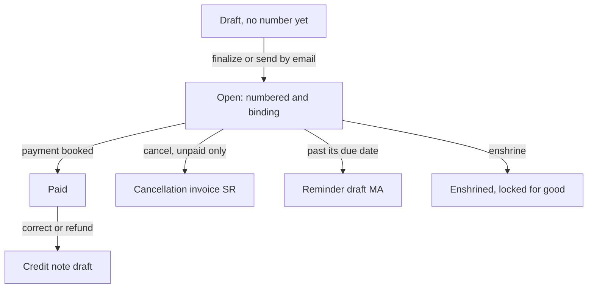

# Invoices: from draft to payment

This guide follows an outgoing invoice (Rechnung) through sevDesk with the assistant: draft, check,
finalize, send, book the payment, remind, and correct. It is for anyone who bills customers. Each
step names what you ask, the tool that runs, the [tier](../permissions.md#tiers) it needs and
whether you confirm it.

## Overview

| Step                                   | Tool                                                                                                                                                                     | Tier              | You confirm     |
| -------------------------------------- | ------------------------------------------------------------------------------------------------------------------------------------------------------------------------ | ----------------- | --------------- |
| [Find the customer](#before-you-start) | [`sevdesk_contacts_search`](../tools.md#sevdesk_contacts_search)                                                                                                         | `read`            | no              |
| [Create a draft](#create-a-draft)      | [`sevdesk_invoice_create_draft`](../tools.md#sevdesk_invoice_create_draft), [`sevdesk_invoice_create_from_order`](../tools.md#sevdesk_invoice_create_from_order)         | `write`           | no              |
| [Check it](#check-the-draft)           | [`sevdesk_invoice_get`](../tools.md#sevdesk_invoice_get), [`sevdesk_invoice_pdf`](../tools.md#sevdesk_invoice_pdf)                                                       | `read`            | no              |
| [Change it](#check-the-draft)          | [`sevdesk_invoice_update_draft`](../tools.md#sevdesk_invoice_update_draft)                                                                                               | `write`           | no              |
| [Delete it](#delete-a-draft)           | [`sevdesk_document_delete_draft`](../tools.md#sevdesk_document_delete_draft)                                                                                             | `commit`          | **yes**         |
| [Finalize](#finalize)                  | [`sevdesk_invoice_finalize`](../tools.md#sevdesk_invoice_finalize)                                                                                                       | `commit`          | **yes**         |
| [Send by email](#send-it)              | [`sevdesk_invoice_send_email`](../tools.md#sevdesk_invoice_send_email)                                                                                                   | `external`        | **yes**         |
| [Book the payment](#book-the-payment)  | [`sevdesk_invoice_book_payment`](../tools.md#sevdesk_invoice_book_payment)                                                                                               | `commit`          | **yes**         |
| [Remind](#remind-overdue-customers)    | [`sevdesk_invoice_create_reminder`](../tools.md#sevdesk_invoice_create_reminder)                                                                                         | `write`           | no              |
| [Correct](#cancel-or-correct)          | [`sevdesk_invoice_cancel`](../tools.md#sevdesk_invoice_cancel), [`sevdesk_credit_note_create_from_invoice`](../tools.md#sevdesk_credit_note_create_from_invoice)         | `commit`, `write` | cancel: **yes** |
| [Enshrine](#enshrine)                  | [`sevdesk_invoice_enshrine`](../tools.md#sevdesk_invoice_enshrine)                                                                                                       | `commit`          | **yes**         |
| [Bill on a schedule](#recurring)       | [`sevdesk_invoice_create_recurring`](../tools.md#sevdesk_invoice_create_recurring)                                                                                       | `commit`          | **yes**         |
| [Change a template](#recurring)        | [`sevdesk_invoice_update_recurring`](../tools.md#sevdesk_invoice_update_recurring)                                                                                       | `commit`          | **yes**         |
| [End or restart it](#recurring)        | [`sevdesk_invoice_end_recurring`](../tools.md#sevdesk_invoice_end_recurring), [`sevdesk_invoice_reactivate_recurring`](../tools.md#sevdesk_invoice_reactivate_recurring) | `commit`          | **yes**         |

## Before you start

- **Tiers.** Drafts need `write`; finalizing, payments, cancelling, enshrining and recurring
  templates need `commit`; email needs `external`. Set them with `SEVDESK_ALLOW` ([Permissions](../permissions.md#tiers)).
- **Confirmations.** `commit` and `external` calls show you a preview first. Check that your
  client can show it ([Clients](../clients.md#confirmations-by-client)).
- **Dry runs.** Every step that changes something can run as a [dry run](../permissions.md#dry-run)
  first. Ask for one whenever you want to see the result before it is saved.
- **The customer.** The assistant looks the contact up by name or customer number. If there is
  none, it can create one with [`sevdesk_contact_create`](../tools.md#sevdesk_contact_create)
  (`write`), which checks for duplicates first.

> Find the customer Musterfirma GmbH and show me their billing address.

## Create a draft

### From scratch

> Draft an invoice for Musterfirma GmbH: 8 hours of consulting at 95 EUR net per hour, payable within 14 days.

[`sevdesk_invoice_create_draft`](../tools.md#sevdesk_invoice_create_draft) (`write`, no
confirmation) saves a draft with its positions. Nothing is sent and no invoice number is assigned
yet; sevDesk numbers the invoice when it is finalized. Unless you say otherwise, the draft uses
today's date as invoice and delivery date, net prices, EUR, the contact's invoice address and the
tax rule that fits your account: 1 for regular VAT (rates 0, 7 and 19 %), 11 for a Kleinunternehmer
(0 %). A tax rule or rate that does not fit the account is refused before anything is saved, and
the preview warns about a possible duplicate. If the account has several sevDesk users, the
assistant has to name one as contact person.

A position can link a part (Artikel) from [`sevdesk_parts_list`](../tools.md#sevdesk_parts_list),
but its name and price still come from the position.

### From an offer or order confirmation

> Turn offer AN-1042 into an invoice.

> Create a 30 % advance invoice for order confirmation AB-1007.

[`sevdesk_invoice_create_from_order`](../tools.md#sevdesk_invoice_create_from_order) (`write`, no
confirmation) copies the positions of an offer (Angebot) or order confirmation
(Auftragsbestätigung): the whole order, a partial invoice (Teilrechnung) or an advance invoice
(Abschlagsrechnung) for a percentage or an amount, net or gross. The order must be sent, accepted
or partially invoiced; partial and advance invoices need tax rule 1 or 11. If a draft from the
same order already exists, the tool refuses unless you ask for a second one. Offers themselves are
drafted with [`sevdesk_order_create_draft`](../tools.md#sevdesk_order_create_draft).

## Check the draft

> Show me the draft invoice for Musterfirma with all positions and the total.

> Open the PDF of that draft.

[`sevdesk_invoice_get`](../tools.md#sevdesk_invoice_get) returns positions, totals, tax rule,
address and payment terms; [`sevdesk_invoice_pdf`](../tools.md#sevdesk_invoice_pdf) returns the
PDF as a preview that never marks the invoice as sent. Both are `read`. To keep a copy on disk,
[`sevdesk_document_save`](../tools.md#sevdesk_document_save) writes it into `SEVDESK_OUTPUT_DIR`
([Configuration](../configuration.md)).

> Change the payment term to 30 days and add a line for travel costs, 120 EUR net.

[`sevdesk_invoice_update_draft`](../tools.md#sevdesk_invoice_update_draft) (`write`, no
confirmation) changes only the fields you name. New positions replace all stored positions, so
the assistant passes the full list. Only drafts can be changed.

### Delete a draft

> Delete the draft invoice for Musterfirma, it went to the wrong customer.

[`sevdesk_document_delete_draft`](../tools.md#sevdesk_document_delete_draft) (`commit`, **you
confirm**) deletes a draft with its positions; the same tool deletes order and credit note drafts.
The preview names the document (number, customer, date, total); if the draft changes before you
approve, you are asked again. Only drafts (status 100) are deleted: a finalized invoice stays in
the books and is cancelled or corrected with a credit note instead, and recurring invoice
templates are not deleted here (they are [ended](#recurring)). Orders and credit notes take their number when the draft is
saved; after the draft is deleted, sevDesk gives that number to the next document, so the number
range keeps no gap.

> [!WARNING]
> A deletion cannot be undone.

### E-invoice readiness

> Can this invoice go out as an XRechnung? Check what is missing.

[`sevdesk_invoice_einvoice_preflight`](../tools.md#sevdesk_invoice_einvoice_preflight) (`read`)
checks your company data, the customer (address, e-mail, Leitweg-ID for public bodies, VAT ID
where the tax rule needs it), the delivery date, payment terms, units and tax rule, and names the
tool that fixes each problem. For a finalized invoice it also checks the XML sevDesk generated.

> [!NOTE]
> The server cannot turn an invoice into an e-invoice. sevDesk generates XRechnung and ZUGFeRD
> only for invoices created as e-invoices (E-Rechnung) in the sevDesk web app; the preflight says
> so when that is missing.

## Finalize

> Finalize the Musterfirma invoice; I'll send the PDF myself.

[`sevdesk_invoice_finalize`](../tools.md#sevdesk_invoice_finalize) (`commit`, **you confirm**)
turns the draft into an open invoice: sevDesk assigns the final number, books it and marks it as
sent. Nothing reaches the customer; the tool only records how you send it (PDF download by
default, or post, print, email outside sevDesk). Before you approve, the preview lists what the
invoice says as sevDesk stores it: address, head and foot text, every position, terms and dates.

> [!WARNING]
> Finalizing makes the invoice legally binding under its number. Afterwards it can only be reset
> to a draft while it has no payments and is not enshrined, and an invoice the customer already
> received should be cancelled or corrected with a credit note instead.

## Send it

> Email the invoice to buchhaltung@musterfirma.de with a short thank-you note.

[`sevdesk_invoice_send_email`](../tools.md#sevdesk_invoice_send_email) (`external`, **you
confirm**) lets sevDesk send the PDF to one recipient, with up to 10 cc and 10 bcc, and marks the
invoice as sent. The preview shows every recipient, the subject and the full text. A draft is
finalized by sending it, which also needs the `commit` tier. For an e-invoice the assistant can
attach the XML instead of the PDF.

> [!WARNING]
> An email cannot be recalled. Check the recipient and the text in the preview before you approve.

To send it your own way, take the PDF ([`sevdesk_invoice_pdf`](../tools.md#sevdesk_invoice_pdf))
or, for an e-invoice, the XML ([`sevdesk_invoice_xml`](../tools.md#sevdesk_invoice_xml)), and
finalize with the matching send type. The server does not send letters by post.

## Book the payment

> Musterfirma paid RE-1001 yesterday; book it on the business account.

> RE-1003 was paid with 2 % Skonto. Book the payment and write off the rest.

[`sevdesk_invoice_book_payment`](../tools.md#sevdesk_invoice_book_payment) (`commit`, **you
confirm**) books a gross amount on a payment account. For an account fed by a bank import, the
assistant links the imported transaction, so the payment is not counted twice. It refuses more
than the open amount unless the extra is reminder charges or another intended difference; Skonto
and bank fees settle the invoice with less. A wrong booking is undone with
[`sevdesk_invoice_reset`](../tools.md#sevdesk_invoice_reset) to `open` (`commit`, you confirm).

Many payments are easier from the bank side: the
[`bank_reconciliation`](../tools.md#bank_reconciliation) prompt matches unbooked transactions to
open invoices with [`sevdesk_reconcile_suggest`](../tools.md#sevdesk_reconcile_suggest) and books
each match you agree to with [`sevdesk_transaction_book`](../tools.md#sevdesk_transaction_book)
(`commit`).

## Remind overdue customers

> Which invoices are overdue, and by how many days?

> Prepare payment reminders for the invoices more than 14 days overdue.

[`sevdesk_invoices_list`](../tools.md#sevdesk_invoices_list) with `overdueOnly` and
[`sevdesk_receivables_aging`](../tools.md#sevdesk_receivables_aging) find them (`read`).
[`sevdesk_invoice_create_reminder`](../tools.md#sevdesk_invoice_create_reminder) (`write`, no
confirmation) creates a reminder draft (Mahnung, type MA) for an open or partially paid invoice
past its due date, and refuses a second unsent one. On Update 2.0 it adds no reminder fee. The
reminder is then finalized (`commit`) or emailed (`external`) like an invoice, with your
confirmation. The [`dunning_run`](../tools.md#dunning_run) prompt walks through the whole run,
and first rules out payments that are not booked yet.

## Cancel or correct

> Cancel invoice RE-1004, it was issued to the wrong customer.

[`sevdesk_invoice_cancel`](../tools.md#sevdesk_invoice_cancel) (`commit`, **you confirm**) lets
sevDesk create a cancellation invoice (Stornorechnung, type SR) with negated amounts that offsets
the original; both stay in the books. Only open, unpaid invoices can be cancelled. Send the
cancellation to the customer with `sevdesk_invoice_send_email`.

> [!WARNING]
> A cancellation cannot be undone.

> Musterfirma already paid RE-1002 but one position was wrong. Create a credit note for it.

For a paid or partially paid invoice,
[`sevdesk_credit_note_create_from_invoice`](../tools.md#sevdesk_credit_note_create_from_invoice)
(`write`, no confirmation) creates a credit note draft (Gutschrift) with all its positions, which
the assistant can then adjust. It is finalized with
[`sevdesk_credit_note_finalize`](../tools.md#sevdesk_credit_note_finalize) or emailed with
[`sevdesk_credit_note_send_email`](../tools.md#sevdesk_credit_note_send_email), and a refund is
booked with [`sevdesk_credit_note_book_payment`](../tools.md#sevdesk_credit_note_book_payment), each
with your confirmation.

## Enshrine

> Enshrine all invoices of October; the VAT return is filed.

[`sevdesk_invoice_enshrine`](../tools.md#sevdesk_invoice_enshrine) (`commit`, **you confirm**)
locks one finalized invoice permanently (festschreiben, GoBD), so a batch means one confirmation
per invoice. Payments can still be booked, but the
invoice can never be changed, reset or deleted again; corrections then need a cancellation or a
credit note. When to enshrine is a question for you and your Steuerberater.

> [!WARNING]
> Enshrining is irreversible. The preview carries an irreversibility warning; approve it only for
> invoices you are sure about.

## Recurring

> Bill Musterfirma GmbH 500 EUR net for website maintenance every month, starting on 1 January.

[`sevdesk_invoice_create_recurring`](../tools.md#sevdesk_invoice_create_recurring) (`commit`,
**you confirm**) creates a recurring invoice template (Abo-Rechnung, type WKR) for retainers, rent
or subscriptions. Customer, positions, texts, payment term and tax rule work as for a draft and
pass the same checks; the template is in EUR, and its total must be above zero. The schedule has:

- an **interval**: monthly, quarterly, half-yearly or yearly;
- a **start date**, the first run: today or later, at most a year ahead, on day 1 to 28 of a
  month. Every later run falls on the same day of the month. Days 29 to 31 are refused, because
  how sevDesk moves a run into a shorter month is not recorded. A start in the past is refused too:
  sevDesk catches up and creates an invoice for every period since then, one a minute;
- an optional **end date**, at most ten years after the start. Without one, the template runs until
  it is ended.

**Automatic generation** (Automatische Generierung) decides whether anything happens on a run date,
not the template's status. The tool switches it on unless you ask for it off:

- **On** (the default): on every run date, within about a minute after midnight (Berlin time),
  sevDesk creates a **draft** invoice from the template by itself. The draft is dated the day it
  is created, has the run date as its delivery date and the billing period up to the day before the
  next run, and sevDesk adds a line naming that period to the head text. It is not finalized and
  not sent. Its number is provisional: several generated drafts can show the same number, and each
  gets its own when it is finalized. Check a generated draft, then finalize and send it like any
  other ([Finalize](#finalize), [Send it](#send-it)). A first run today is due at once: the first
  draft appears about a minute after saving.
- **Off**: sevDesk creates nothing by itself, until automatic generation is switched on for the
  template ([below](#change-end-or-restart-a-template), or in the sevDesk web app) or someone
  clicks "Rechnung erzeugen" in the web app.

The preview shows what every invoice will say: customer and address, each position with its text,
head and foot text, the total per invoice. It also shows the first run, the next three run dates,
the end with the number of runs up to it, whether automatic generation is on and what that means,
and a warning when the customer already has a template with the same total. After saving, the
assistant reads the template back and says where sevDesk stored another schedule or another
automatic generation than it sent.

> [!WARNING]
> sevDesk can also send generated invoices by itself: with **automatic sending** (Automatisches
> Versenden) on as well, it finalizes each one with its final number, e-mails it with the PDF to
> the customer and enshrines it within about two minutes of the run, before anyone has seen it.
> This server never switches automatic sending on, and its read-back tells you when a template has
> it. Switch it on in the web app only if that is what you want.

The web app's "Nachfällig" option (bill in arrears) is not set by this server either, and its
other intervals (7 or 14 days, 2 months, 2 to 5 years) are not offered.

Templates are listed with [`sevdesk_invoices_list`](../tools.md#sevdesk_invoices_list) and type
`recurring`. Each row, and [`sevdesk_invoice_get`](../tools.md#sevdesk_invoice_get), shows the
schedule as sevDesk stores it: interval (also one made in the web app, in words), start, next run,
end, last run, whether automatic generation and automatic sending are on, and whether the template
is ended.

### Change, end or restart a template

> Raise the Musterfirma maintenance to 550 EUR net from the next invoice on.

[`sevdesk_invoice_update_recurring`](../tools.md#sevdesk_invoice_update_recurring) (`commit`,
**you confirm**) changes a template: positions (given positions replace all of them), texts,
payment term, tax rule, customer or address, the schedule, and automatic generation
(`autoGenerate`). Only what you give changes. The preview shows each change as before → after, new
positions and texts in full, the total per invoice before and after, and the run dates after the
change. Every invoice sevDesk creates afterwards carries the change; invoices it already created
stay as they are.

- A new **interval** keeps the next run date; the runs after it follow the new interval.
- A new **start date** becomes the next run as well, and sevDesk clears the template's last run.
  It must lie after today and, once the template has generated invoices, after the end of the
  period of the newest one; otherwise sevDesk would bill a period again. The assistant finds those
  invoices by their origin, the template.
- A new **end date** lies on or after the next run; `removeEndDate` lets the template run until it
  is ended.
- Switching **automatic generation on** is refused while the next run lies before today: sevDesk
  would catch up and create one draft per missed period, a minute apart. Give a new start date in
  the same call. A next run today is due at once.

After saving, the assistant reads the template back and names every way sevDesk stored something
else, including a position whose change sevDesk ignored and a switch that did not take.

> End the Musterfirma maintenance subscription.

[`sevdesk_invoice_end_recurring`](../tools.md#sevdesk_invoice_end_recurring) (`commit`, **you
confirm**) ends a template (status 50): sevDesk creates no further invoice from it, even with
automatic generation on. Invoices it already created stay as they are; a wrong one is cancelled
with [`sevdesk_invoice_cancel`](../tools.md#sevdesk_invoice_cancel). The template keeps its
positions, schedule and automatic generation, and
[`sevdesk_invoice_reactivate_recurring`](../tools.md#sevdesk_invoice_reactivate_recurring)
(`commit`, **you confirm**) starts it again. Its preview says what happens then: with automatic
generation on, sevDesk generates drafts again, the first at once if the next run is today; with it
off, reactivating alone generates nothing. Reactivating is refused while the next run lies before
today, because sevDesk would catch up the missed periods at once: give the template a new start
date first.

> [!WARNING]
> A template with **automatic sending** on is only ended through this server: ending stops the
> e-mails. Changing or reactivating it is refused, because sevDesk would finalize, e-mail and lock
> invoices from it with no further approval; manage such a template in the sevDesk web app. When
> sevDesk does not return its settings, changing and reactivating are refused as well.

Templates made in the web app work too, also with an interval this server does not offer (such as
weekly or every two months): they can be ended, and changed as long as the interval stays; where
their run dates cannot be computed, the preview says so.

A template is deleted only in the sevDesk web app (Abo-Rechnungen); ending it is the reversible
way. The other invoice tools refuse a template: it is never finalized, sent, paid, cancelled,
changed as a draft or deleted through them. An invoice sevDesk creates from a template is a
regular draft and is not refused because of its template.

## Related

- [Receipts and vouchers](receipts.md): the other direction, supplier invoices and receipts.
- [Reports and exports](evaluations.md): open receivables, the VAT summary, the DATEV export.
- [Glossary](../glossary.md): German terms such as Rechnung, Storno and Mahnung.
