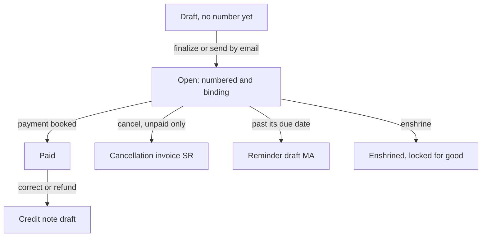

# Invoices: from draft to payment

This guide follows an outgoing invoice (Rechnung) through sevDesk with the assistant: draft, check,
finalize, send, book the payment, remind, and correct. It is for anyone who bills customers. Each
step names what you ask, the tool that runs, the [tier](../permissions.md#tiers) it needs and
whether you confirm it.

## Overview

| Step                                   | Tool                                                                                                                                                             | Tier              | You confirm     |
| -------------------------------------- | ---------------------------------------------------------------------------------------------------------------------------------------------------------------- | ----------------- | --------------- |
| [Find the customer](#before-you-start) | [`sevdesk_contacts_search`](../tools.md#sevdesk_contacts_search)                                                                                                 | `read`            | no              |
| [Create a draft](#create-a-draft)      | [`sevdesk_invoice_create_draft`](../tools.md#sevdesk_invoice_create_draft), [`sevdesk_invoice_create_from_order`](../tools.md#sevdesk_invoice_create_from_order) | `write`           | no              |
| [Check it](#check-the-draft)           | [`sevdesk_invoice_get`](../tools.md#sevdesk_invoice_get), [`sevdesk_invoice_pdf`](../tools.md#sevdesk_invoice_pdf)                                               | `read`            | no              |
| [Change it](#check-the-draft)          | [`sevdesk_invoice_update_draft`](../tools.md#sevdesk_invoice_update_draft)                                                                                       | `write`           | no              |
| [Finalize](#finalize)                  | [`sevdesk_invoice_finalize`](../tools.md#sevdesk_invoice_finalize)                                                                                               | `commit`          | **yes**         |
| [Send by email](#send-it)              | [`sevdesk_invoice_send_email`](../tools.md#sevdesk_invoice_send_email)                                                                                           | `external`        | **yes**         |
| [Book the payment](#book-the-payment)  | [`sevdesk_invoice_book_payment`](../tools.md#sevdesk_invoice_book_payment)                                                                                       | `commit`          | **yes**         |
| [Remind](#remind-overdue-customers)    | [`sevdesk_invoice_create_reminder`](../tools.md#sevdesk_invoice_create_reminder)                                                                                 | `write`           | no              |
| [Correct](#cancel-or-correct)          | [`sevdesk_invoice_cancel`](../tools.md#sevdesk_invoice_cancel), [`sevdesk_credit_note_create_from_invoice`](../tools.md#sevdesk_credit_note_create_from_invoice) | `commit`, `write` | cancel: **yes** |
| [Enshrine](#enshrine)                  | [`sevdesk_invoice_enshrine`](../tools.md#sevdesk_invoice_enshrine)                                                                                               | `commit`          | **yes**         |

## Before you start

- **Tiers.** Drafts need `write`; finalizing, payments, cancelling and enshrining need `commit`;
  email needs `external`. Set them with `SEVDESK_ALLOW` ([Permissions](../permissions.md#tiers)).
- **Confirmations.** `commit` and `external` calls show you a preview first. Check that your
  client can show it ([Clients](../clients.md#confirmations-by-client)).
- **Dry runs.** Every step that changes something can run as a [dry run](../permissions.md#dry-run)
  first. Ask for one whenever you want to see the result before it is saved.
- **The customer.** The assistant looks the contact up by name or customer number. If there is
  none, it can create one with [`sevdesk_contact_create`](../tools.md#sevdesk_contact_create)
  (`write`), which checks for duplicates first.

> Find the customer Musterfirma GmbH and show me their billing address.

## Create a draft

### From scratch

> Draft an invoice for Musterfirma GmbH: 8 hours of consulting at 95 EUR net per hour, payable within 14 days.

[`sevdesk_invoice_create_draft`](../tools.md#sevdesk_invoice_create_draft) (`write`, no
confirmation) saves a draft with its positions. Nothing is sent and no invoice number is assigned
yet; sevDesk numbers the invoice when it is finalized. Unless you say otherwise, the draft uses
today's date as invoice and delivery date, net prices, EUR, the contact's invoice address and the
tax rule that fits your account: 1 for regular VAT (rates 0, 7 and 19 %), 11 for a Kleinunternehmer
(0 %). A tax rule or rate that does not fit the account is refused before anything is saved, and
the preview warns about a possible duplicate. If the account has several sevDesk users, the
assistant has to name one as contact person.

> Which tax rule does an invoice for consulting to Wiener Muster GmbH in Vienna take?

For a customer abroad, or a sale that is not plain domestic,
[`sevdesk_tax_rule_suggest`](../tools.md#sevdesk_tax_rule_suggest) (`read`) suggests the tax rule
from the customer's country, whether it buys as a business, its VAT ID (USt-IdNr.) and whether you
sell goods or services: the rule, the rate (for One-Stop-Shop sales the customer country's
standard rate), the note the invoice must carry (for example "Steuerschuldnerschaft des
Leistungsempfängers") and the legal basis. When a threshold or a special kind of service decides,
it lists each option with its condition instead of guessing. Northern Ireland follows the EU rules
for goods (pass country `XI` or the customer's XI VAT ID), Monaco counts as France, and parts of
member states outside the EU VAT area, such as the Canary Islands, come as exceptions (Heligoland
and Büsingen, for a German customer, as a note). It is not tax advice.
[`sevdesk_vat_id_check`](../tools.md#sevdesk_vat_id_check) (`read`) checks a VAT ID's format; it
asks the European Commission's VIES service only if the server's operator switched that on
(`SEVDESK_VIES_CHECK`, see [Privacy](../../PRIVACY.md)). The draft preview also warns when the tax
rule is not the usual one for the customer; it never refuses the draft for that.

A position can link a part (Artikel) from [`sevdesk_parts_list`](../tools.md#sevdesk_parts_list),
but its name and price still come from the position.

### Offers: accept, confirm, deliver

Before an offer (Angebot) is invoiced, the assistant can record the customer's answer and create
the documents that follow it:

> Musterfirma accepted offer AN-1042 by phone. Mark it as accepted.

> They declined AN-1043.

[`sevdesk_order_set_offer_status`](../tools.md#sevdesk_order_set_offer_status) (`commit`, **you
confirm**) marks a sent offer as accepted (angenommen) or rejected (abgelehnt), or sets an accepted
or rejected offer back to sent (`reopen`). It changes nothing but the status and sends nothing to
the customer. Offer drafts are refused (send them first: sevDesk would renumber a draft), and so are
order confirmations and delivery notes.

> Create the order confirmation for AN-1042.

[`sevdesk_order_create_confirmation`](../tools.md#sevdesk_order_create_confirmation) (`commit`,
**you confirm**) creates an order confirmation (Auftragsbestätigung, AB) draft with the offer's
contact, texts and positions, which the preview lists. sevDesk marks the offer as accepted in the
same step, which is why you confirm it. It takes sent and accepted offers only: a draft is refused
(it would accept an offer the customer never received), and a rejected offer must be reopened
first, so turning a rejection into an acceptance is always a step of its own.

> Create a delivery note for AB-1007.

[`sevdesk_order_create_delivery_note`](../tools.md#sevdesk_order_create_delivery_note) (`write`,
no confirmation) creates a delivery note (Lieferschein, LI) draft from an order confirmation (draft,
sent or accepted) or a sent offer, and leaves the source as it is. Offer drafts, rejected and
accepted offers are refused (for an accepted offer, deliver on its confirmation).

Both creating tools refuse a second document from the same order unless you ask for one, and
finalize the new draft with [`sevdesk_order_finalize`](../tools.md#sevdesk_order_finalize). sevDesk
gives the new document the next number of its range without moving the counter, so it can carry a
number another confirmation or delivery note already has; the result names any it finds. To find
offers that are still open, ask for sent offers in a date range
([`sevdesk_orders_list`](../tools.md#sevdesk_orders_list)).

### From an offer or order confirmation

> Turn offer AN-1042 into an invoice.

> Create a 30 % advance invoice for order confirmation AB-1007.

[`sevdesk_invoice_create_from_order`](../tools.md#sevdesk_invoice_create_from_order) (`write`, no
confirmation) copies the positions of an offer (Angebot) or order confirmation
(Auftragsbestätigung): the whole order, a partial invoice (Teilrechnung) or an advance invoice
(Abschlagsrechnung) for a percentage or an amount, net or gross. The order must be sent, accepted
or partially invoiced; partial and advance invoices need tax rule 1 or 11. If a draft from the
same order already exists, the tool refuses unless you ask for a second one. Offers themselves are
drafted with [`sevdesk_order_create_draft`](../tools.md#sevdesk_order_create_draft).

## Check the draft

> Show me the draft invoice for Musterfirma with all positions and the total.

> Open the PDF of that draft.

[`sevdesk_invoice_get`](../tools.md#sevdesk_invoice_get) returns positions, totals, tax rule,
address and payment terms; [`sevdesk_invoice_pdf`](../tools.md#sevdesk_invoice_pdf) returns the
PDF as a preview that never marks the invoice as sent. Both are `read`. To keep a copy on disk,
[`sevdesk_document_save`](../tools.md#sevdesk_document_save) writes it into `SEVDESK_OUTPUT_DIR`
([Configuration](../configuration.md)).

> Change the payment term to 30 days and add a line for travel costs, 120 EUR net.

[`sevdesk_invoice_update_draft`](../tools.md#sevdesk_invoice_update_draft) (`write`, no
confirmation) changes only the fields you name. New positions replace all stored positions, so
the assistant passes the full list. Only drafts can be changed.

### E-invoice readiness

> Can this invoice go out as an XRechnung? Check what is missing.

[`sevdesk_invoice_einvoice_preflight`](../tools.md#sevdesk_invoice_einvoice_preflight) (`read`)
checks your company data, the customer (address, e-mail, Leitweg-ID for public bodies, VAT ID
where the tax rule needs it), the delivery date, payment terms, units and tax rule, and names the
tool that fixes each problem. For a finalized invoice it also checks the XML sevDesk generated.

> [!NOTE]
> The server cannot turn an invoice into an e-invoice. sevDesk generates XRechnung and ZUGFeRD
> only for invoices created as e-invoices (E-Rechnung) in the sevDesk web app; the preflight says
> so when that is missing.

## Finalize

> Finalize the Musterfirma invoice; I'll send the PDF myself.

[`sevdesk_invoice_finalize`](../tools.md#sevdesk_invoice_finalize) (`commit`, **you confirm**)
turns the draft into an open invoice: sevDesk assigns the final number, books it and marks it as
sent. Nothing reaches the customer; the tool only records how you send it (PDF download by
default, or post, print, email outside sevDesk). Before you approve, the preview lists what the
invoice says as sevDesk stores it: address, head and foot text, every position, terms and dates.

> [!WARNING]
> Finalizing makes the invoice legally binding under its number. Afterwards it can only be reset
> to a draft while it has no payments and is not enshrined, and an invoice the customer already
> received should be cancelled or corrected with a credit note instead.

## Send it

> Email the invoice to buchhaltung@musterfirma.de with a short thank-you note.

[`sevdesk_invoice_send_email`](../tools.md#sevdesk_invoice_send_email) (`external`, **you
confirm**) lets sevDesk send the PDF to one recipient, with up to 10 cc and 10 bcc, and marks the
invoice as sent. The preview shows every recipient, the subject and the full text. A draft is
finalized by sending it, which also needs the `commit` tier. For an e-invoice the assistant can
attach the XML instead of the PDF.

> [!WARNING]
> An email cannot be recalled. Check the recipient and the text in the preview before you approve.

To send it your own way, take the PDF ([`sevdesk_invoice_pdf`](../tools.md#sevdesk_invoice_pdf))
or, for an e-invoice, the XML ([`sevdesk_invoice_xml`](../tools.md#sevdesk_invoice_xml)), and
finalize with the matching send type. The server does not send letters by post.

## Book the payment

> Musterfirma paid RE-1001 yesterday; book it on the business account.

> RE-1003 was paid with 2 % Skonto. Book the payment and write off the rest.

[`sevdesk_invoice_book_payment`](../tools.md#sevdesk_invoice_book_payment) (`commit`, **you
confirm**) books a gross amount on a payment account. For an account fed by a bank import, the
assistant links the imported transaction, so the payment is not counted twice. It refuses more
than the open amount unless the extra is reminder charges or another intended difference; Skonto
and bank fees settle the invoice with less. A wrong booking is undone with
[`sevdesk_invoice_reset`](../tools.md#sevdesk_invoice_reset) to `open` (`commit`, you confirm).

Many payments are easier from the bank side: the
[`bank_reconciliation`](../tools.md#bank_reconciliation) prompt matches unbooked transactions to
open invoices with [`sevdesk_reconcile_suggest`](../tools.md#sevdesk_reconcile_suggest) and books
each match you agree to with [`sevdesk_transaction_book`](../tools.md#sevdesk_transaction_book)
(`commit`).

## Remind overdue customers

> Which invoices are overdue, and by how many days?

> Prepare payment reminders for the invoices more than 14 days overdue.

[`sevdesk_invoices_list`](../tools.md#sevdesk_invoices_list) with `overdueOnly` and
[`sevdesk_receivables_aging`](../tools.md#sevdesk_receivables_aging) find them (`read`).
[`sevdesk_invoice_create_reminder`](../tools.md#sevdesk_invoice_create_reminder) (`write`, no
confirmation) creates a reminder draft (Mahnung, type MA) for an open or partially paid invoice
past its due date, and refuses a second unsent one. On Update 2.0 it adds no reminder fee. The
reminder is then finalized (`commit`) or emailed (`external`) like an invoice, with your
confirmation. The [`dunning_run`](../tools.md#dunning_run) prompt walks through the whole run,
and first rules out payments that are not booked yet.

## Cancel or correct

> Cancel invoice RE-1004, it was issued to the wrong customer.

[`sevdesk_invoice_cancel`](../tools.md#sevdesk_invoice_cancel) (`commit`, **you confirm**) lets
sevDesk create a cancellation invoice (Stornorechnung, type SR) with negated amounts that offsets
the original; both stay in the books. Only open, unpaid invoices can be cancelled. Send the
cancellation to the customer with `sevdesk_invoice_send_email`.

> [!WARNING]
> A cancellation cannot be undone.

> Musterfirma already paid RE-1002 but one position was wrong. Create a credit note for it.

For a paid or partially paid invoice,
[`sevdesk_credit_note_create_from_invoice`](../tools.md#sevdesk_credit_note_create_from_invoice)
(`write`, no confirmation) creates a credit note draft (Gutschrift) with all its positions, which
the assistant can then adjust. It is finalized with
[`sevdesk_credit_note_finalize`](../tools.md#sevdesk_credit_note_finalize) or emailed with
[`sevdesk_credit_note_send_email`](../tools.md#sevdesk_credit_note_send_email), and a refund is
booked with [`sevdesk_credit_note_book_payment`](../tools.md#sevdesk_credit_note_book_payment), each
with your confirmation.

## Enshrine

> Enshrine all invoices of October; the VAT return is filed.

[`sevdesk_invoice_enshrine`](../tools.md#sevdesk_invoice_enshrine) (`commit`, **you confirm**)
locks one finalized invoice permanently (festschreiben, GoBD), so a batch means one confirmation
per invoice. Payments can still be booked, but the
invoice can never be changed, reset or deleted again; corrections then need a cancellation or a
credit note. When to enshrine is a question for you and your Steuerberater.

> [!WARNING]
> Enshrining is irreversible. The preview carries an irreversibility warning; approve it only for
> invoices you are sure about.

## Related

- [Receipts and vouchers](receipts.md): the other direction, supplier invoices and receipts.
- [Reports and exports](evaluations.md): open receivables, the VAT summary, the DATEV export.
- [Glossary](../glossary.md): German terms such as Rechnung, Storno and Mahnung.
