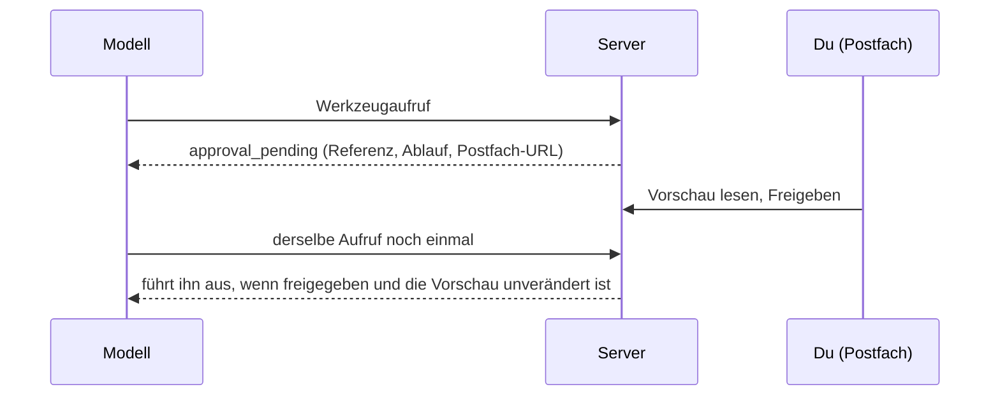

<!-- translated-from: docs/remote/approvals.md sha256:e9b1eb2eb0b8 -->

# Das Freigabe-Postfach

Mit `SEVDESK_CONFIRM=browser` warten Aufrufe der Stufen `commit` und `external` im
[Fernzugriff](../remote.de.md) auf eine Entscheidung im Freigabe-Postfach des Servers unter
`<public URL>/approvals`. Es ersetzt die lokale Freigabeseite des stdio-Modus, die ein entfernter
Server nicht in deinem Browser öffnen kann. Diese Seite ist für Betreiber und Benutzer eines
entfernten Servers; die Bestätigungsarten selbst stehen unter
[Berechtigungen](../permissions.de.md#bestätigungsarten).

Verwende es mit Clients, die über HTTP nicht im Chat gefragt werden können; dazu gehört zum
Zeitpunkt des Schreibens claude.ai
([`SEVDESK_CONFIRM`](configuration.de.md#andere-variablen-im-http-modus)).

## So läuft eine Bestätigung ab

1. Das Modell ruft etwa das Werkzeug auf, das eine Rechnung fertigstellt. Der Server bereitet den
   Aufruf vor und antwortet mit `approval_pending`, einem kurzen Referenzcode, dem Ablauf
   (10 Minuten) und der URL des Postfachs.
2. Du öffnest das Postfach, suchst die Anfrage mit diesem Referenzcode und liest die Vorschau: die
   Aktion, Warnungen, Beträge, Empfänger, Texte. In einem deutschen Browser sind das Postfach und
   die Vorschau deutsch ([Berechtigungen](../permissions.de.md#browser)).
3. Du drückst „Freigeben“ oder „Ablehnen“ (in einem englischen Browser „Approve“ oder „Reject“).
4. Du bittest das Modell, es erneut zu versuchen. Es ruft das Werkzeug mit denselben Argumenten
   auf; der Server bereitet die Aktion noch einmal vor und führt sie nur aus, wenn du freigegeben
   hast und die Vorschau unverändert ist. Jede Freigabe wird einmal verwendet.

## Anmelden

Das Postfach zeigt nichts außer einem Anmeldeformular, bis der Browser nachweist, dass er für das
Konto handeln darf:

- **nach der OAuth-Zustimmung** automatisch: Die Zustimmungsseite meldet den Browser an, der sie
  abgeschlossen hat (sobald das Postfach oder die [Dateiübertragung](files.de.md) aktiv ist;
  dieselbe Sitzung öffnet beides);
- **durch Einfügen des sevDesk-API-Tokens** in das Anmeldeformular. Im OAuth-Modus prüft der Server
  das Token bei sevDesk und gegen `SEVDESK_OAUTH_ACCOUNTS`. Im Bearer-Modus muss es das eigene
  `SEVDESK_API_TOKEN` des Servers sein; das Bearer-Geheimnis meldet nicht an, weil der Client es
  hält.

Eine Anmeldung gilt 12 Stunden oder bis du dich abmeldest, der Zugang, aus dem sie stammt,
widerrufen wird oder `grants revoke --account <id>` alle Sitzungen des Kontos beendet. Eine
Anmeldung mit eingefügtem Token ist nicht an dieses Token gebunden: Wird das Token in sevDesk neu
erzeugt, endet sie nicht. Anmeldeversuche sind je Client-Adresse begrenzt, IPv6-Adressen je
/64-Netz gezählt (5 pro Minute, 20 pro Stunde). Setze im Bearer-Modus zusätzlich
`SEVDESK_HTTP_SECRET`, wenn Anmeldungen einen Neustart überdauern sollen.

## Was das Modell sieht

Den Referenzcode, den Ablauf und die URL des Postfachs. Die URL ist nicht geheim: Ohne Anmeldung
zeigt sie nur das Formular. Das Modell sieht nie die eigene ID einer Freigabe, ein Cookie oder
irgendetwas, das freigeben könnte.

## Wer was sieht

Freigaben gehören der Verbindung, die gefragt hat: Ein erneuter Versuch findet nur Freigaben, die
sein eigener Zugang angelegt hat. Das Postfach listet die Freigaben des ganzen Kontos auf; jeder,
der an diesem Konto angemeldet ist, sieht sie also und kann über sie entscheiden. Höchstens fünf
Freigaben je Konto warten gleichzeitig, und die Anfragen eines Kontos können die Freigaben eines
anderen Kontos nicht aus dem Speicher des Servers verdrängen ([Grenzen](operations.de.md#grenzen)).

## Grenzen

- Ein Agent, der deinen Browser steuern kann, während er angemeldet ist
  (Browser-Automatisierung, ein Werkzeug zur Computersteuerung), könnte selbst freigeben.
- Das Postfach fragt nach deinem sevDesk-Token; eine nachgeahmte Seite könnte also versuchen, es
  abzugreifen: Füge es nur in eine Seite ein, deren Adresse `/approvals` deines Servers ist.
- Bei einer Einrichtung mit einfachem http auf `localhost` erhalten auch andere lokale Webserver
  das Sitzungs-Cookie ([Schnellstart](../remote.de.md#schnellstart-bearer-modus-mit-docker)).
- Ausstehende Freigaben enden, wenn der Server neu startet; das Modell fragt dann einfach erneut.

Die Seite der Bedrohungen steht unter [Sicherheit im Fernzugriff](../security/remote.de.md#grenzen-des-postfachs), was eine
Freigabe garantiert, unter [Bestätigung durch einen Menschen](../security/confirmation.de.md); der Entwurf
ist [ADR 0007](../adr/0007-approval-inbox-over-http.de.md).
