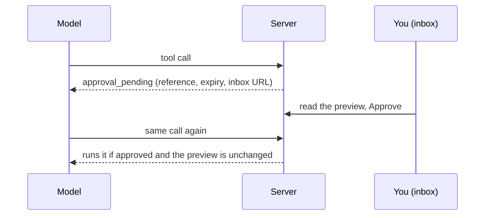

# The approval inbox

With `SEVDESK_CONFIRM=browser`, `commit` and `external` calls in [remote mode](../remote.md) wait
for a decision in the server's approval inbox at `<public URL>/approvals`. It replaces the local
approval page of the stdio mode, which a remote server cannot open in your browser. This page is
for operators and users of a remote server; the confirmation modes themselves are described in
[Permissions](../permissions.md#confirmation-modes).

Use it with clients that cannot be asked in the chat over HTTP, which includes claude.ai at the time
of writing ([`SEVDESK_CONFIRM`](configuration.md#other-variables-in-http-mode)).

## How a confirmation runs

1. The model calls, say, the tool that finalizes an invoice. The server prepares it and answers
   `approval_pending` with a short reference code, the expiry (10 minutes) and the inbox URL.
2. You open the inbox, find the request with that reference code and read the preview: the
   action, warnings, amounts, recipients, texts. With a German browser the inbox and the preview
   are in German ([Permissions](../permissions.md#browser)).
3. You press Approve or Reject (Freigeben or Ablehnen).
4. You ask the model to try again. It calls the tool with the same arguments; the server prepares
   the action once more and runs it only if you approved and the preview is unchanged. Each
   approval is used once.

## Signing in

The inbox shows nothing but a sign-in form until the browser proves it may act for the account:

- **after OAuth consent**, automatically: the consent page signs in the browser that completed it
  (whenever the inbox or [file transfer](files.md) is on; the same session opens both);
- **by pasting the sevDesk API token** into the sign-in form. In OAuth mode the server checks the
  token with sevDesk and against `SEVDESK_OAUTH_ACCOUNTS`. In bearer mode it must be the server's
  own `SEVDESK_API_TOKEN`; the bearer secret does not sign in, because the client holds it.

A sign-in lasts 12 hours, or until you sign out, the grant it came from is revoked, or
`grants revoke --account <id>` ends every session of the account. A sign-in with a pasted token is
not tied to that token: regenerating the token in sevDesk does not end it. Sign-in attempts are
limited per client address, with IPv6 addresses counted per /64 network (5 a minute, 20 an hour).
In bearer mode, set `SEVDESK_HTTP_SECRET` as well if sign-ins should survive a restart.

## What the model sees

The reference code, the expiry and the inbox URL. The URL is not a secret: without a sign-in it
shows only the form. The model never sees an approval's own id, a cookie or anything that could
approve.

## Who sees what

Approvals belong to the connection that asked: a retry only finds approvals its own grant created.
The inbox lists the approvals of the whole account, so everyone signed in to that account sees and
can decide them. At most five approvals per account wait at a time, and one account's requests
cannot push another account's approvals out of the server's memory
([Limits](operations.md#limits)).

## Limits

- An agent that can drive your browser while it is signed in (browser automation, a computer-use
  tool) could approve on its own.
- The inbox asks for your sevDesk token, so a lookalike page could try to phish it: only paste it
  into a page whose address is your server's `/approvals`.
- On a plain-http `localhost` setup, other local web servers receive the session cookie too
  ([Quick start](../remote.md#quick-start-bearer-mode-with-docker)).
- Pending approvals end when the server restarts; the model then simply asks again.

The threat side is in [Security in remote mode](../security/remote.md#limits-of-the-inbox), what an
approval guarantees in [Human confirmation](../security/confirmation.md); the design is
[ADR 0007](../adr/0007-approval-inbox-over-http.md).
